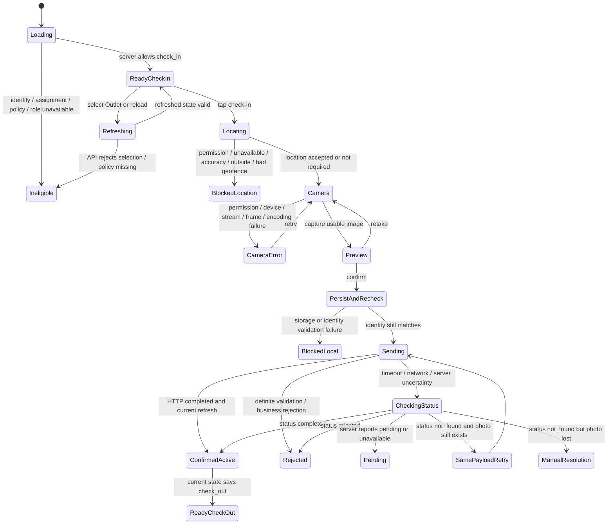

# Employee Personal Attendance: current-state UX audit

**Audit date:** 4 November 2026  
**Scope:** source inspection of the Employee `/attendance` experience, Laravel API and attendance domain, authorization/session behavior, and existing tests. No source, database, configuration, or running-service changes were made. Tests were inspected, not run.

## Executive summary

Personal Attendance is a server-led workflow. The page first establishes an authenticated session and active tenant, then requests the employee's identity, current schedule, assigned outlets, active session, policy eligibility, and recent/effective history. `allowed_next_operation` from Laravel controls whether the user can check in or check out. The browser gathers location (if required) and a new camera photo, stores a short-lived recovery payload locally, rechecks identity, and sends the multipart operation with an idempotency key. A successful message is shown only after a server-confirmed result.

The strongest safeguards are identity/tenant revalidation before submission, server-side assignment/policy/geofence checks, a single active-session owner per employee, idempotency records, and a status lookup after uncertain outcomes. The principal UX costs are that required photo/location prerequisites are discovered only after tapping the attendance action; the employee can be blocked on an uncertain operation if its local photo is unavailable; and the current page combines schedule, action, location, pending recovery, requests, and history in one long surface.

**Current runtime observation (one local QA session, read-only):** `/attendance` rendered a synthetic employee, “Belum terjadwal”, “Tidak ada shift terjadwal”, an unscheduled-attendance review notice, an enabled “Catat presensi masuk” action, a required 100 m geofence map, “Lokasi Anda belum tersedia”, an empty current-day history row, and a “Lihat riwayat” control. This confirms one local page state only; it does not prove the general policy or other employees' states.

### Evidence labels used below

- **Verified:** directly visible in current source or asserted by an existing test (tests are not a live runtime guarantee).
- **Runtime observation:** read from the currently open localhost page only.
- **Inferred:** follows from the code paths but was not exercised in the live browser.
- **Unverified/gap:** source does not establish a complete user-visible behavior, or behavior depends on environment/configuration not verified here.
- **Potential UX improvement:** a suggestion for later product review, not an approved change.

## Screen and component inventory

| Surface | Responsibility and evidence |
|---|---|
| `/login` | Login form, existing-session check, expired-session notice, generic invalid-credentials feedback. `src/routes/login.tsx` — `LoginPage`, especially 17–65 and 68–140. |
| `/select-tenant` | Lists active memberships and roles; selecting one posts its membership ID, regenerates session server-side, then routes by role. `src/routes/select-tenant.tsx` — `SelectTenantPage`, 15–65. |
| `/attendance` | Bootstrap, eligibility, schedule, location, photo capture, check-in/out submission and recovery, requests summary, current-day summary, expanded/effective history. `src/routes/attendance.tsx` — `AttendancePage`, 183 onward; boot 248–386; operation recovery/submission 547–829; location/capture 831–1011; rendering 1089 onward. |
| Employee navigation/profile | Attendance, schedule, requests and profile menu; logout is a server POST. `src/components/employee-shell.tsx` — `destinations`, `EmployeeNavigation`, `EmployeeShell`, 16–31, 35–150, 153 onward; logout 190–203. |
| Geofence map | Outlet marker, allowed-radius circle, and optional employee position/accuracy overlay. `src/components/outlet-geofence-map.tsx` — map setup/render, especially 90–207 and 209 onward. |
| Attendance history | Effective day outcome, review status/indicators, session-by-session original and effective timestamps, correction summary, unresolved conflicts. `src/components/employee-attendance-history.tsx` — `EmployeeAttendanceHistory`, 21–179; outcome labels 182–200. |
| API client | Same-origin API base defaults to `/api/v1`; cookie credentials, CSRF cookie acquisition/header and one 419 retry for unsafe requests. `src/lib/api.ts` — `apiRequest`, 67–123; CSRF 147–182; fetch 184–221. |
| Eligibility copy and presentation | User-facing status and indicator labels. `src/lib/personal-eligibility.ts` — `attendanceEligibilityCopy`; `src/lib/attendance-presentation.ts` — `attendanceConfirmation`, `reviewIndicatorLabel`. |
| Browser photo recovery | Identity-scoped IndexedDB photo and localStorage metadata, stale-photo cleanup, identity-change cleanup. `src/lib/attendance-photo-recovery.ts` — photo persistence 1–130; metadata 132–209; stale cleanup 219 onward. |

## End-to-end journeys

### 1. Entry, authentication, and navigation

**Verified from source:** Login checks `/auth/me` on mount and redirects an existing session according to active membership role. Employee-only role routes to `/attendance`; Owner/Supervisor routes to `/workspace`; no active membership routes to `/select-tenant` (`src/routes/login.tsx:27–47`; `src/lib/auth-navigation.ts:10–25`). Submitting login posts identifier/password to `/auth/login`, then performs the same role-based redirect. The visible error is deliberately generic (“Email/nomor telepon atau kata sandi tidak valid. Coba lagi.”) (`login.tsx:49–65`).

Laravel verifies the password and requires at least one active membership with roles; it regenerates the session and automatically sets active membership only when there is exactly one (`backend/app/Http/Controllers/Api/V1/AuthSessionController.php:20–48, 154–162`). Multiple memberships leave selection to the employee. Selecting a membership is constrained to the authenticated user's active membership; Laravel regenerates the session again (`AuthSessionController.php:101–122`). Personal API routes require `auth:sanctum`, `active-tenant`, and `no-store` (`backend/routes/api.php:157–178`). Missing/invalid active tenant produces `409 active_membership_required` (`backend/app/Http/Middleware/EnsureActiveTenant.php:12–37`).

The Employee shell links to Attendance, Schedule, Requests and Profile. Profile/logout uses `POST /auth/logout`, then navigates to `/login`; failure leaves an inline message unless authentication recovery redirects (`src/components/employee-shell.tsx:16–31, 190–203`).

```mermaid
flowchart TD
  A[Open app or /attendance] --> B{GET /auth/me session valid?}
  B -- no --> C[/login]
  C --> D[POST /auth/login]
  D -- invalid --> E[Generic credential error]
  D -- valid, no active tenant --> F[/select-tenant]
  D -- Employee membership --> G[/attendance]
  D -- Owner or Supervisor --> H[/workspace]
  F --> I[POST /auth/tenant]
  I --> G
  G --> J[Employee nav: attendance, schedule, requests, profile]
  J --> K[POST /auth/logout]
  K --> C
```

### 2. Dashboard load and eligibility

On mount, `/attendance` calls `/auth/me`; if there is no active membership it goes to `/select-tenant`. It then calls `GET /attendance/me`, asynchronously loads `/attendance/me/requests`, sets employee/tenant identity and selected outlet, and inspects local pending-operation metadata and photo storage. Local photo cleanup/read errors block new attendance while preserving status checks (`src/routes/attendance.tsx:265–386`). Loading text is “Memuat kehadiran…” (`attendance.tsx:1089–1095`). Identity errors are rendered as specific eligibility states; other errors disable attendance and ask the employee to check status safely (`attendance.tsx:351–375`).

Laravel `personalCurrent` validates an optional outlet ID, resolves the active membership, checks the employee link and Employee role, calls `AttendanceService::current`, adds effective attendance for the latest seven local dates, and returns JSON (`backend/app/Http/Controllers/Api/V1/AttendanceController.php:44–75`). `current` finds assignments effective at server time; rejects an explicitly requested outlet that is not assigned; resolves an active session or today’s schedule; returns up to 10 recent sessions, policy/location requirements, and the next allowed operation (`backend/app/Services/AttendanceService.php:34–149`). Eligibility is one of linked/eligible, `assignment_unavailable`, `policy_unavailable`, `kiosk_only`, or `personal_mode_unavailable`, with identity states `employee_link_required`, `employee_unavailable`, `employee_role_required` handled by the controller.

Schedule resolution incorporates weekly rules/exceptions and published planner entries, outlet calendar/closure exceptions, effective tenant/outlet policy versions, assignment coverage, and conflicts; no policy produces `attendance_policy_missing` (`backend/app/Services/EffectiveScheduleResolver.php:145–160, 205–338`). The frontend shows “Belum ada jadwal” for unscheduled status and explicitly warns attendance outside schedule may need manager review (`attendance.tsx:1273–1280`).

### 3. Check-in

**User action and UI:** The primary action is available only when a server-authorized operation exists, state is fresh, there is no pending operation, employee identity/photo storage are ready, and for check-in an outlet is selected (`attendance.tsx:857–897, 1084–1087, 1147–1186`). If multiple outlets exist (or none is selected), an outlet selector requests `GET /attendance/me?outlet_id=…`; assignment mismatch is surfaced as “Outlet tersebut tidak tersedia…” (`attendance.tsx:993–1010, 1147–1165`).

Tapping the action requests high-accuracy geolocation (10-second timeout, no cached position) when policy requires it; client-side eligibility checks coordinates, accuracy and distance. If accepted, the camera dialog opens. Camera must run in secure context/localhost, and a usable frame must be at least 320×240. It captures a JPEG at up to 1920 px and 5 MB, offers preview/retake, and submits only after confirmation (`attendance.tsx:421–493, 831–991`; client geofence `src/lib/geofence.ts:30–105`). Camera permission denial, no camera, insecure context, unready/too-small frame, canvas failure, and encoding/size failure have explicit messages.

Before the POST, frontend persists the photo in identity-scoped IndexedDB and metadata locally, rechecks `/auth/me` and `/attendance/me` to ensure user, tenant and employee have not changed, then sends multipart `POST /attendance/me/check-in` with `outlet_id`, location, photo and UUID `Idempotency-Key` (`attendance.tsx:666–754`). Backend verifies membership/employee/outlet, active assignment and personal mode, and required photo; then evaluates location and schedule. It can reject an already-active session with 409, assignment mismatch with 403, unavailable personal mode with 403, and required geofence failures with 422. If schedule is absent/rest day/late/closed/conflicted, supported cases are captured as review indicators rather than inherently preventing check-in; review indicator generation includes unscheduled/rest/late/outside-window/closed/conflict (`AttendanceService.php:386–465, 893–925`). Success creates one active session/event and optional evidence, returning HTTP 201 and a completed operation; the UI then refreshes and says success only after confirmation (`AttendanceService.php:437–465`; frontend `attendance.tsx:759–773`).

### 4. Active working session

The server’s active session fixes the Outlet and schedule snapshot; the frontend initializes selected outlet from the active session rather than the selector (`attendance.tsx:248–262`). When active, the next operation is `check_out` if the effective policy permits Personal mode (`AttendanceService.php:65–80, 96–125`). UI shows “Sedang bekerja”, originating Outlet, server-confirmed check-in time and available session/review information (`attendance.tsx:1019–1070, 1211–1268`). Outlet switching does not apply to an active session. The page has no employee self-service “close forgotten session” or automatic timeout path found in this route/service; administrative resolution is reflected in historical status, but its initiating flow is outside this employee page.

### 5. Check-out

The same location/photo flow applies. Frontend sends `POST /attendance/me/check-out`, no outlet ID, with new photo/location and a fresh idempotency key. Backend finds the active-session owner, rejects if none, rechecks effective personal policy and server time, enforces location, adds early-departure/late-checkout indicators around scheduled end/tolerance, creates the event, closes the session and releases active ownership (`AttendanceService.php:468–575`). It returns HTTP 200; the frontend refreshes and displays server-confirmed “Presensi keluar dicatat oleh server” (`attendance-presentation.ts:attendanceConfirmation`; route `attendance.tsx:759–773`). A location rejection leaves the active session open, as asserted by `backend/tests/Feature/S4/GeofenceEnforcementTest.php:70–86`.

### 6. History and employee actions

The dashboard gets `effective_attendance` for a seven-day window and `recent_history` (up to 10 session rows) from `GET /attendance/me`. Mobile shows a compact current-day row and collapsible history; desktop renders the effective history component (`attendance.tsx:1409–1488`). `EmployeeAttendanceHistory` displays date, finalized status, outcome, review status and indicators, each session’s original and effective check-in/out, correction request/reason, and unresolved conflicts (`src/components/employee-attendance-history.tsx:21–179`). Empty-array and unavailable (`undefined`) data have different copy (`:53–67`).

The separate `GET /attendance/me/requests` populates a recent request summary. Loading, unavailable, empty and pending counts have explicit copy; the link “Permintaan saya” navigates to `/requests` (`attendance.tsx:282–297, 1363–1400, 1458–1484`). This audit did not establish all `/requests` page actions because they are outside the Personal Attendance screen.

## Check-in and check-out state diagrams

```mermaid
stateDiagram-v2
  [*] --> ActiveSession
  ActiveSession --> Locating: tap check-out
  Locating --> ActiveSession: location rejected; session remains open
  Locating --> Camera: location accepted or not required
  Camera --> Preview: capture; retake returns to Camera
  Preview --> PersistAndRecheck: confirm
  PersistAndRecheck --> Sending: identity valid + local photo stored
  Sending --> ClosedSession: completed response
  Sending --> CheckingStatus: uncertain response
  CheckingStatus --> ClosedSession: status completed
  CheckingStatus --> ActiveSession: definite rejection + refresh
  CheckingStatus --> Pending: server still pending / status unavailable
  CheckingStatus --> SamePayloadRetry: not_found + same photo and key
  CheckingStatus --> ManualResolution: not_found + photo unavailable
  ClosedSession --> ReadyCheckIn: fresh server state allows another session
```





These are source-derived state paths; the diagrams do not imply every path was exercised at runtime.

## API and backend interaction mapping

| Purpose | Request | Auth/rules and result |
|---|---|---|
| Login/current session/logout | `POST /api/v1/auth/login`, `GET /api/v1/auth/me`, `POST /api/v1/auth/logout` | Login throttled; Sanctum session; active membership auto-selected only for exactly one membership; logout invalidates session and regenerates CSRF token (`backend/routes/api.php:38–47`; `AuthSessionController.php:20–48, 80–87, 124–130`). |
| Select tenant | `POST /api/v1/auth/tenant` | Authenticated active membership belonging to user; session regenerated and membership saved (`AuthSessionController.php:101–122`). |
| Dashboard/eligibility/history | `GET /api/v1/attendance/me[?outlet_id=…]` | Auth Sanctum + active tenant; employee link and Employee role; returns schedule, active session, outlets, allowed operation, location policy, recent history, seven-day effective projection (`routes/api.php:157–167`; `AttendanceController.php:44–75`; `AttendanceService.php:34–149`). |
| Requests summary | `GET /api/v1/attendance/me/requests` | Auth + active tenant; own employee requests; UI marks unavailable separately (`routes/api.php:169–178`; route caller `attendance.tsx:282–297`). |
| Check-in | `POST /api/v1/attendance/me/check-in` | Requires assigned tenant Outlet, active assignment, personal mode, UUID `Idempotency-Key`; validates photo policy, location payload and business rules; successful created response 201 (`AttendanceController.php:78–99, 343–365, 452–465`; `AttendanceService.php:279–369, 386–465`). |
| Check-out | `POST /api/v1/attendance/me/check-out` | Requires existing active session; effective policy allows origin; required location/photo accepted; returns closed session 200 (`AttendanceController.php:101–115`; `AttendanceService.php:468–575`). |
| Resolve uncertain operation | `GET /api/v1/attendance/me/operations/{check_in\|check_out}/{uuid}` | Returns `not_found`, `pending`, or stored completed/rejected result; frontend polls on recovery and permits resubmission only with same payload/key if not found (`AttendanceService.php:175–193, 1062–1083`; `attendance.tsx:587–659, 899–923`). |
| CSRF/session transport | `GET /sanctum/csrf-cookie`; unsafe requests include `X-XSRF-TOKEN` and cookies | `apiRequest` includes credentials, obtains CSRF token before unsafe methods, retries once on 419; page redirects to login on 401/419 during protected fetches (`src/lib/api.ts:67–123, 147–221`; `src/lib/auth-navigation.ts:27–32`). |

## Edge-case and error-state matrix

| Case | Current behavior and user feedback | Evidence/status |
|---|---|---|
| No effective schedule | Resolver can return `unscheduled`; check-in still can be allowed by personal policy, with “dapat memerlukan tinjauan” notice/indicator. | Verified in `AttendanceService.php:893–925`, `attendance.tsx:1273–1280`; local runtime also showed it. |
| Rest day | Resolver returns rest status; server adds `rest_day_work` indicator. No source evidence that rest itself blocks attendance. | Verified `AttendanceService.php:893–905`; broader behavior tested by `AttendanceEngineTest::test_date_specific_rest_exception_records_attendance_with_a_rest_day_indicator` (`backend/tests/Feature/S4/AttendanceEngineTest.php:192`). |
| Late arrival / outside check-in window | Adds late/outside-window review indicators; schedule window/policy decides indicator threshold. Check-in is not automatically blocked by lateness in the reviewed path. | Verified `AttendanceService.php:893–925`; exact ranges configurable; specific boundary expectations should be confirmed against whole test body/config. |
| Missing assignment | Eligibility becomes `assignment_unavailable`; user action is unavailable. A forced mismatch at mutation is rejected 403. | Verified `AttendanceService.php:39–51, 116–125, 410–412`; `PersonalEligibilityTest.php:71–105`. |
| Conflicting/multiple assignments | Current endpoint returns assigned outlets; implicit selection uses schedule outlet if valid, otherwise first outlet by ID ordering from assignment set. Requested unauthorized outlet gets 403. No dedicated clear “conflicting assignment” employee recovery path found. | Verified selection `AttendanceService.php:45–80`; inference on confusing fallback. Resolver marks assignment conflict. |
| Geofence unconfigured | Client blocks before camera if policy says required but coordinates/radius invalid; server also rejects 422. Message says contact manager. | Verified `src/lib/geofence.ts:41–57`; `AttendanceService.php:803–806, 837–868`; feature test `GeofenceEnforcementTest.php:87–102`. |
| Outside radius | Client blocks before camera; server rechecks and rejects 422. No transaction/event is created on rejection in feature tests. | Verified `geofence.ts:93–105`; `AttendanceService.php:813–824, 852–868`; `GeofenceEnforcementTest.php:48–85`. |
| Poor GPS accuracy | Client rejects when accuracy exceeds configured radius. Server independently rejects low accuracy. User is told to refresh location / move to open area. | Verified `geofence.ts:88–92`; `AttendanceService.php:807–812, 854–868`. |
| Location permission denial/unavailable | Geolocation callback records `permission_denied` or `unavailable`; client blocks if required; server also rejects. | Verified `attendance.tsx:831–855`; `geofence.ts:59–70`; service `:797–802, 852–868`. |
| Camera permission/device/frame/encoding failure | Explicit dialog errors; capture stays blocked until frame is usable; retry attempt supported; retake supported. | Verified `attendance.tsx:421–493, 925–991`; frontend test `src/routes/-attendance.test.tsx:356 onward` and camera denial test (search `does not send`). |
| Network/timeout/5xx after request begins | Keeps pending payload; displays uncertain-result state; checks operation status. It does not treat a timeout as a definite failure. | Verified `attendance.tsx:741–764, 774–824`. |
| Idempotent duplicate submission | Same key+same hash returns stored/pending outcome; same key with different request body returns `idempotency_key_conflict`; employee lock and DB transaction serialize mutations. | Verified `AttendanceService.php:308–363, 1062–1083`; tests `AttendanceEngineTest.php:60–119`, `AttendanceConcurrencyTest.php:96–130`. |
| Existing active session / duplicate check-in | Server returns 409 `attendance_already_active`; dashboard shows active session and exposes checkout if policy allows. | Verified `AttendanceService.php:405–408, 111–125`. |
| Forgotten checkout | Session remains active; no automatic employee closure or self-resolution path found. Checkout remains next operation when policy permits. Potential manager/admin resolution is outside this screen. | Source gap/inference from `AttendanceService.php:52–59, 111–114` and employee route. Test surface includes admin corrections; no employee timeout behavior established. |
| Multiple consecutive sessions | Once checkout releases active ownership, next refreshed state allows check-in; each history row remains a separate session. No hard daily session limit found in inspected service. | Verified active owner create/release `AttendanceService.php:437–465, 561–575`; history component explicitly says each session remains separate (`employee-attendance-history.tsx:43–45`). Daily limits are unverified. |
| Session expires during page/submit | Protected API 401/419 routes to `/login?expired=1`; login shows “Sesi Anda berakhir”. API client retries one unsafe request on 419 after refreshing CSRF, then reports error. | Verified `auth-navigation.ts:27–32`; `login.tsx:27–47, 79–85`; `api.ts:92–103`. If submission outcome is uncertain, pending status is retained locally before redirect/recovery. |
| Pending op photo missing after restart | Status can be queried, but if `not_found` and photo is absent, new submission is blocked and user is told to request audited administrative resolution. | Verified `attendance.tsx:322–343, 632–640, 899–904`; tests cover account identity and lost photo recovery. |
| Effective-history endpoint/data unavailable | History component distinguishes no data (`[]`) from unavailable (`undefined`), but dashboard's main `GET /attendance/me` bundles projection; failure handling generally disables attendance/status rather than rendering stale data as authoritative. | Verified `attendance.tsx:351–375`; history `employee-attendance-history.tsx:53–67`. A separate history retry is not visible. |
| Request summary unavailable | Attendance page continues and shows “Status permintaan belum tersedia”; history/action remain independent. | Verified `attendance.tsx:282–297, 1363–1369`. |

## UX friction points supported by evidence

1. **Prerequisites are staged after the main action.** Employee taps the primary action before location is acquired and before camera permission is tested; a denied permission or inaccurate GPS then interrupts the flow. Evidence: `attendance.tsx:831–897`.
2. **Photo capture appears universally required by frontend even though backend configuration can make personal photo optional.** Frontend refuses `submitOperation` without a photo, while controller/service require it conditionally (`attendance.tsx:666–679`; `AttendanceController.php:355–365`; `AttendanceService.php:295–297`). This is a meaningful frontend/backend contract question, even if current local policy requires photos.
3. **A lost local photo has a severe recovery endpoint.** If the server says not found but photo is gone, user is directed to audited administrative resolution; no in-screen recovery action exists (`attendance.tsx:632–640`).
4. **Unscheduled/rest/late attendance can be accepted but may need review.** Employee sees a caution, but the causal reason and expected next step belong to managers and are not actionable from the attendance screen (`attendance.tsx:1273–1280`; `AttendanceService.php:893–925`).
5. **Outlet selection fallback may be hard to predict.** With multiple eligible outlets and no schedule-resolved outlet, selected outlet falls back to first assignment-derived outlet; source does not explain that rule to the employee (`AttendanceService.php:69–80`).
6. **Dashboard has multiple adjacent concepts.** The same route shows primary operation, location map, unresolved/pending operation recovery, request summary, compact day summary, and expanded history (`attendance.tsx:1129 onward, 1292 onward, 1309 onward, 1363 onward, 1409 onward`). This increases page length and can bury the primary task on small screens; source has mobile-specific collapse, so impact varies by viewport.
7. **Active session is robustly protected but employee recovery is limited.** A forgotten checkout cannot be closed automatically or through an obvious self-service correction in this screen; the employee can only continue the permitted checkout path. (Source-derived; no explicit auto-close workflow found.)
8. **Success is server-based, but refresh failure can complicate feedback.** The code sets notice then refreshes and shows toast; toast occurs after the refresh call, while the notice is set first (`attendance.tsx:767–773`). User may see a notice and still get a reload error if the write succeeded but refresh failed; current copy should be checked against that sequence.

## Unverified behavior and implementation gaps

- Exact network proxy target, CORS/SameSite cookie attributes, session expiry duration, and browser/device geolocation behavior were not independently revalidated in DevTools during this audit; the source establishes the intended credential/CSRF mechanics, not infrastructure health.
- No write journey was executed. All mutation outcomes above are source-derived and covered by existing tests, not a fresh end-to-end transaction.
- Existing tests mock frontend API and camera behavior. They verify presentation and recovery branches, but they do not prove that the current running backend, policy, photo enforcement configuration, camera, or GPS all agree. `src/routes/-attendance.test.tsx` is a frontend behavioral test; backend feature tests are separate.
- Exact schedule-selection precedence where multiple legacy rules, exceptions, and planner entries overlap requires examining the full `EffectiveScheduleResolver` precedence branches and their tests before making employee-facing policy claims.
- Whether several sessions per work date are intentionally valid, and any maximum or review handling for them, is not established by the inspected service path.
- Whether employee can view/download their attendance evidence from history is not exposed as an action in the reviewed history component; backend evidence endpoint authorization exists, but no employee-facing action is evident here.
- Product decision needed on whether personal photo capture should always be mandatory in frontend, or depend on server policy; the backend contract supports optionality while current page code unconditionally gates submission on a photo.
- Product decision needed on the employee recovery policy for active sessions crossing work dates/long absences and for pending operations whose local evidence is lost.

## Potential UX improvements for product review (not approved)

- Show a concise readiness checklist before starting: selected Outlet, location permission/accuracy/geofence, camera availability, and photo requirement. Preserve server as final authority.
- Explain whether an unscheduled/rest-day check-in is permitted and what review means, using the actual server indicators and a clear manager follow-up.
- Make active session origin and checkout requirement persistently visible, including work date/time zone and what to do if checkout is forgotten.
- Offer a history retry/reload state separate from the action state if history/projection is unavailable.
- Align photo requirement copy and client behavior with policy returned by backend, or explicitly make photo universally mandatory in the API contract.
- Explain that a pending operation must be checked before another attendance action, and present the same-payload retry only when the original payload remains available.
- Review outlet auto-selection with employees who are assigned to multiple outlets; show why a default Outlet was selected.

## Questions for product owner

1. Should a Personal Attendance check-in on rest days and without an effective schedule be allowed by default, and who is responsible for reviewing it?
2. Is a fresh photo mandatory for every Personal check-in and check-out across all tenant policies, or should frontend follow `require_personal_photo`?
3. What is the approved employee path when a session was forgotten overnight or a pending request's local photo is lost?
4. Can an employee have multiple sessions on one work date? If yes, what should the UI call them and is there a daily limit?
5. For multiple current Outlet assignments with no matching schedule, should the app pick the first Outlet, require explicit selection, or show an assignment conflict?
6. Should employees have a direct “request correction” action from an incomplete/administratively resolved history item, or is that available only from the separate Requests page?
7. Should the employee be allowed to see their evidence/photo in history, and under what retention/permission rules?

## Source and test index

- Frontend route/state/API flow: `src/routes/attendance.tsx` (`AttendancePage`, `refresh`, `bootstrap`, `recoverStatus`, `submitOperation`, `captureLocation`, `startAttendance`, `retrySameOperation`, `changeOutlet`).
- Auth and tenant: `src/routes/login.tsx` (`LoginPage`), `src/routes/select-tenant.tsx` (`SelectTenantPage`), `src/lib/auth-navigation.ts`, `backend/app/Http/Controllers/Api/V1/AuthSessionController.php`, `backend/app/Http/Middleware/EnsureActiveTenant.php`.
- Frontend request/session/CSRF: `src/lib/api.ts` (`apiRequest`, `ensureCsrfCookie`, `sendRequest`).
- Backend endpoint and validation: `backend/routes/api.php`, `backend/app/Http/Controllers/Api/V1/AttendanceController.php` (`personalCurrent`, `personalCheckIn`, `personalCheckOut`, `personalOperationStatus`, `locationRules`, `personalPhotoRules`, `idempotencyKey`).
- Rules and transaction lifecycle: `backend/app/Services/AttendanceService.php` (`current`, `mutate`, `performCheckIn`, `performCheckOut`, `evaluateLocation`, `locationRejection`, `scheduleIndicators`, `modeAllows`, `replay`).
- Schedule: `backend/app/Services/EffectiveScheduleResolver.php` (`resolveFromContext`, `hasAssignment`, effective policy merge).
- History and map: `src/components/employee-attendance-history.tsx`, `src/components/outlet-geofence-map.tsx`, `src/lib/attendance-presentation.ts`, `src/lib/geofence.ts`.
- Frontend tests inspected: `src/routes/-attendance.test.tsx`; `src/lib/geofence.test.ts`; `src/lib/attendance-presentation.test.tsx`.
- Backend tests inspected: `backend/tests/Feature/S5/PersonalEligibilityTest.php`; `backend/tests/Feature/S4/GeofenceEnforcementTest.php`; `backend/tests/Feature/S4/AttendanceEngineTest.php`; `backend/tests/Feature/S4/AttendanceConcurrencyTest.php`; `backend/tests/Feature/S2/AuthenticationAndTenantAccessTest.php`.

**Read-only verification:** source inspection, `rg` searches, and a read-only accessibility snapshot of the already-open `http://localhost:3000/attendance` page. No tests, attendance writes, service restarts, database commands, or application/config changes were performed. The worktree had 267 pre-existing changed/untracked status entries at audit start; this audit adds only this new document.
