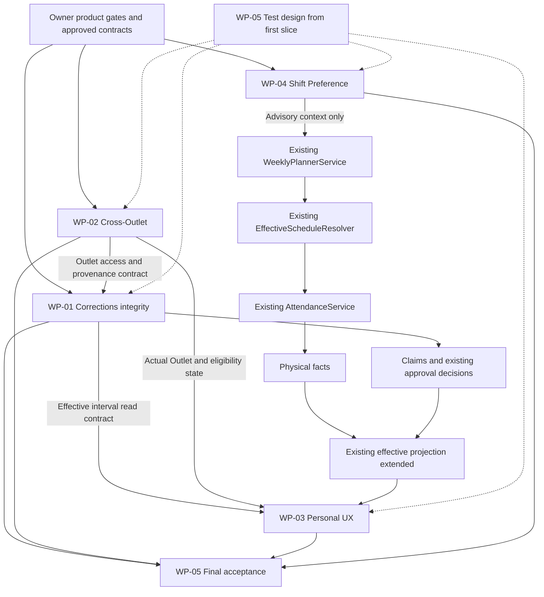

# HadirinAja V1 Implementation Blueprint — Flexible Attendance and Shift Preference

Date: 2026-11-04 (Asia/Jakarta). Status: **planning complete; implementation is not authorized**. This blueprint covers WP-01–WP-05. Product gates remain open; completing this document does not resolve them or establish release readiness.

Authoritative inputs:

- [Approved Product Rules V1](product-rules-v1-flexible-attendance-shift-preference.md), including every explicitly unresolved decision.
- [Completed Gap Analysis](product-rules-v1-flexible-attendance-shift-preference-gap-analysis-2026-11-04.md), particularly findings F01–F48. Its counts are historical assessment results, not test results for this blueprint.

Repository inspected: `/Users/aryaajisadda/Development/hadirinaja`; HEAD `3115ff9adb55fe80212b0f4a47fa8b094216ef57`. The working tree, including untracked implementation files, is the inspected source. HEAD alone does not reproduce it. Current source references R01–R30 in section 13 were re-inspected for this task; no reliance on unchanged line references from the earlier report is required.

## 0. WP-01/WP-02 documentation freeze — 2026-11-05

**Documentation freeze: PASS with explicit G17 semantic reservation. Implementation readiness: FAIL / NOT READY. Runtime/concurrency: UNVERIFIED.** [Owner-authoritative Product Rules](product-rules-v1-flexible-attendance-shift-preference.md#owner-authoritative-freeze--2026-11-05) govern G02/G03/G08/G10/G12/G14/G15/G17. This section is the current technical contract; historical planning/source observations below remain useful, but any conflicting older proposal is superseded. No application behavior was changed by this documentation freeze.

### 0.1 Checkout authorization, provenance and reporting

- Personal checkout supplies an explicit destination Outlet; kiosk checkout derives destination exclusively from its authenticated paired device. Reject destination spoofing, foreign tenant, missing/inactive assignment, disallowed destination attendance mode or failed destination geofence. Recheck Primary/Temporary assignment at trusted server checkout time under the transaction locks; no Owner physical-attendance bypass.
- Both personal and kiosk checkout validate destination geofence. The earlier trusted-kiosk no-GPS exception is superseded for G02 checkout; pairing is not location evidence. Missing location must not be recorded as verified. Unrelated kiosk check-in policy is unchanged by this freeze.
- Preserve `attendance_sessions.outlet_id`, originating Work Date/schedule snapshot and active-owner invariant. Destination does not transfer a session, split duration or rewrite check-in attribution. Evaluate destination policy against its own local checkout date/timezone; do not overwrite originating Work Date with that date.
- Proposed additive event fields: `checkout_outlet_id` and immutable `checkout_context` containing destination assignment identity/type/validity, destination policy version/mode/timezone, actual location verdict/evidence references, authenticated actor/device/channel and server recorded-at. Keep the existing event `outlet_id` as session attribution for composite-FK compatibility. Primary-at-check-in provenance remains separate; never derive it from today's assignment.
- Include destination and operation contract version in canonical request hash and durable recovery payload. Identical-key replay preserves the original result; altered destination conflicts. Old in-flight contracts remain identifiable and recoverable without falsely claiming G02 destination verification.
- Projection, history, reports/CSV and audit expose session-origin and checkout-destination separately. Keep session counts/duration attributed to the fixed session; a destination field is not permission to read the Employee's whole history. Destination-only historical review access is reserved under G17 below.

Verified implementation gaps: [origin-only kiosk guards](../backend/app/Services/AttendanceService.php#L216), [origin policy/location checkout](../backend/app/Services/AttendanceService.php#L502), [personal checkout has no destination](../backend/app/Http/Controllers/Api/V1/AttendanceController.php#L101), [kiosk passes null location](../backend/app/Http/Controllers/Api/V1/AttendanceController.php#L186), [event uses session Outlet](../backend/app/Services/AttendanceService.php#L590). These are implementation conflicts, not remaining product questions.

### 0.2 Consolidated authorization matrix

| Action | Employee | Currently authorized Supervisor | Owner |
| --- | --- | --- | --- |
| Physical check-in/checkout | Own linked identity; active Primary/Temporary assignment at actual transaction Outlet; destination mode/geofence for checkout | Management role alone grants no physical bypass | No physical assignment/geofence bypass |
| Submit correction | Own attendance within G12 window | Proposal in approved scope; out-of-window requires Owner decision | Exempt deadline; mandatory reason/audit |
| Approve ordinary correction/reconstruction | No | Historical Primary OR Actual Outlet scope; one final decision; no new Supervisor self-approval privilege | Direct approval permitted, including own Employee attendance |
| Historical assignment exception | No | No approval authority | Explicit audited exception only; no fabricated assignment/event/geofence |
| Approve reversal | No | No | Owner-only, immutable decision |
| Read cross-Outlet review context/evidence | Own authorized request | Only the request and necessary supporting context under G17; no general history/export grant | Tenant-authorized |
| Compare finalizations | Existing authorized self/read scope | Authorized scoped comparison only; request grant does not expose unrelated history | Tenant-authorized immutable version comparison |

Current reviewer membership/role/scope must be checked on reads, decisions and idempotent result retrieval. Owner self-approval must bypass only the old self-review restriction, not tenant, input, conflict or audit validation. Historical Primary/Actual facts are frozen; authorization to review those Outlets is current. Unknown historical Primary remains unknown. **OPEN G17 boundary:** whether Checkout Destination independently qualifies as Actual Outlet for historical review. Do not infer a destination-only grant from G02; that branch remains unresolved.

### 0.3 Immutable lifecycle and effective views

- Correction targets are existing physical session or completed reconstruction interval. Full reconstruction requires claimed start AND end, one request, reason and applicable approval; never manufacture physical events/sessions/geofence evidence. An Owner historical-assignment exception records the missing assignment and explicit exception reason/actor/time.
- Still working after missed check-in: actual-time physical check-in → start-time correction request → normal checkout. An approved start correction changes only effective start; active physical ownership and original start remain intact. Preserve physical checkout facts if they arrive while approval is pending; revalidate/rebase explicitly rather than silently overwrite them.
- Request transitions: submitted → pending → approved/rejected/cancelled; direct Owner approval records submission and decision atomically. A revision is a new immutable request against the current effective basis. Rejected/cancelled amendments have no effect. Only Owner approves reversal, recorded as an immutable targeted decision with reason, actor, server time and expected basis.
- Reversal removes the target's effect from effective calculation, not its original record/history. Compute from the surviving valid decision chain, preserving dependency links and rejecting stale/ambiguous competing changes. No status reset/delete to simulate reversal; dependent revisions must be explicitly reconciled against the new basis.
- Physical actual totals remain physical-only. Effective attendance includes current valid session corrections and approved, unreversed completed reconstructions exactly once. Include reconstruction-only days in projections/report candidates; no fake session IDs or double-counted combined totals.
- Any effective change to a finalized period requires a new finalization version with a fingerprint of its source claims/decisions/reversals. Preserve prior immutable snapshots. Current effective view and an authorized comparison of selected historical versions are distinct views; show version IDs/time/actor/source references. No payroll engine, wage-rate data, impact ledger or integration.

### 0.4 Deadline and evidence contract

Employee cutoff is the end of Work Date H+N in the actual attendance Outlet timezone, inclusive. Compute historical-policy and currently-effective-policy deadlines separately and use the later deadline. Compare trusted server submission instant, never browser clock; store both policy/version IDs, N values, timezone and evaluated cutoff in immutable submission context. Exact replay of a recorded request is not a fresh submission. Owner is exempt; scoped Supervisor may propose beyond the window, but only Owner may approve that out-of-window proposal.

Routine attachments, including full reconstruction, are optional. Mandatory reason/approval remains; a special review can request additional evidence. Accept JPEG/PNG/WebP/PDF only, at most three files and 5 MB per file, with server content/size validation and private authorized delivery. Do not send PDF through the image normalizer or trust extension/MIME claims alone. Attach immutable bytes/hashes and bindings to the request; additional special-review evidence is appended, not substituted into an old payload.

Retention is Owner-configurable: minimum 90 days, default 365 days, maximum five years. Persist the applied retention/expiry context and audit policy/lifecycle changes; hold prevents byte deletion and races serialize on the evidence record. Expiry preserves metadata, hashes/provenance as appropriate to the immutable correction history, tombstone and access/lifecycle audit; never replace expired bytes with invented evidence. Freeze-time reference is not evidence of a running retention worker. Use a separate correction-evidence namespace/reference-aware cleanup; existing physical-evidence cleanup must not delete valid correction attachments.

### 0.5 Concurrency, migration and acceptance

Preserve `AttendanceService`, `EffectiveScheduleResolver`, `WeeklyPlannerService`, approval and durable idempotency foundations. Serialize competing checkout/correction/reconstruction/reversal/finalization through the Employee and relevant target/version locks; use one deterministic order for affected paths, expected effective basis and current authorization on replay. Recheck destination assignment/policy/device validity before commit; two checkout channels can close a session only once. No network/file side effect may duplicate during bounded transaction retries.

Additive migrations only: reconstruction subjects/immutable complete claims, targeted revision/reversal audit links, private correction evidence/lifecycle, historical Primary snapshot, checkout destination context and finalization provenance. Preserve existing real-session correction FK and physical event/session identity constraints. D06 checkout provenance is now required; D07 independent attendance grants and D15 historical valuation are superseded/excluded from V1. Old rows remain explicitly unknown/unverified; no fabricated backfill. Deploy capable readers before enabling future writes; disabling new writes must preserve status recovery, accepted history and checkout of existing active sessions.

Future acceptance must prove: same-tenant assigned destination succeeds for personal and kiosk; arbitrary kiosk destination/foreign tenant/expired assignment/mode/geofence failure cannot close a session; replay destination change conflicts; one close under two-channel race; Owner self-approval and Owner-only reversal/exception; Supervisor OR scope with no history leakage; G12 exact cutoff/policy changes; completed reconstruction/no fake facts; active-start correction plus normal checkout; PDF/count/size/retention/hold; effective reporting/reversal and immutable finalization comparison. Existing [self-review tests](../backend/tests/Feature/S5/ApprovalWorkflowTest.php#L317) describe legacy expectations; [checkout/correction races](../backend/tests/Feature/S5/ApprovalConcurrencyTest.php#L113) are reusable fixtures, not executed acceptance evidence.

Dependency order: record approved rules and G17 reservation → authorization/typed provenance and immutable lifecycle/API contract → additive schema plus projection/report/comparison readers → separately authorized write/evidence work → focused authorization/tenant/concurrency tests → device/runtime acceptance. Unresolved destination-only G17 review is isolated; it is not silently enabled to make acceptance pass.

### 0.6 Supersession and historical evidence

Sections 1–14 retain the original planning structure and source/test assessment history. Current normative corrections are applied where practical; this section and the Product Rules freeze override any residual older conditional proposal for these eight decisions. Other work packages/gates retain their prior scope. Section 14 is the **original blueprint task** verification record, not the verification of this 2026-11-05 edit; the current documentation-only verification is recorded at the end. Source observations remain static evidence, never implementation readiness PASS.

## 1. Reading and execution contract

**Approved constraint** means a decision already in Product Rules V1. **Verified current source** means static source inspection in this task. **Proposed architecture** means the implementation recommendation made here; it is not an additional approved business rule. **Gate Gxx** means an Owner/product or operational decision that must be recorded before the dependent implementation/acceptance step. No gate has a timeout-based or implicit default.

All new classes, fields, tables, routes and payloads below are **proposed**, unless explicitly described as existing. Names are intended to make implementation tickets concrete; they do not claim those artifacts exist. No sample credentials, migrations, application code or tests are created by this planning task.

Future implementation should proceed by the ticket slices in section 10. Each slice must name its gates, preserve unrelated changes, run risk-appropriate checks only in separately authorized environments, review its diff, and stop short of commit/deployment without authorization. Do not start work merely because a gate has been discussed; implementation itself still needs explicit approval.

## 2. Target architecture and domain boundaries

### 2.1 Architecture decisions

| ID | Proposed architecture / invariant | Repository grounding and consequence |
| --- | --- | --- |
| AD01 | Extend the current Laravel service/controller and React route structure in place. No service replacement, microservices or new scheduling engine. | `AttendanceService`, `ApprovalWorkflowService`, `EffectiveAttendanceProjectionService`, `WeeklyPlannerService` already own these workflows (R01–R08). |
| AD02 | Physical events, correction claims, management decisions and derived effective intervals remain distinguishable at storage, API and UI boundaries. | Existing corrections overlay immutable physical timestamps; missed checkout can resolve ownership without an event (R03–R05). No reconstructed `AttendanceEvent` or counterfeit physical `AttendanceSession`. |
| AD03 | Keep existing session corrections unchanged structurally; add a separate reconstruction subject and immutable claims linked to existing approval requests/decisions. | Existing correction FK and session check-in are non-null; existing code assumes a real session throughout approval and projection (R03/R04/R12). Avoid making that FK nullable and scattering null handling through proven paths. |
| AD04 | `ApprovalWorkflowService` remains the approval orchestrator. Add narrowly scoped claim validation/read helpers rather than parallel approval machinery. | Reuse pending/approved/rejected/cancelled, reasons and decision history; update reviewer rules for approved Owner self-approval and G17 (R02–R04). |
| AD05 | `EffectiveAttendanceProjectionService` remains the only effective attendance projection. Add typed reconstructed intervals and provenance; never feed claims into scheduling. | Current projection and downstream reports are session-centered (R05/R15). All consumers must be upgraded before reconstruction writes are exposed. |
| AD06 | Preserve durable operation keys, payload hashes, database uniqueness and server-confirmed result recovery. | Physical attendance and planner already have distinct durable protocols (R01/R08/R12/R13). Extend their patterns to new commands without replacing either foundation. |
| AD07 | Separate Employee attendance Outlet access from management Outlet scope. Centralize only the newly needed Employee access/provenance calculation. | Current Employee access is assignment-based; management is Owner/scoped Supervisor (R09/R10). G03 fixes physical access to active Primary/Temporary assignments; historical exceptions are Owner-only. |
| AD08 | Session `outlet_id` continues to mean actual check-in Outlet, fixed for that physical session. Add Primary Outlet provenance separately. | Event/session composite identity and checkout origin are already enforced (R01/R12). G02 permits assigned same-tenant destination checkout with destination mode/geofence, without session transfer. |
| AD09 | Shift Preference is an advisory input domain. Templates and published planner remain authoritative. | Official entry uniqueness permits one work/rest/unscheduled entry per Employee/day/revision; existing swaps act on published future entries (R07/R08/R13/R14). Preferences must not use those rows as their storage. |
| AD10 | Reuse existing UI primitives and identity-scoped photo recovery; move capture into a verification page and confirmation into its own modal. | Existing components use Base UI wrappers; recovery persists exact payload/photo across uncertainty (R16–R20/R25). No component replacement or preset change. |
| AD11 | Prefer additive nullable columns and new tables, no destructive backfill. Old records retain explicitly unknown provenance. | Historical snapshots and immutable decisions are already meaningful records. Current assignment state cannot prove a historical Primary Outlet (R01/R10/R12). |
| AD12 | V1 is Attendance Only. No payroll engine, historical wage rates, payroll impact ledger or payroll integration is included. | No payroll/rate owner was found in inspected backend surfaces (R30). G15 excludes payroll/rates/integration from V1; historical-rate absence is not a V1 blocker. |

These are local modular boundaries, not a claim that current Eloquent-based services are framework-independent. Do not add repositories/interfaces for every model to satisfy an architecture diagram. New helpers should hide only logic with a distinct responsibility and actual callers; keep controller validation, service orchestration and existing DI idioms.

### 2.2 Domain vocabulary and ownership

| Domain | Owns | Reads / may call | Must not own |
| --- | --- | --- | --- |
| Attendance Recording | Physical sessions/events, active ownership, server transaction times, location verdicts and immutable check-in context | Employee Outlet access, existing schedule/policy resolver, event evidence storage | Historical claims, preference submission, overtime approval or payroll valuation |
| Attendance Corrections | Reported actual times, original/basis snapshots, Employee deadline evaluation, reconstruction subjects, supporting evidence bindings | Existing identity/authorization, policy, effective interval reader, approval workflow | Physical-event fabrication, schedule publication, compensation |
| Review and Finalization | Decisions, reviewer independence, unresolved indicators, attendance finalization revisions | Corrections and effective projection | Changing original events, assigning shifts or computing payroll |
| Scheduling | Templates/versions, calendar, legacy schedules, planner drafts/revisions/publications, EffectiveScheduleResolver | Authorized manager input, optionally preference context in UI | Treating preference/non-submission as official work/REST or attendance eligibility |
| Shift Preference | Employee advisory submissions/revisions, daily choices/priorities/unavailability, manager review context | Allowed template catalogue, relevant Employee/Outlet scope | Schedule entries, staffing acceptance, publication or guaranteed assignment |
| Attendance Read/Reporting | Original and effective interval presentation, weekly summary, scoped reports/CSV/audit | All approved attendance sources, scheduling provenance | Mutating source facts during reads; audited evidence/export endpoints remain explicit exceptions |
| Payroll integration — excluded from V1 | No payroll engine, historical wage rates, impact ledger or integration | No V1 dependency | Attendance Only current effective reporting and authorized historical finalization comparison |

### 2.3 Dependency diagram



WP-01 and WP-02 have an **interface dependency**, not a cycle requiring both implementations first: settle the shared Outlet/date/provenance contract before WP-01 schema finalization. Existing-assignment behavior can be tested behind that interface; target cross-Outlet implementation follows the approved G02/G03 contract; only the G17 destination-review boundary remains reserved. WP-03 can build independent navigation/read components before those writes are enabled. WP-05 test design starts immediately; final acceptance comes last.

## 3. Shared contracts, integrity rules and compatibility

### 3.1 Time, identity and claims

1. Resolve tenant, active membership, Employee link and actor from authenticated context. Employee input never selects a different subject or elevates itself to management reconstruction. Management subject IDs are separately scope checked.
2. Persist claimed actual instants in UTC with explicit source timezone/local work date. Accept offset-bearing timestamps or an explicit local date/time plus IANA timezone resolved with existing `LocalTimeResolver`; reject ambiguous/nonexistent local time unless disambiguated. Browser timezone must not decide work date silently.
3. Server submission/reconstruction/decision timestamps are distinct fields from claimed event time. A successful physical operation shows server-recorded event time; an approved historical claim shows **claimed time approved by management**, with server decision/submission timestamps available separately.
4. Physical, corrected-session and reconstruction subjects have stable typed identities: `physical_session:<id>` and `reconstruction:<id>`. No negative fake session IDs. A reconstruction has zero physical event references until there is an explicit, audited relationship; it must never invent one.
5. Proposed interval overlap convention is half-open `[start,end)` so adjacent shifts may touch; include open physical intervals in collision checks. This is a technical overlap convention; it does not reopen the completed-interval G10 rule. Unknown end is incomplete, not zero duration.
6. Freeze relevant original/basis values, policy/version/cutoff evaluation, claimed Outlet provenance and reviewer decision context. Do not rewrite prior claim JSON or policy snapshots when a new claim is submitted.

### 3.2 Idempotency and command recovery

- Keep physical attendance's UUID `Idempotency-Key` and `/attendance/me/operations/{operation}/{key}` contract. Do not resubmit altered GPS/photo with an old key.
- New correction commands also use UUID keys and the existing approval submission uniqueness. Canonical hash envelope includes contract version, operation, actor/tenant/subject, target type/ID, basis revision, all claimed fields and ordered attachment hashes. A route target is part of the hash, not just the JSON body.
- Current administrative correction hashes `$data` but its session target is in the route (R02). The affected correction slice must bind route target/operation when extending that path. Preserve legacy-key retries by identifying the old hash contract and validating stored request target before replay; do not rewrite old hashes or invalidate recoverable submissions.
- New preference commands reuse `scheduling_operations` storage and canonical payload hashing with a distinct operation namespace; do not call planner `mutate()` just to acquire unrelated planner locks. UUID keys are a valid conservative subset of the current planner key grammar. A key reused across commands with different payload/target yields conflict.
- Correction operation lookup returns `recorded` plus request ID/status, or `not_found`; **recorded does not mean approved**. Atomic request/claim/evidence metadata commit makes submission lookup sufficient; do not add a second approval state machine. Decision lookup verifies exact action/reason/key and current access before returning a terminal result.
- A lost response is uncertain. Lookup by actor/key first; when absent, retry identical canonical input/key under the same uniqueness/locking rules. Status reads are authorized and no-store. No broad listing of other users' operation keys.

### 3.3 Transaction and file boundaries

Use the existing Employee row as the serialization point for competing attendance/correction outcomes. Proposed affected correction paths: resolve IDs without trusting them, acquire Employee lock, then affected approval requests in ID order, then session/reconstruction root and basis rows in deterministic order. Apply that order consistently to **touched correction submit/decide/cancel/routine paths**; current decision and administrative paths use differing request/Employee/session order (R02/R03). Audit their scope/membership locks before finalizing code. Do not claim existing lock order is globally safe.

Preserve planner's Tenant → Outlet → Employees → week order and physical attendance's operation/device → Employee → session/owner order (R01/R08). New correction/provenance helpers must not acquire a Tenant/Outlet write lock after Employee, nor an attendance-operation lock. Recheck authorization after needed locks. A focused lock-order change is a dependency of the touched workflow, not a reason for unrelated transaction refactoring. Retain bounded deadlock retries; test both race orders using the existing independent-process harness.

Prepare/validate uploads before opening a retriable DB transaction. Final file move and DB metadata must follow the established durable private-file pattern with idempotent storage actions and reference-aware cleanup. Do not perform non-idempotent notifications inside retried callbacks. A database failure must preserve no effective claim; a file orphan may require reconciliation but must never be publicly served. If reference lookup fails, retain bytes pending reconciliation rather than delete possibly committed evidence.

### 3.4 Compatibility boundary

- Existing physical attendance routes, `sessions` IDs, event IDs and current `actual_duration_seconds` semantics remain stable.
- Reconstruction-aware projection adds `projection_contract_version: 2`, `reconstructed_intervals`, provenance/coverage fields and proposed combined effective totals. Keep session-only totals distinguishable. Do not silently redefine an old `sessions` array as a heterogeneous union.
- All consumers must agree on total semantics before activation: add `combined_effective_duration_seconds` and `reconstruction_effective_duration_seconds`; retain legacy effective totals as session-based until an explicit versioned migration. A UI must not add a combined total to its session total again.
- Proposed total contract: physical actual totals remain based only on recorded physical facts; session-effective totals retain their current scope; reconstruction-effective totals include each root's current approved claim once. A combined total includes those two effective sources once each. An included incomplete interval yields an unknown/null complete total and an explicit incomplete-coverage indicator; a separately named known-seconds subtotal may sum completed intervals. Do not silently convert an unknown interval to zero or include pending claims. G10 excludes incomplete reconstruction; an incomplete physical session still has unknown duration until normal checkout.
- Deploy capable readers before enabling reconstruction/preference writes in any later authorized release. No feature flag is assumed to exist today; activation configuration, if used, is an explicit implementation artifact and operational approval.
- No rollback to an old reader that omits accepted claims is safe after those claims become effective. Disabling new writes is safer than erasing data or silently dropping it from reports.

## 4. WP-01 — Attendance Correction Integrity

Traceability: Product Rules C/F and B's Employee Correction Window; gap F24–F31, F44–F46. Dependencies: G03, G08, G10, G12–G15; shared Outlet contract from WP-02; WP-05 race and projection tests.

### 4.1 Existing architecture to preserve

Keep existing `ApprovalRequest`, `AttendanceCorrection`, `ApprovalDecision`, cancellation/queue/history and applicable non-Owner self-review protections, `reconcileMissingCheckout()`, Employee serialization, and projection overlay (R02–R05/R11). Existing real-session missing checkout remains a correction, not a reconstruction. Physical timestamps and event references remain original facts.

### 4.2 Proposed domain model and workflow

Use **two target types under existing `request_type=attendance_correction`**:

- `session`: existing session correction row; use for missed checkout and corrections to an existing physical check-in.
- `reconstruction`: new stable subject plus immutable claim revisions; use when no physical session exists for a missed check-in. The stable subject represents a reported work interval, not an active physical recording session.

New `AttendanceReconstruction` root groups the history and stores a lock version and current effective claim pointer. New `AttendanceReconstructionClaim` belongs to exactly one existing approval request and one root; it stores claimed start/end/work date/actual Outlet, baseline effective claim ID, originals/basis, server submission time, actor path, reason/context snapshots and immutable revision number. The root changes only as an audited projection pointer/version; claims never change.

Employee workflow:

1. Select **Missed Check-in** or **Missed Check-out** and the relevant work date. Server supplies available real-session targets and correction eligibility, without inventing a session for a missed check-in.
2. For session target, capture proposed changes against a server-returned basis fingerprint. For reconstruction, select actual Outlet and enter claimed actual start/end with explicit timezone and evidence if applicable.
3. Validate ownership/scope, chronology, deadline, completeness rules, interval collision, claim basis and evidence; keep unscheduled/REST attendance as review context, not automatic ineligibility.
4. Create one immutable claim/request and evidence binding transactionally; Employee request is pending, never automatically approved.
5. Independent authorized management reviewer inspects original facts, claims, previous correction history, Outlet context and evidence. Revalidate current authorization, basis and overlap at decision, not just submission.
6. Approval records a decision and atomically advances the root's effective pointer or applies the existing session overlay. Rejection/cancellation keeps history and does not change the effective interval. Competing approvals cannot both advance from the same basis.

Management workflow uses a separate authorized entry with mandatory reason/audit. Owner may directly approve, including own Employee attendance. Supervisor ordinary decisions require G17 scope; out-of-window proposals require Owner approval; historical assignment exceptions and reversals are Owner-only. Full reconstruction requires completed claimed start/end. Still working after missed check-in uses actual-time check-in, start correction and normal checkout; no partial reconstruction is activated.

Amend an effective reconstruction by a new request/claim revision referencing its current effective claim, not by altering it. A rejected later claim cannot replace the previous approved claim. Cancellation of pending requests retains current existing semantics; reversal of an approved reconstruction requires Owner approval under G08 and an append-only targeted decision, never delete or status reset.

### 4.3 Backend service/controller changes

| Existing / proposed owner | Planned responsibility |
| --- | --- |
| Existing `ApprovalController` | Extend submit/request-view validation for discriminated target; keep legacy session requests valid. Add dedicated management reconstruction action and actor-key submission lookup. No business approval rules in controller. |
| Existing `ApprovalWorkflowService` | Route target to existing correction vs new claim; retain one approval/cancellation/decision history; include reconstruction in queue/show/ownRequests, decision basis validation, discoverReviews and finalization checks. |
| Proposed `AttendanceReconstructionService` | Create immutable claims, validate the reconstruction-specific target, advance root pointer under Employee/root lock. It does not independently approve or publish. Called by the workflow. |
| Proposed `AttendanceCorrectionEligibility` | Compute Employee deadline using `AttendancePolicyService` plus G12; return allowed/reason/cutoff/policy context. Management authorization is a separate method/path, not an input boolean. |
| Proposed `EffectiveAttendanceIntervalReader` | Read physical-session effective intervals plus approved reconstruction intervals and fingerprints for overlap/basis checks. No HTTP, UI formatting or scheduling rules. Used by workflow/projection; does not call back into approval orchestration. |
| Existing `EffectiveAttendanceProjectionService` | Batch load approved claims across requested dates/Outlets, typed reconstructed rows, combined coverage/totals, review/conflict semantics and provenance. Include both old/new dates for amendments that move work date; do not miss moved claims. |
| Existing reporting/controller consumers | Upgrade `AttendanceReportingService::candidatePairs/shapeRows/reportTotals/dashboard` and `ReportingController::export`; include reconstruction-only days and explicit claim/decision columns, without increasing physical session/event counts. R15/R28. |
| Existing audit / evidence services | Extend scoped audit query details for reconstruction and attachment activity; isolate new evidence references from event-only cleanup. |

Changes to existing real-session correction overlap checks must include approved reconstructions. Finalization must consider reconstructed intervals when determining presence/exceptional attendance, pending claims, changed basis and superseded snapshots. Existing `finalize()` only detects later approvals linked through `AttendanceCorrection` and the projection gives confirmed absence precedence (R03/R05). New claim approval after a prior absence decision/finalization needs G08's versioned re-finalization with preserved prior snapshots. Preserve old finalization history and mark stale context; do not silently let a prior absence suppress newly approved attendance or auto-approve a new outcome.

### 4.4 Database and migration design

Proposed D01–D04 in section 9:

- `attendance_reconstructions`: stable ID, tenant/Employee composite identity, lock version, nullable effective claim pointer, creation actor/time. No one-per-day uniqueness: multiple separate physical sessions already exist; use interval validation to prevent duplicates/overlap.
- `attendance_reconstruction_claims`: root/revision, approval request, target/basis, claimed instants/work date/actual Outlet, immutable context and creator/submitted time. Unique root/revision and approval request; composite tenant/Employee foreign keys. No FK to a fabricated physical session.
- `attendance_correction_evidence`: private attachment metadata bound to the request/Employee, immutable content identity plus controlled lifecycle state. Works for existing session corrections and new claims. Not a physical `attendance_evidence` row.
- `attendance_correction_evidence_events`: append-only upload/view/download/denial/retention/hold activity with authenticated actor and request scope. Keep protected evidence history even if bytes later expire under G14.

Keep existing correction/session schema constraints. New request `details` can store target discriminator, deadline evaluation and context without changing old immutable payloads. New FK/pointer columns must be created in stages: roots, claims with root FK, then root effective-claim composite FK; prove pointer refers to the same tenant/Employee/root. Do not rely on a globally unique ID alone to establish tenant identity.

### 4.5 API contract changes

All routes are proposed under `/api/v1` and retain Sanctum/active-tenant/no-store/CSRF protections:

- Extend `POST /attendance/me/requests`: existing session body remains supported; new `target_kind: reconstruction`, `reconstruction_id` nullable for first claim, `expected_effective_claim_id` explicitly null or current ID, `claimed_check_in_at`, required `claimed_check_out_at`, `work_date`, `actual_outlet_id`, timezone, reason and `evidence[]` multipart. No Employee-supplied `employee_id`, actor or approved status.
- `POST /management/attendance/reconstructions`: same claim data plus management-selected `employee_id`, separate authorization and G08 disposition. For an amendment, include root ID and expected basis.
- `GET /attendance/me/correction-eligibility`: date/target/actual Outlet → `can_submit`, `reason_code`, server time, cutoff, timezone, policy version IDs, eligibility basis. This is advisory; POST revalidates.
- `GET /attendance/me/correction-submissions/{key}` and management equivalent `/management/attendance/correction-submissions/{key}`: actor-scoped recorded/not-found lookup with request ID, target identity and request status. Do not expose another actor's key.
- Existing queue/show/decision/cancel responses gain `target_kind`, reconstruction root/claim IDs where relevant, original/claim/effective sections, deadline context, evidence metadata and complete decision history. Status `pending` remains approval pending even if submission is recorded successfully.
- Paginate long correction/reconstruction histories with stable cursors and an explicit continuation indicator. A list limit or the latest effective claim is not the complete history; detail/history retrieval must make every preserved claim and decision reachable within authorized scope.
- Existing self/management effective attendance responses add versioned reconstructed interval fields per section 3.4; evidence retrieval uses new `/attendance/corrections/{request}/evidence/{evidence}` with Employee-own or authorized manager access. Audited retrieval must not be called by static planning checks.

New error codes include `correction_window_closed`, `correction_basis_stale`, `attendance_interval_conflict`, `correction_evidence_unavailable`. Use 422 for semantic input/window rejection; 409 for stale basis/idempotency/state conflict; preserve current 401/403/404 non-disclosure conventions. An unresolved product gate prevents feature activation, not an arbitrary per-user business denial in a released feature.

### 4.6 Frontend components and state transitions

Extend `src/routes/requests.tsx`, `src/routes/approvals.tsx` and the existing history component. Proposed reusable blocks: `attendance-correction-form`, `attendance-correction-history`, `correction-evidence-list` and `reconstruction-review` under `src/components/`. Names indicate proposed module files, not existing artifacts.

State: `loading_context → editing → validating → submitting → recorded_pending → approved/rejected/cancelled`; submission timeout → `checking_submission → recorded_pending | not_found | unknown`. Not-found permits identical-key/body retry; unknown prevents a new submission for that intent. A stale basis returns to context refresh and explicit re-entry/reconfirmation, never auto-rebase a claimed time. Preserve unsaved local work when a definitive validation error occurs; clear sensitive attachment recovery on identity change without losing unresolved-operation metadata.

Present original physical time, Employee/management claim, server submission time and reviewer decision separately. Reconstructed intervals have a visible reconstruction label and no fabricated session number. UI acceptance must include the claim-only day in History, Home's approved summary basis, management review, reports and CSV.

### 4.7 Authorization and audit

Employee submits/views own linked identity within G12 deadline. Owner may direct/self approve and approve historical assignment exceptions/reversal. Currently authorized Supervisor may decide ordinary corrections with historical Primary OR Actual Outlet scope; out-of-window proposals require Owner approval. Cross-Outlet disclosure is request-scoped. Checkout Destination independently qualifying as Actual Outlet remains explicitly unresolved under G17; see section 0.2.

Every immutable claim records actor/user/membership, management-vs-Employee origin, reason, claimed time, server time, original/basis fingerprint, policy context and supporting-evidence receipt identity. Every decision records reviewer/time/reason/effective basis. Append corrections and reversals; no audit record can be replaced by an updated form payload.

### 4.8 Dependencies and implementation order

Use settled G08/G10/G12/G14 and the shared approved Outlet contract; then typed contracts/tests, additive models, projection/report/comparison readers, deadline/approval/reversal/evidence writes and UI under separate implementation authorization. No payroll/rate dependency remains in V1.

### 4.9 Failure and recovery scenarios

| Scenario | Required outcome |
| --- | --- |
| Double click / lost submit response | One request/claim/evidence binding; lookup returns recorded pending; identical replay does not create another revision. |
| Another approval or real checkout wins | Revalidate basis under Employee lock; stale claim stays unapplied and history remains intact. Physical checkout facts cannot be overwritten by an old missing-checkout claim. |
| Reconstruction collides with corrected or active physical interval | Reject application of conflicting claim; do not auto-merge or adjust either interval. G10 requires completed reconstruction targets; active physical sessions use the normal correction/checkout path. |
| Deadline crossed during upload | Use trusted server submission evaluation under G12; preserve evaluated cutoff and rule; no client clock override. Exact idempotent replay of an already recorded request is still replayed after current access checks. |
| File move/DB commit/audit fails | No effective claim without committed decision; rollback claim creation when required evidence cannot be bound. Preserve uncertain file references; reconcile orphans without deleting committed files. |
| Reviewer loses scope or was submitter | Deny decision; request remains pending. Do not silently grant another role. |
| New reconstruction amends a finalized day | Preserve old finalization; flag changed attendance basis and apply G08's reviewed re-finalization procedure. No payroll adjustment. |

### 4.10 Acceptance criteria and verification strategy

AC-01.1: Employee and authorized management can submit no-session missed check-in and real-session missed checkout through their distinct paths. Full reconstruction requires a completed interval; active-session start correction must preserve normal checkout.

AC-01.2: Approved reconstruction contributes exactly once to the effective read model, has zero fabricated physical sessions/events, preserves claim/decision times, and appears in self/management views, report totals/dashboard/CSV with typed provenance.

AC-01.3: Deadline tests cover cutoff minus/exact/plus boundary, timezone/overnight/zero-day/maximum configured window, policy revisions, moved work dates, retry after cutoff and separate management authorization. Expected equality/inclusivity follows G12.

AC-01.4: Pending/rejected/cancelled/stale claims do not change effective duration; a later rejected amendment does not erase an earlier approved claim. Originals and all prior claim decisions remain inspectable.

AC-01.5: Evidence ownership/lifecycle, foreign tenant/subject, self-review, revoked membership, decision replay, duplicate claims, overlapping corrections, real checkout races, and finalization-basis changes pass focused WP-05 tests. All payroll engines, wage rates, impact ledgers and integrations are excluded by G15.

### 4.11 Risks and rollback

Largest risk is a read path silently ignoring a claim-only interval or confusing it with a real session. Activate writes only after every identified consumer is capable. If an incident occurs, disable new correction/reconstruction writes while retaining capable reads, evidence and decision history. Do not delete claims, reset decisions, fill original timestamps, drop tables or revert to a reader that omits accepted reconstruction. Recovery uses another audited claim/decision under G08; database restoration is a separately authorized operational action.

## 5. WP-02 — Cross-Outlet Attendance

Traceability: Product Rules B/D; gap F15–F22, F32–F36. Dependencies: G01–G03, G09, G11, G16–G17; common contracts consumed by WP-01/WP-03. No new tenant-wide Employee access is approved.

### 5.1 Existing architecture to preserve

Keep assignment history/Primary uniqueness in `EmployeeOutletAssignmentService`, existing Owner/Supervisor scope checks, actual-Outlet policy/geofence, fixed session Outlet, active-session ownership, current schedule snapshots and generic review mechanism (R01/R09/R10/R12). Do not change `EffectiveScheduleResolver` into an authorization service or replace `AttendanceService` with another attendance engine.

### 5.2 Proposed domain model and workflow

Introduce proposed `AttendanceOutletAccessService` with two distinct responsibilities: `allowedOutlets(actor, employee, at)` under the G03 policy, and `captureProvenance(employee, actualOutlet, at)` for the validated transaction. This narrowly scoped helper returns data, not a mutable alternate session. `TenantAuthorization` remains the management authorization foundation.

Check-in sequence under existing Employee lock:

1. Resolve authenticated Employee, chosen actual Outlet and trusted server instant.
2. Re-evaluate allowed attendance scope for that actual Outlet at that instant. UI catalogue selection is never sufficient authorization.
3. Select Primary assignment effective at check-in independently from the selected actual-Outlet assignment. Snapshot Primary Outlet ID/assignment identity/validity and actual Outlet/authorization source. Exactly one valid Primary assignment is expected where the selected product policy requires it; missing/ambiguous Primary handling is G11.
4. Resolve schedule/policy in actual Outlet context and evaluate its geofence. Keep generic unscheduled/REST/late flags and original published schedule provenance. Add proposed `cross_outlet_attendance` when actual and known Primary Outlet differ.
5. Record physical event/session with actual `outlet_id`, frozen Primary provenance and review indicator in the same transaction. The indicator requires review; it never automatically approves overtime or remuneration.
6. Include the new indicator in review discovery/projection/finalization. A review decision must refer to this session/context and relevant indicators; reviewing another session's same string cannot implicitly settle it. Where current day-level indicator aggregation is insufficient, extend target-scoped review keys/matching only for affected cases (R03/R05).

Checkout locates the active physical session and preserves its Outlet. G02 requires same-tenant destination, active Primary/Temporary destination assignment at checkout time, destination mode and geofence for personal and kiosk. Personal supplies destination; kiosk derives it only from authenticated device pairing. Record immutable destination provenance separately from fixed session attribution. See section 0.1.

Flexible attendance policy is part of this package's classification work: preserve allowed unscheduled/REST/unpublished and early checkout, existing grace configuration, and generic late indicators. Add an Extreme Late indicator only after G01 defines the threshold; do not map `check_in_window.late_minutes` to it. G16 decides any changed behavior outside the early window and whether early-departure grace differs from the current reuse of late tolerance. Closure/holiday behavior remains G09.

### 5.3 Backend service/controller changes

- `AttendanceService::current/performCheckIn`: consume the same Employee Outlet access calculation; expose eligibility and next action separately from compliance flags; capture provenance once under lock. Keep legitimate non-schedule gates such as active session, authentication, required geofence and attendance mode.
- `AttendanceController`: add validated provenance response fields; checkout destination input follows approved G02, never implicitly accepted/ignored. Kiosk remains paired to one Outlet; G02 already covers both channels; enforce destination geofence for each and derive kiosk destination from its authenticated device.
- `EmployeeOutletAssignmentService`: preserve Primary/temporary history; align any new scope writes to Employee serialization. Do not rewrite or add assignments just to make an attempted attendance succeed.
- `ApprovalWorkflowService`, effective projection and audit: target-scoped Cross-Outlet review, frozen Primary/actual display, reviewer scope and decision context. Existing `createReviewCase` key is session-oriented and must support new typed subjects without collision (R03).
- `AttendancePolicyService`/`SchedulingController`: reuse effective-dated Owner policy. Add only fields approved under G01/G03/G16; retain old JSON shape and allowed key validation for old versions. Extreme lateness never becomes a hard rejection threshold.
- `TenantAuthorization`/report scope: add explicit Employee attendance access integration without substituting management permissions. Reports must filter actual recorded/effective Outlet deliberately; Primary affiliation is metadata, not an alternate way to expose every session of an Employee.

### 5.4 Database and migration design

Proposed D05 adds nullable `primary_outlet_id` and `outlet_provenance` JSON to `attendance_sessions`. Keep actual `outlet_id`, existing actual assignment snapshot and physical event FK unchanged. `outlet_provenance` includes schema version, trusted captured instant, Primary assignment snapshot, actual authorization basis and context origin. Composite tenant/Primary Outlet FK; JSON references are validated against tenant/Employee at write and frozen.

Old rows remain null/`unknown_legacy` in read presentation. Do not backfill from today's Primary Outlet. If reliable historic evidence is later approved for backfill, that is a separate audited data task. New rows with unknown Primary follow G11, not a false “same Outlet” classification.

G02 requires additive checkout destination/context fields on physical events with tenant FK while preserving session attribution (D06). G03 uses existing Primary/Temporary assignments: independent attendance-grant storage/API (D07/A10) is superseded and excluded from V1. Historical assignment exceptions are explicit Owner-only reconstruction audit records, never assignments.

### 5.5 API contract changes

- Extend `GET /attendance/me` with `primary_outlet`, `actual_outlet`, provenance completeness and server-derived compliance indicators; keep `selected_outlet_id`, `allowed_next_operation` and existing field meanings. An active session freezes Outlet selection.
- Keep `POST /attendance/me/check-in` actual `outlet_id`. Server computes all Primary/cross flags; reject forged Primary/authorized-scope fields rather than trust them.
- Required checkout addition `checkout_outlet_id` follows G02 and and included in idempotency hashing, evidence recovery schema and event verification context. Old in-flight operation payloads must still be replayable under their stored contract.
- G03 uses existing Primary/Temporary assignment controls; do not add independent attendance grants or a generic all-tenant-Outlets Employee endpoint.
- Add Cross-Outlet context to manager review/effective attendance/report responses with G17-approved redaction. Classification and actual/Primary fields retain the same meaning across Home, History, approval and CSV.

### 5.6 Frontend components and state transitions

Use existing Outlet picker; add proposed `attendance-outlet-context` block for Primary and actual labels plus review indicator. States: `loading_access → selectable → context_ready`; actual Outlet change → `refreshing_context`, invalidate previous GPS/photo/confirmation, then `context_ready | unavailable`. Active physical session → `outlet_fixed`; the picker cannot imply a transfer.

Review UI shows which Outlet was Primary at the event and where attendance happened. Label unknown legacy Primary explicitly, not with the current assignment. G02-specific checkout UI must describe the physical verification Outlet without suggesting session transfer. Failure to fetch scope or policy disables submitting stale context while allowing safe history/status reads.

### 5.7 Authorization and audit

Authorized Employee attendance scope (G03), management reviewer scope (G17) and assignment planning scope are separate. Revalidate attendance access at mutation, record assignment basis, and audit assignment changes. A Primary Outlet transfer must not rewrite old sessions. For corrected/claimed historical attendance, WP-01 asks the same helper for G03-approved historical context and records it as claim context, distinct from physical verification.

Cross-Outlet review is explicit management judgment; it is not automatic schedule approval or compensation. Keep actual Outlet tenant FKs, subject identity and event/session integrity. Do not disclose Primary Outlet names/details to out-of-scope reviewers until the redaction contract is settled.

### 5.8 Dependencies and implementation order

Apply settled G02/G03 and approved G17 OR-scope with its destination-only reservation; preserve unknown historical Primary honestly. Implement provenance readers/schema, server assignment/mode/geofence checks, immutable checkout context, scoped review/projection/reporting, then race and policy tests under separate authorization.

### 5.9 Failure and recovery scenarios

| Scenario | Required outcome |
| --- | --- |
| Scope/Primary changes while a check-in form is open | Server rechecks and freezes context under Employee lock; stale UI cannot grant access. Response reports actual captured provenance. |
| Two Outlets check in concurrently | Existing one-active-owner invariant allows at most one physical session; winner's actual Outlet is preserved. |
| Different-Outlet checkout attempted | Execute only the approved G02 rule, preserving origin session. Denial/uncertainty cannot silently close or transfer it. |
| GPS valid for Primary but not actual Outlet | Reject if actual-Outlet geofence is required; never treat Primary validation as sufficient. |
| Primary provenance unavailable | Follow G11, retain unknown state and audit; no fabricated Primary assignment. |
| Review discovery repeats / same indicator appears on another interval | One case per typed target/context; no duplicate case and no accidental resolution from another subject's decision. |

### 5.10 Acceptance criteria and verification strategy

AC-02.1: Authorized other-Outlet attendance succeeds and persists distinct Primary/actual provenance plus review; unauthorized and foreign-tenant Outlet attempts fail without event/session creation.

AC-02.2: Scope and Primary transfer races retain historical provenance; two simultaneous check-ins share the original invariant; one active session never moves Outlet.

AC-02.3: Geofence tests use actual Outlet coordinates/accuracy boundary. G02's approved personal/kiosk destination-assignment/mode/geofence matrix passes with immutable checkout provenance.

AC-02.4: Unscheduled, REST, unpublished, grace, extreme late after G01, early/late boundary and early checkout behaviors preserve eligibility vs compliance. Cross review cannot approve pay and cannot be settled by a different interval's review.

### 5.11 Risks and rollback

Main risks are authorization widening, wrong geofence, ambiguous legacy Primary and privacy leakage across reviewer scope. Additive provenance allows old data to remain honest. If disabling new cross-Outlet writes, retain checkout/status support for sessions already opened under the new contract and keep their provenance/reviews readable. Restoring older scope logic must not strand active sessions or misinterpret new verification fields. No assignment deletion, snapshot rewrite or schema rollback as a release recovery tactic.

## 6. WP-03 — Personal Attendance UX

Traceability: Product Rules A; gap F01–F14/F23. Dependencies: WP-01 read model, WP-02 server eligibility/provenance, G02/G10/G13/G18; WP-05 real-device acceptance. UI design follows existing shadcn/Base UI components and project UI-kit/typography instructions, not a new visual system.

### 6.1 Existing architecture to preserve

Keep `/attendance`, `EmployeeShell`, weekly daily-list `PersonalSchedule`, original/effective `EmployeeAttendanceHistory`, geofence utilities, camera readiness/retake behavior, identity-scoped IndexedDB/local metadata, same-key recovery, server confirmation formatting and current auth navigation (R16–R21/R25). Do not replace them with a fresh attendance client or install a camera/upload framework.

### 6.2 Proposed domain model and workflow

Home is a read/launch surface. The verification page owns the current draft and camera/GPS lifecycle; durable pending command data remains recoverable independently of the mounted route. Confirmation is a separate modal over that page. Server state alone determines which physical operation is eligible, combined with local readiness/uncertainty guards.

Four primary destinations are **Home, Schedule, History, Profile**. Proposed routes retain Home `/attendance` and Schedule `/scheduling`, add `/attendance/history`, `/attendance/profile`, and `/attendance/verify` with validated operation selection. Requests `/requests` remains reachable through correction/request links in History/Profile; Shift Preference is a Schedule subfeature, not a fifth primary navigation item. Preserve legacy `/attendance#history` links by redirecting/focusing History without rewriting user data. URLs are architectural proposals; labels and behavior are approved requirements.

Home shows actual/selected Outlet plus Primary context where authorized, compact weekly schedule, simple current attendance status and current-week first/last values. It renders **both Check-in and Check-out** permanently in the action area, each with a reasoned disabled state. A pending command disables both; an unlinked/unavailable identity never activates either. A reconstructed interval does not become a physical active session merely to enable checkout; G10 specifies actual-time physical check-in, start correction and normal checkout instead.

### 6.3 Backend service/controller changes

Add proposed `PersonalAttendanceSummaryService` (read composition only) and a thin `AttendanceController::personalWeekSummary` action. It composes existing resolver/projection, server time and Outlet context rather than querying events in a second way or reimplementing duration rules.

Proposed `GET /attendance/me/week?week_start=YYYY-MM-DD&context_outlet_id=…` response:

- `server_time`, explicit `week_start`, `week_end`, `timezone` and selected context identity.
- Seven `days` in server-defined week order, effective schedule and provenance, physical sessions and reconstructed intervals from the existing projection.
- Separate `recorded_summary` and `effective_summary` first-check-in/last-checkout references/timestamps and coverage/completeness. Return per-day values and a clearly named week aggregate only as needed by the G13-agreed display, without substituting “latest of ten sessions”.
- Summary references include typed source, relevant event/claim/decision IDs and basis. Null means unknown/not recorded; it is not replaced with schedule time or device clock.

G13 settles display basis (physical vs approved effective), per-day/week meaning, week boundary and timezone when multiple Outlets differ. Existing scheduler uses a weekly range; recommending Monday–Sunday alignment is not silently approving a new product convention. Preserve current rolling `GET /attendance/me` fields for compatibility; add the weekly endpoint rather than quietly change the old history period.

### 6.4 Database and migration design

No WP-03-specific table is required. Use WP-01/WP-02 fields and existing projection. No persisted Home aggregate, offline attendance queue, replacement local secret store or client-generated attendance time. If pending metadata gains checkout verification fields under G02, version browser payloads with backward-compatible readers; do not clear an unresolved old operation during a schema upgrade.

### 6.5 API contract changes

Retain `/attendance/me`, physical POSTs and operation-status route. Add the weekly summary read route and additive eligibility/compliance/provenance fields where WP-02 requires. Operation/Outlet selections are validated route context, not authorization. Server revalidates before mutation even if the page fetched an eligible state seconds earlier.

Do not change photo requirements through UI alone: current UI always captures, while backend personal-photo enforcement is configurable (R01/R16). G18 settles whether the product requires mandatory API evidence enforcement for personal attendance; implementation must not toggle `.env` or a live policy as part of UX work. UI capture/manual-retake remains approved regardless.

### 6.6 Frontend components and state transitions

Proposed reusable blocks: `employee-week-summary`, `attendance-action-panel`, `attendance-verification`, `attendance-verification-status`, `attendance-confirmation-dialog`. Keep their presentation reusable with explicit input state/callbacks; route containers own auth/context and API effects. Small shared `use-attendance-operation` logic may be extracted from the existing page **only as needed to preserve recovery across pages**, not as a broad state-management rewrite.

| State | Enter / visible behavior | Allowed transition |
| --- | --- | --- |
| `loading_server_state` | Load identity, current state and any pending metadata | Ready Home, eligibility error, or pending recovery; never optimistic check-in |
| `home_ready` | Both actions visible; server-next-operation enabled if local guards pass | User opens verification for that permitted operation |
| `verification_preparing` | After identity/context validation, automatically start GPS acquisition and camera request independently; show separate loading states | GPS/camera can succeed/fail independently; one denial does not conceal the other's status |
| `verification_blocked` | Show denied/unavailable/inaccurate/outside/unconfigured location or camera failure with targeted retry guidance | Retry affected capability; refresh server context when needed; no automatic repeated permission loop |
| `live_preview` | Camera video starts as soon as permission/usable stream is available, even while GPS checks finish | Manual capture only; no automatic photo or submit |
| `photo_captured` | Stop/release stream as appropriate, show captured frame; keep verification page mounted | Retake returns to camera; open confirmation only when required context is valid |
| `confirmation_open` | Modal shows operation, actual Outlet, claimed capture context and photo; underlying verification remains mounted | Cancel returns to page; confirm persists exact pending payload/key then submits once |
| `submitting` | Both actions locked; modal/page cannot create another key for the intent | Confirmed server result, definitive rejection, or uncertainty |
| `uncertain/checking` | Durable identity/operation/photo payload retained; status checked | Completed, rejected, pending/unknown, or not-found; only not-found enables identical-key/photo retry |
| `server_confirmed` | Show recorded server event timestamp and refresh state/weekly summary/history | Cleanup payload; return Home; unresolved cleanup failure still blocks new command as existing logic requires |
| `context_invalidated` | Tenant/Employee/Outlet/operation/basis changed or page resumed from background | Close confirmation, stop tracks, invalidate unsent GPS/photo draft, reload trusted context; pending submitted operation remains recoverable |

Each async GPS/camera/state response carries the context identity/generation; discard results from a prior context. Location acquisition timeout and camera errors retain existing safe defaults unless a reviewed contract changes them. G18 defines any explicit maximum acceptable capture age; do not invent a numerical freshness limit or reuse stale GPS after Outlet switch. Server geofence remains authoritative.

On pagehide, unmount, identity change, camera error or cancelled unsent verification, stop tracks/revoke Blob URLs. Reopening verification reacquires preview safely. Leaving after submission must not erase pending identity/key even if sensitive bytes are cleared; missing local photo means status recovery and administrative resolution, not a fabricated new operation.

Composition: existing `Button`, `Card`, `Field/FieldGroup`, `Badge`, `Alert`, `Skeleton`, `Empty`, and `Dialog` wrappers. Confirmation includes `DialogTitle`/description and focus return; forms use associated labels and field errors; status updates use appropriate live announcements. Use existing semantic color and typography tokens. No custom z-index overlay stack or custom brand SVG. Reusable changed/new blocks must be registered and demonstrated in `src/components/ui-kit/catalog.ts` and matching section using real imports; route pages do not go into the UI kit. Existing Base UI `render` composition is preserved (R25); library API details must be checked against installed sources/docs during actual implementation, without running package tooling in this planning task.

### 6.7 Authorization and audit

All reads are self-linked and tenant scoped; direct URL entry cannot select a foreign Employee or bypass current eligibility. Browser storage stays scoped by user/tenant/Employee; images are not placed in query strings, history state URLs, logs or generic analytics. GPS/camera failure is a verification state, not proof of fraud. Only confirmed physical operations create their current event/audit trail; opening a modal creates no attendance transaction.

### 6.8 Dependencies and implementation order

Implement navigation/read-only blocks and their demos first; finalize G13 summary contract; consume reconstruction-aware/provenance readers; move existing operation/recovery into a route-safe owner; build verification lifecycle and modal; integrate server confirmation/recovery; then real-device acceptance. Do not deploy a Home that hides accepted reconstruction while the backend already counts it.

### 6.9 Failure and recovery scenarios

Permission denied, GPS timeout/low accuracy, absent camera, HTTP interruption, stale server eligibility, storage quota/IndexedDB unavailable, page refresh/back navigation, two tabs, account/tenant change, background/resume and file cleanup failure each have an explicit non-success state. Preserve same-key recovery across refresh/navigation; never show scheduled/device time as confirmation; do not auto-submit when GPS or camera becomes ready. Summary loading failure must not fabricate zero attendance; show unavailable separately from an empty week.

### 6.10 Acceptance criteria and verification strategy

AC-03.1: Four approved separate menus, weekly daily schedule list, Outlet/compact schedule/status, agreed weekly first/last semantics and accessible empty/loading/error states.

AC-03.2: Both actions remain visible across active, inactive, unavailable and uncertain states; enabled action matches server state. No alternative client schedule-only gate.

AC-03.3: On verification entry GPS/camera checks start automatically and independently; live preview appears after permission; manual capture/retake; confirmation is a modal over the verification page; focus and camera cleanup are correct.

AC-03.4: Repeated confirm, lost response, refresh, route/identity changes and two-tab attempts preserve one physical operation and exact-payload recovery. Confirmed result always uses server physical timestamp; reconstructed historical times are labeled separately.

AC-03.5: Browser component tests extend current attendance/recovery/navigation fixtures, and WP-05 verifies real HTTPS devices/permission prompts. Existing test that expects History inside Profile must change with the product contract, not be used as V1 acceptance evidence (R23).

### 6.11 Risks and rollback

Moving effects between routes can lose pending commands, duplicate permission prompts or leak camera streams; define ownership before extraction. Roll back new navigation/verification only to a client that understands existing pending metadata and new server contract. Do not delete IndexedDB/local metadata to make the UI appear idle. A write-disabled recovery page can remain available while UX is repaired; preserve server status and all historical data.

## 7. WP-04 — Employee Shift Preference

Traceability: Product Rules E; gap F37–F43. Dependencies: G04–G07/G19, relevant G03 scope, existing Shift Templates/Weekly Planner and WP-05 isolation/advisory tests. Preference editing/review states below are proposed mechanisms with explicit gates, not approved submission deadlines or workflows.

### 7.1 Existing architecture to preserve

Keep versioned `ShiftTemplateService`, `WeeklyPlannerService` draft/validate/publish/copy/revision behavior, staffing acknowledgement and historical guards, published shift-change workflow and `EffectiveScheduleResolver` (R06–R08/R13/R14). Current manager-only shift catalogue must not become Employee-readable merely by removing `requireManager`. Add a deliberately self-authorized catalogue with only permitted context.

### 7.2 Proposed domain model and workflow

Recommended aggregate: an Employee **preference week** with immutable submitted revisions. Proposed default technical key is `(tenant_id, employee_id, week_start)` and each daily choice carries its target Outlet context. **G19 must confirm global vs per-Outlet submissions before migration keys are finalized.** If Owner chooses per-Outlet weeks, add `outlet_id` to the root key and make each revision/day inherit that fixed context; do not implement both modes speculatively.

For the recommended Employee-week model:

- Root tracks current submitted revision pointer and lock version; no official schedule pointer.
- Revision records immutable submission, actor/time, context/rule snapshot, prior revision basis and canonical content hash.
- Day holds date plus `choices`, `unavailable` or `unanswered`. `unanswered` means no declaration, not available, REST or unavailable. G06 decides treatment of partial/non-submission; never materialize absence as an Employee declaration.
- Choice holds an existing template ID, concrete effective version reference/snapshot, actual target Outlet context, and priority position. Multiple choices per day are valid and advisory. G19 settles priority ties, completeness and whether choices may span Outlets.
- Review event references a specific submitted revision and authorized manager/time/reason/action. G07 decides actual actions/SLA/escalation. Viewing or acknowledging is not approval of an official schedule and does not lock Employee editing unless G05 explicitly says so.

Workflow after those decisions:

1. Employee opens Schedule → Shift Preference, loads allowed period/context and date-specific available templates.
2. Employee selects multiple templates/day, sets priorities, or declares unavailable. A day cannot simultaneously contain unavailable and choices. No form default may silently declare all unanswered days available.
3. Submit validates server deadline (G04), editing/basis rules (G05), scope and template versions (G19), daily consistency, rank rules and date boundaries. Atomically append a revision and advance submitted pointer with an idempotent response.
4. If editing is permitted, submit a new immutable revision against `expected_version`/prior revision; do not overwrite a manager-reviewed revision. New revision visibility/review invalidation follows G05/G07.
5. Manager views allowed Employee submission context alongside the existing Weekly Planner. Selecting an official work/REST assignment uses the current draft save API. Preference reads/review actions do not save a draft, accept staffing warnings or publish.
6. Explicit official publication continues through `WeeklyPlannerService`; an Employee choice never guarantees assignment. Non-submission never creates REST/absence, changes eligibility or triggers automatic allocation.

Keep swaps/replacements separate: they are post-publication actions on actual assigned future shifts, not a substitute for collecting alternatives before planning (R14).

### 7.3 Backend service/controller changes

Proposed `ShiftPreferenceController` and `ShiftPreferenceService` own self read/submit/revision history. A manager read/review action is separately scope checked. Business validation belongs in the service; controllers validate delivery shapes and authenticated context.

Proposed `ShiftPreferenceCatalogue` composes tenant templates/versions, approved period and Outlet assignment/scope, and date restrictions already enforced by planning. Return available/unavailable reasons without rewriting official schedules. If reuse requires extracting the current weekend 11:00–19:00 restriction or version checks from publication into a narrow shared validator, preserve exact behavior and characterize it first. Do not call planner publication just to validate preference input, and do not build another resolver.

`WeeklyPlannerController/Service` need at most additive preference reference metadata/read composition where the final design requires it. Prefer a separate manager preference-read endpoint consumed by the existing board/editor, so preference availability/failure cannot change official planner validation. Review actions use their own service; official save/publish remains unchanged.

Use existing `scheduling_operations` durable storage for preference commands with namespaced operation hashes, but acquire only the relevant Employee/preference-root locks. Existing planner callbacks/locking are not a generic preference command runner. Audit through the existing scoped audit query, extended to typed preference events; do not emit preference review as a schedule publication event.

### 7.4 Database and migration design

Proposed D08–D12:

1. `shift_preference_weeks`: tenant/Employee/week key under G19, lock version, submitted revision pointer; explicit period timezone/context.
2. `shift_preference_revisions`: unique root/revision, previous revision, actor, server submitted time, context/rule snapshot and immutable payload hash. No speculative persisted draft lifecycle; local editing is sufficient unless G05 specifically requires server drafts.
3. `shift_preference_days`: unique revision/local date and explicit declaration state; dates must lie inside root week, enforced server-side and by appropriate constraints where feasible.
4. `shift_preference_choices`: day, template/version, Outlet context, priority, frozen relevant template fields. Unique day/template-version/Outlet prevents repeated identical choices. Priority uniqueness is conditional on G19's tie rule, not silently fixed by an early migration.
5. `shift_preference_events`: append-only submission/revision/review actions with revision, authenticated actor, server time and reason where applicable. No unbounded generic freeform event writer.

Composite FKs keep tenant/Employee/root/revision/day and template-version identities consistent. Root submitted pointer must refer to its own revision. Parent-first migration followed by pointer FK avoids cyclic creation problems. Template changes do not rewrite prior choices; their snapshots remain the Employee's original input. At planning time show a stale/ineligible template clearly and require an explicit official assignment choice; never silently substitute a new version with changed hours.

G04/G05 may require policy storage. Recommend effective-dated preference rules attached to a minimal dedicated configuration only after its Owner/Outlet scope is chosen; do not overload Attendance Policy with unrelated submission lifecycle by default. Record the rule used by each revision. No such policy table or exact rule fields are mandatory until those gates close.

### 7.5 API contract changes

Proposed `/api/v1` inventory:

- `GET /scheduling/me/shift-preferences?week_start=…`: own root/version/latest submitted revision and history references, explicit submission/edit eligibility and server deadline/context. An absent submission is represented as `submission_state: not_submitted`, not default unavailability.
- `GET /scheduling/me/shift-preferences/options?week_start=…&outlet_id=…`: date-specific available template versions, scope/context identity, restrictions and current rule version. Only authenticated linked Employee's permitted catalogue.
- `POST /scheduling/me/shift-preferences/submissions`: UUID idempotency key; `week_start`, `expected_version`, explicit context and ordered days/choices/priorities. Complete-vs-partial week requirements and editing are gated. Return immutable revision ID, root version, server submission time and `advisory: true`.
- `GET /scheduling/me/shift-preferences/operations/{key}`: actor-scoped durable command result/not-found lookup through the existing operation storage pattern.
- `GET /management/scheduling/outlets/{outlet}/shift-preferences?week_start=…`: authorized manager view of relevant submitted input, typed non-submission state and review context. A global revision spanning multiple Outlets needs G19/G17-safe filtering/redaction; no foreign choices leaked.
- Conditional `POST /management/scheduling/shift-preferences/revisions/{revision}/reviews`: only G07-approved review action/reason with idempotency and expected revision. It never calls publish. If review workflow is only read-and-consider, do not invent approval/rejection states merely to fill this endpoint.
- Existing planner draft and publication APIs retain their current version/checksum/idempotency fields. Optional captured `preference_revision_id` references can document manager input, but cannot be mandatory publication gates unless separately approved.

Errors: explicit window/edit-ineligible errors (422), stale root/context/version and reused key (409), invalid/foreign template or Outlet authorization failures under existing disclosure conventions. Rules are rechecked during submit; server time and frozen rule context govern, not the browser date.

### 7.6 Frontend components and state transitions

Proposed Schedule subroute `/scheduling/preferences`; manager preference panel integrated with `src/routes/-weekly-planner.tsx` and the existing `WeeklyPlannerBoard`. Proposed reusable `shift-preference-week-form`, `shift-preference-day-choices`, `shift-preference-review-panel`. Register changed/new blocks in `/ui-kit`; preserve actual component imports and semantic typography.

Employee states: `loading → not_submitted | submitted`; local `editing → validating → submitting → submitted_revision`. Timeout → `checking_operation`; not-found permits identical retry; recorded rehydrates server revision. Stale version leaves local input available for comparison but requires fresh context and explicit resubmission. `window_closed`/`editing_disallowed` states derive from server/G04/G05, never an assumed Friday cutoff. `unanswered` is visually distinct from unavailable.

Multi-select controls support several templates/day. Priority ordering must be keyboard/screen-reader operable using explicit move-up/down or rank controls; drag-only interaction is insufficient. An unavailable toggle/radio clears mutually incompatible choices only with a visible, reversible local edit; it does not change submitted data until a permitted explicit submit. Manager panel labels all choices “preferences” and official assignments separately; clicking context must not accidentally save/publish.

### 7.7 Authorization and audit

Employee can read/submit only its own identity and approved date/Outlet context. Owner/scoped Supervisor can read/review only the relevant roster scope; stale role/grant changes are revalidated on writes. Foreign template/version IDs are rejected even if the numeric ID exists. Review event identifies the exact revision considered, preventing a newer Employee submission from being mistaken for the reviewed one.

Preserve all submitted revisions and review history. No guarantee-of-assignment field, automatic Employee penalty, absence classification, payroll update or schedule mutation follows from preference state. Notification/reminder reuse is optional only after G07 defines intent; do not silently add reminders/SLA escalation.

### 7.8 Dependencies and implementation order

Close G04–G07/G19; settle root key and date/context/rank contract; characterize available-template restrictions; migrate parent/revisions/days/choices/events; build authorized catalogue/read service; add idempotent submission/revision handling; Employee UI; manager read/review integration; advisory-isolation acceptance. Official planner publication behavior must remain verifiable even if the preference read service is unavailable.

### 7.9 Failure and recovery scenarios

| Scenario | Required outcome |
| --- | --- |
| Duplicate/retried submit | One revision and durable result; same key with reordered/changed preference intent conflicts according to canonical ordered-list contract. |
| Deadline or edit eligibility changes | Definitive server response with rule/context; preserve local unsent values, do not silently submit under an old cutoff. |
| Two tabs edit same root | Version/basis check allows one compatible successor; loser refreshes and explicitly resolves intent. No last-write-wins overwrite. |
| Template version/assignment changes | Prior submitted choice remains historically readable; new submit is validated against current approved catalogue rules. Manager sees changed availability without automatic official reassignment. |
| Manager reviews revision A while B arrives | Review records A exactly; B's review state follows G05/G07. No retroactive rewrite of the review. |
| Preference service fails during planner use | Show input unavailable; do not mutate preference, draft, publication or staffing acknowledgement as a recovery action. Any proposal to block official planning on missing preference needs explicit product approval. |

### 7.10 Acceptance criteria and verification strategy

AC-04.1: Multiple distinct choices/day, agreed priority semantics and explicit unavailable declaration persist with tenant/date/template constraints and immutable history.

AC-04.2: Deadline/edit/partial/non-submission/review branches match recorded G04–G07/G19 decisions, including exact cutoff/version boundaries and role/scope changes. No default behavior is asserted for open gates.

AC-04.3: Submitted preference and manager review never change resolver output, attendance eligibility, planner draft/published revision, staffing warnings, overtime or payroll. Explicit official planner actions retain existing concurrency/history controls.

AC-04.4: Cross-tenant/template attacks, duplicate key, stale root, template revision, two-tab submission, Employee/manager scope and unauthorized review fail safely. Manager context references exact submitted revision and remains advisory in UI/API/audit.

### 7.11 Risks and rollback

Biggest risks are treating preference as a third schedule engine, selecting an unavailable template, leaking other-Outlet preference data and inventing non-submission policy. Disable new submissions/reviews if necessary while keeping prior history readable and official planner working. No revert of published roster is justified by disabling preference. Retain all revisions and idempotency results; new tables need not be dropped for an application rollback.

## 8. WP-05 — Testing and Final Acceptance

Traceability: all Product Rules A–G and gap F01–F48. This section defines future checks, not execution results. **No tests, builds, migrations, browser/device actions or application commands were run for this document.**

### 8.1 Existing architecture/harness to preserve

Use current PHPUnit feature/independent-process concurrency fixtures, frontend Vitest/component tests and existing synthetic data builders. `Tests\TestCase` confines tests to local MySQL `hadirinaja_test` but does not prevent `RefreshDatabase` writes (R22/R24). Execution therefore needs explicit later test-environment authorization and verified actual connection identity. Do not substitute SQLite for MySQL lock/constraint races. Reuse existing worker guards rather than removing them to make a new test pass.

### 8.2 Proposed verification model and workflow

Each implementation slice records requirement/AC ID, exact reviewed source revision plus dirty-file provenance if applicable, environment, command, observed result and limitation. Test design accompanies schema/API design. Final evidence separates:

- **Static:** source/schema/contract checks; proves structure only.
- **Automated synthetic:** deterministic fixtures and real DB races in disposable authorized local test DB; proves those scenarios, not operational usage.
- **Real-device synthetic:** authorized test identities/Outlets on actual HTTPS devices with camera/GPS; still synthetic attendance.
- **Operational/Owner acceptance:** separately authorized real workflow and sign-off. Never relabel simulated attendance as cash/payroll/employee operational proof.

### 8.3 Backend/controller changes and test hooks

No new production-only testing controller or bypass token is proposed. Add feature tests at existing service/HTTP boundaries; time-bound rules use existing test clock mechanisms. Worker entry points may extend `backend/tests/Support/approval-operation-worker.php` and attendance/scheduling workers for new operations, retaining test-DB guards. Verify HTTP and direct service boundary authorization/input checks where critical, not just controller validation.

### 8.4 Database/migration verification design

Test new FK/check/unique constraints on the actual supported MySQL version and later authorized hosting-compatible target. Cover tenant-mismatched pointers, request-to-subject identity, revision number conflicts, template version identity, nullable legacy provenance and conditional schema choices after gates. No destructive production migration or `down()` rehearsal is implied. Measure additive migration compatibility and rollback-reader behavior on a disposable copy only after approval. DDL transaction/online behavior must be verified for the target version; do not assume Laravel transactions make MySQL DDL atomic.

### 8.5 API contract verification

Fixtures cover legacy session requests/pending keys and new discriminated targets; UUID/canonical hashes; recorded-vs-approved submission status; no-store and session/CSRF/active tenant; unauthorized status/evidence lookup; summary null-vs-zero and typed references; preference advisory invariants. Keep old in-flight payload contracts recoverable. Any intended breaking change must receive a separate API migration decision before release.

### 8.6 Frontend/state and real-device matrix

| Surface | Deterministic component/state checks | Separately authorized real-device checks |
| --- | --- | --- |
| Home/navigation/history | Both actions, four menus, week context, unavailable vs empty, reconstructed vs physical labels | Responsive navigation, focus/keyboard, timezone/date display on supported devices |
| Verification | Independent GPS/camera outcomes, immediate stream attachment, manual capture/retake, modal over page, context-generation guards | Real permission prompts, actual camera orientation/preview/frame readiness, GPS accuracy/geofence and permission revocation |
| Recovery | Timeout/no false success, same key/photo retry after not-found, refresh/back/identity switch/storage failure | Network loss around server commit, foreground/background/resume, multiple tabs, low-memory reload, camera released on exit |
| Corrections/reconstruction | No-session form, deadline messages, basis conflict, evidence/history/reviewer states | File picker/upload behavior for approved types and long-running submission/recovery |
| Preference/planner | Multi-choice/rank keyboard support, unavailable vs unanswered, stale root/review revision and no implicit publish | Touch interaction, small screen and assistive navigation in Employee and manager flows |

G20 determines supported OS/browser/device matrix and environment. Suggested starting coverage is an actual Android Chromium device and an actual iPhone Safari device if both belong to the supported audience; do not call desktop emulation equivalent. G18 determines any freshness policy. A geolocation mock proves state handling, not actual geofence accuracy or spoof resistance.

### 8.7 Authorization and audit test matrix

| Case family | Required assertions |
| --- | --- |
| Tenant isolation | Foreign Employee/session/root/claim/request/attachment/template/version/revision IDs never disclose or mutate another tenant; forged operation keys cannot retrieve results. |
| Role/scope | Employee cannot reconstruct as management, edit another preference or review; scoped Supervisor cannot act outside target scope; Owner/subject self-review remains rejected; revoked membership/access is rechecked. |
| Evidence | Private byte access requires request scope; denied/success/failure access audit is reliable; expiry/hold/tombstone behavior preserves metadata/history under G14; audit failure cannot produce unauthorized success. |
| Provenance | Original timestamps/outlet/event IDs immutable; Primary transfer cannot rewrite snapshots; reconstructed time labeled as claim; no fake physical events/session IDs. |
| Payroll boundary | No automatic overtime/pay/deduction writes from any mismatch, approval or preference; G15 excludes historical rates, payroll impact ledger and integration entirely. |

### 8.8 Dependencies and implementation order

Test contracts and race invariants first; extend fixtures with each WP slice; run focused regressions after each affected area; then run the combined affected authorization/attendance/approval/planner/reporting suite. Broader regression is justified here by shared high-stakes boundaries, not run after every documentation/UI-only edit. Final device/Owner acceptance waits until gates are closed, a reviewable integrated candidate exists, and the environment is separately approved.

### 8.9 Failure/recovery and concurrency cases

RC01: Two sessionless claims for the same interval/basis race → no conflicting pair becomes effective; physical fact count remains unchanged.

RC02: Reconstruction approval vs existing-session correction approval/real check-in or checkout → no overlapping accepted effective interval or competing closure; test both winners.

RC03: Missing-checkout approval vs physical checkout → preserve the current invariant and original timestamps; admin resolution emits no fake checkout (R22).

RC04: Approval vs rejection/cancellation/duplicate decision → one terminal request outcome and complete history; same-key replay stable.

RC05: Cross-Outlet check-ins / Primary or attendance-grant change → one active session, trusted provenance and effective authorization at the accepted instant.

RC06: Planner publication vs attendance → preserve existing Employee lock and frozen snapshot behavior; preference operations cannot introduce a reverse lock dependency.

RC07: Preference same-key submit/different-key stale versions/review vs edit → one compatible new revision and exact reviewed revision, no schedule write.

RC08: Evidence prepare/move/DB commit/access-audit/expiry/hold races → no data-loss cleanup, no unapproved byte access and recoverable references.

RC09: New effective claim vs day finalization/re-finalization → basis/version checks prevent an unnoticed stale finalization; no compensation side effect.

RC10: Browser lost response/refresh/two tabs/account change → one operation and identity-isolated recovery; `not_found` race handled by durable idempotency, never a new intent key.

### 8.10 Acceptance criteria and future commands

AC-05.1: Every AC-01.* through AC-04.* and applicable RC01–RC10 has observed evidence tied to source/environment; open product gates are unresolved, not skipped and counted as passing.

AC-05.2: Legacy physical attendance, assignment scope, geofence, missing checkout, planner publication/revision/shift-change, evidence, reporting and history tests pass for affected behavior; changed V1 navigation tests reflect approved rules.

AC-05.3: New tables accept valid data and reject tenant/pointer/uniqueness violations; race tests use independent DB connections/processes, not only mocked sequential calls.

AC-05.4: Real-device matrix, operational permissions, restore/reader rollback compatibility and Owner acceptance have their own explicit evidence. No outstanding critical integrity/auth issue; any unmet non-critical criterion is documented and accepted explicitly, not hidden in a blanket PASS.

Future command examples, **not executed here**, after verifying an authorized disposable environment:

```text
# From repository root: focused existing frontend harness, extended by the implementation
npm test -- src/routes/-attendance.test.tsx src/lib/attendance-presentation.test.tsx src/lib/geofence.test.ts src/lib/policy-editor.test.ts src/routes/-weekly-planner.test.tsx
npm run typecheck

# From backend/: existing affected test definitions, plus newly added WP-specific files
vendor/bin/phpunit tests/Feature/S4/AttendanceEngineTest.php tests/Feature/S4/GeofenceEnforcementTest.php tests/Feature/S4/AttendanceConcurrencyTest.php tests/Feature/S5/ApprovalWorkflowTest.php tests/Feature/S5/ApprovalConcurrencyTest.php tests/Feature/S3/WeeklyPlannerTest.php tests/Feature/S3/WeeklyPlannerConcurrencyTest.php
```

Add focused S1/S2 tenant/access and S6 reporting tests, new reconstruction/preference tests, migration/evidence cases and device procedures according to actual changed files. These examples are neither an exhaustive release command nor authorization to run them. Inspect package scripts and test connection guards again before use; do not run commands that clear configuration or mutate a different DB by habit.

### 8.11 Risks and rollback verification

Test evidence can overstate reality: mocked GPS/camera is not a real device, test schema is not deployed schema, local MySQL is not proven target hosting compatibility, and a synthetic Owner account is not operational approval. A failing race or incomplete supported-device case blocks its acceptance claim. Preserve failing evidence; disable only the affected newly enabled writes in a later approved rollback while keeping readable claims/status. Prove that rollback does not strand active sessions, lose pending keys or hide previously accepted attendance.

## 9. Consolidated database and API change inventories

### 9.1 Database inventory

All objects below are proposed. Every table uses repository-consistent primary keys, tenant composite identity/FKs, explicit timestamps and indexes serving its actual read/write path. Prefer restrictive deletion to cascading away claim/decision history. Append-only application guards must be implemented and tested; they do not prove protection from privileged SQL. Verify supported MySQL/MariaDB constraint/DDL behavior during later WP-05, not by assumption.

| ID / WP | Additive object | Essential columns / keys / integrity | Gate / compatibility |
| --- | --- | --- | --- |
| D01 / 01 | `attendance_reconstructions` | `id`, `tenant_id`, `employee_id`, `lock_version`, nullable `effective_claim_id`, creator/time; unique tenant/Employee/ID; composite effective-claim FK after D02 | G08/G10; no physical-session row, no uniqueness forcing one interval/day |
| D02 / 01 | `attendance_reconstruction_claims` | Root/revision/request IDs, `basis_effective_claim_id`, claimed start/end, local work date, timezone, actual Outlet, original/basis/context JSON, origin/actor/submitted time; unique root/revision and tenant/request; root/request/Employee/Outlet tenant FKs; claimed start/end required for reconstruction; end after start | G08/G10/G12; immutable revisions; approval request status/decisions remain existing source of decision history |
| D03 / 01 | `attendance_correction_evidence` | Request/Employee/tenant binding, uploader, private storage key, original detected and stored MIME, bytes/hash, receipt time, lifecycle state, expiry/hold metadata per G14; unique storage key and request attachment identity | G14 fixed: JPEG/PNG/WebP/PDF, 5 MB/file, 3/request, 90-day minimum/365-day default/5-year maximum retention, hold protection; private `correction-evidence/` namespace separate from physical event evidence |
| D04 / 01 | `attendance_correction_evidence_events` | Attachment/request/tenant, action/outcome, actor/membership, server time and safe context; indexes tenant/request/time and attachment/time; immutable event identity | Audits byte lifecycle/access without deleting claim history; hold protection mandatory under G14 |
| D05 / 02 | New nullable session columns | `primary_outlet_id`, `outlet_provenance`; composite tenant/Primary Outlet FK; versioned snapshot incl Primary assignment/actual authorization/captured-at | G03/G11; existing `outlet_id` and actual assignment snapshot remain; no historical fabricated backfill |
| D06 / 02 required | Checkout event destination provenance | `checkout_outlet_id`, immutable `checkout_context`, tenant FK; session attribution unchanged | G02 settled for personal/kiosk; no historical fabricated backfill |
| D07 / superseded | Independent attendance grants — EXCLUDED from V1 | Preserve this ID for planning history; use active Primary/Temporary assignments | G03 settled; no migration |
| D08 / 04 | `shift_preference_weeks` | Tenant/Employee/week, timezone/context, lock version and submitted pointer; root uniqueness according to G19; pointer FK added after D09 | G19 chooses Employee-week vs per-Outlet key before migration |
| D09 / 04 | `shift_preference_revisions` | Root/revision, prior revision basis, immutable payload/rule context hash, actor/submitted time; unique root/revision; same-root tenant identity for submitted pointer | G04/G05; no speculative server draft lifecycle |
| D10 / 04 | `shift_preference_days` | Revision/date/declaration state; unique revision/date; date belongs to week; `choices/unavailable/unanswered` consistency validated | G06/G19; unanswered never auto-translates to availability/REST |
| D11 / 04 | `shift_preference_choices` | Day/template/version/Outlet/priority and version snapshot; unique repeated choice guard; composite template-version/tenant binding; positive rank; tie index only after G19 | G19; unavailable day has no choices; available template rights validated at submit |
| D12 / 04 | `shift_preference_events` | Root/revision/tenant/subject, actor, action/reason/time; append-only history/indexes | G07 defines review actions; no schedule-publication status |
| D13 / shared reuse | Existing `approval_requests`, `approval_decisions`, `scheduling_operations` | Reuse request types/status, decisions, immutable JSON details and durable command result; no required new generic operation table | New hash contract versions/namespaces must coexist with old keys; physical attendance operation table unchanged |
| D14 / conditional config | Preference/scope/classification configuration | Only effective-dated rule fields actually chosen under G01/G03–G07/G19; freeze evaluated version in submissions | Do not fill defaults for unresolved decisions or silently seed live policy |
| D15 / superseded | Historical valuation — EXCLUDED from V1 | No rate/provider/valuation schema, ledger or integration | G15 settled; attendance/finalization comparison only |

No WP-03/WP-05-specific production data tables. No required change to `attendance_corrections.attendance_session_id`, physical session `check_in_at`, physical event enums/identity FKs, planner schedule-entry cardinality or published history. Existing finalization JSON snapshots can carry reconstruction provenance; if stale-basis detection needs a dedicated version/hash, justify an additive field with tests rather than silently changing historical snapshots.

For evidence, **do not reuse `AttendanceEvidenceStorage::cleanup()` unchanged for D03**: it checks references only in `AttendanceEvidence` (R11). Nor may physical-evidence orphan expiry scan treat claim files as unreferenced. Reuse validation/normalization through a narrow image-preparation boundary or separate correction storage entry with D03-aware commit/cleanup and its own namespace; keep physical behavior characterized. G14 approves PDF as well as JPEG/PNG/WebP; non-image evidence, which needs its own safe validation/view/download contract rather than feeding it to a GD image encoder. An evidence format/storage choice is not permission to extend supported types without review.

Migration plan: establish parent composite unique identities → create children/FKs → add cyclic pointers → reader-compatible nullable provenance → conditional configuration. No data backfill by this blueprint. Later rollout must authorize additive DDL separately, capture schema/version compatibility and retention ownership, then deploy capable readers and tests before write activation. `down()` is not a production recovery mechanism.

### 9.2 API inventory

All new routes are recommendations under `/api/v1`. Existing route definitions re-inspected at R26. Preserve active-tenant/identity, no-store, CSRF and existing HTTP disclosure behavior. Opaque IDs remain tenant-bound server-side.

| ID / WP | Route / change | Request / response essentials | Existing or proposed |
| --- | --- | --- | --- |
| A01 / 01 | `POST /attendance/me/requests` | Extend session-only correction with explicit target union and immutable claim/basis/evidence; legacy fields remain accepted for session targets | Existing, additive extension |
| A02 / 01 | `POST /management/attendance/reconstructions` | Management-selected Employee, explicit reason/claim/basis; G08 direct Owner approval (including self) or authorized Supervisor ordinary review; immutable decision path | New |
| A03 / 01 | `GET /attendance/me/correction-eligibility?work_date=…&target_kind=…&actual_outlet_id=…` | Optional session/root target; server cutoff/timezone/policy versions and eligibility reason | New, advisory read |
| A04 / 01 | `GET /attendance/me/correction-submissions/{key}` and `/management/attendance/correction-submissions/{key}` | Actor-scoped recorded/not-found with target/request status, no implied approval | New |
| A05 / 01 | Existing approval queue/show/decision/cancel | Add reconstruction target/context/history; reuse existing decision endpoint and UUID contract; management session correction retained | Existing, additive extension |
| A06 / 01 | `GET /attendance/corrections/{request}/evidence/{evidence}` | Own Employee or authorized manager; private audited bytes, safe metadata, lifecycle availability | New, audited read |
| A07 / 01–03 | Existing self/management effective attendance + report/dashboard/CSV/audit | Versioned reconstructed intervals and combined totals, typed provenance/review basis; preserve physical session count and old IDs | Existing, coordinated reader extension |
| A08 / 02 | `GET /attendance/me` | Add Primary/actual/provenance/compliance context; same server next operation; permitted Outlet list from G03 | Existing, additive extension |
| A09 / 02 | Physical check-in/check-out/status routes | Same check-in actual Outlet/key; required checkout destination verification context and versioned recovery payload under G02 | Existing, gated extension |
| A10 / superseded | Independent attendance-scope grant API — EXCLUDED | Use active Primary/Temporary assignments; no new independent grants | G03 settled |
| A11 / 03 | `GET /attendance/me/week?week_start=…&context_outlet_id=…` | G13 period/timezone and recorded/effective summary/projection references; no database writes | New |
| A12 / 04 | `GET /scheduling/me/shift-preferences?week_start=…` | Own submitted root/version/revisions, server eligibility and explicit not-submitted state | New |
| A13 / 04 | `GET /scheduling/me/shift-preferences/options?week_start=…&outlet_id=…` | Self-authorized template versions/date restrictions and context version | New; manager catalogue stays manager-only |
| A14 / 04 | `POST /scheduling/me/shift-preferences/submissions` | UUID key, expected version/basis, explicit context/date declarations/ranks; immutable revision, submitted-at, advisory flag | New |
| A15 / 04 | `GET /scheduling/me/shift-preferences/operations/{key}` | Existing scheduling-operation pattern, actor-scoped result/not-found | New |
| A16 / 04 | `GET /management/scheduling/outlets/{outlet}/shift-preferences?week_start=…` | Scoped advisory Employee input with exact revision/review references | New |
| A17 / 04 conditional | `POST /management/scheduling/shift-preferences/revisions/{revision}/reviews` | G07 review action/reason, UUID and expected revision; no publication | Gated new action |
| A18 / shared | Existing policy/template/planner APIs | Only approved config fields added; expected versions/checksums/publication/cutover unchanged | Existing; no third engine |

No new acceptance/debug bypass API for WP-05. API response/payload contract versions are technical compatibility markers, not a second product edition. Generate typed frontend request/response definitions alongside the approved contract in future work; do not leave `any` or a fake session object to bridge the reconstruction gap.

## 10. Implementation sequencing and dependency gates

These are future ticket-sized slices, not instructions to execute now. Slice size estimates reflect shared-code impact; actual estimates should be refined against the reviewed integration tree.

| Sequence / slice | Deliverable for later implementation | Entry gate | Exit evidence / size |
| --- | --- | --- | --- |
| S00 / all | Record Owner gate answers and freeze API/DB semantics; establish exact candidate worktree and preservation boundary | Explicit implementation authorization; relevant gates from section 11 | Approved contract matrix and authorized test environment; M |
| S01 / 05 + 01/02 | Characterization fixtures for current physical/correction/projection/review/locking behavior; typed interval/Outlet context contracts | G03/G08/G10/G12 core decisions | Existing behavior evidence, schema contract review; M |
| S02 / 02 | Add provenance readers/schema and agreed Employee scope calculation; old rows explicit unknown | G02/G03/G11/G17 | Auth/tenant/provenance regression; M |
| S03 / 01 | Add reconstruction roots/claims/evidence schema and read projection/report/CSV/audit support, without exposing writes | G08/G10/G12/G14 plus shared Outlet contract | Reconstruction-only fixture appears exactly once in all readers; migration/reader compatibility; L |
| S04 / 01 | Employee deadline, separate management reconstruction and existing approval integration; correction-target hash and lock consistency | S03, G08/G10/G12/G14, G15 Attendance Only boundary recorded | AC-01 and RC01–RC04/RC08/RC09; L |
| S05 / 02 | Cross classification/review and G02 checkout contract; flexible policy branches only after G01/G09/G16 | S02; relevant gates closed | AC-02, scoped reviews and race matrix; M–L |
| S06 / 03 | Navigation, weekly read summary/History/Profile and UI-kit blocks; no altered physical write semantics | G13 and S03 readers; can develop alongside S04/S05 | AC-03.1/03.2, old links and accessibility; M |
| S07 / 03 | Verification page, automatic capability checks, modal and durable route-safe recovery | S04/S05 contracts, G10/G18 | AC-03.3–03.5/RC10 plus device readiness; M–L |
| S08 / 04 | Preference catalogue/schema/submission revision and operations; no planner mutation | G04–G07/G19 and relevant scope contract | AC-04.1/04.2, tenant/rank/template/version/duplicate tests; L |
| S09 / 04 | Employee preference UI + scoped manager planner context/review | S08, G07/G17/G19 | AC-04.3/04.4 proving advisory isolation; M |
| S10 / 05 | Integrated affected regression, independent DB race matrix, target-schema rehearsal and rollback-read tests | S04–S09 and authorized isolated environment | All applicable AC/RC evidence, no assumed PASS for open gates; L verification |
| S11 / 05 | Supported real-device acceptance and Owner sign-off against complete V1 behavior | G20, S10, all product gates necessary for claimed scope closed | Device/Owner evidence distinct from synthetic tests; deployment/cutover still separately authorized |

WP-04 can be implemented independently after its scope/lifecycle gates, but its schema, APIs and reviews cannot be inferred from the fact that WP-01 is approved. WP-05 accompanies every slice. No cross-WP parallel editing is implied by this sequence; future delegation needs explicit applicable authorization and file ownership.

Release gates after implementation are concrete: reader completeness for new accepted attendance, physical-event integrity, overlap/closure races, authorized Outlet decisions, correct pending-operation recovery, no preference-to-schedule side effects, Attendance Only historical finalization comparison, target-schema/runtime compatibility and actual supported-device evidence. Passing frontend unit tests alone cannot close these gates.

## 11. Decision register and remaining design gates

G02/G03/G08/G10/G12/G14/G15/G17 are now approved as recorded in section 0 and Product Rules. Only the explicit G17 destination-review semantic boundary remains open within those decisions. Other gates retain their unrelated scope. Historical gate wording is superseded, not a reason to reopen approved decisions. A gate may block only its dependent branch rather than all unrelated development, but complete V1 acceptance cannot claim a dependent feature while its semantics remain undecided.

| Gate | Decision needed; no implicit default | Affected WP / blocked artifact |
| --- | --- | --- |
| G01 | Extreme Late threshold, comparison boundary and distinct review classification; lateness remains allowed | 02/05; config/classification and boundary AC |
| G02 | APPROVED — see Owner-authoritative Product Rules and section 0 | Closed product decision; implementation and acceptance still required |
| G03 | APPROVED — see Owner-authoritative Product Rules and section 0 | Closed product decision; implementation and acceptance still required |
| G04 | Preference submission deadline, governing week/timezone and cutoff behavior | 04/05; submit eligibility and policy storage |
| G05 | Preference editing after submit/deadline/review and revision visibility | 04/05; allowed successor revisions and UI states |
| G06 | Missing/partial preference submission treatment without assumed availability, penalties or assignment | 04/05; unanswered/week completeness validation |
| G07 | Review workflow, SLA and escalation for attendance/preference input; exact preference review actions | 01/02/04/05; review action/notification contract, conditional A17 |
| G08 | APPROVED — see Owner-authoritative Product Rules and section 0 | Closed product decision; implementation and acceptance still required |
| G09 | Special Outlet closures/holiday attendance/scheduling/review treatment | 02/05; target calendar classification; no compensation inference |
| G10 | APPROVED — see Owner-authoritative Product Rules and section 0 | Closed product decision; implementation and acceptance still required |
| G11 | Missing/ambiguous Primary Outlet at event time and allowable representation/action | 01/02/05; new-event provenance completeness; legacy null stays honest |
| G12 | APPROVED — see Owner-authoritative Product Rules and section 0 | Closed product decision; implementation and acceptance still required |
| G13 | Weekly summary: physical vs approved effective time, per-day/week first/last meaning, week boundaries and governing timezone for cross-Outlet contexts | 03/05; summary API/display AC; no silent Monday or browser-timezone default |
| G14 | APPROVED — see Owner-authoritative Product Rules and section 0 | Closed product decision; implementation and acceptance still required |
| G15 | APPROVED — see Owner-authoritative Product Rules and section 0 | Closed product decision; implementation and acceptance still required |
| G16 | Treatment outside early check-in window, distinct grace semantics for early departure if needed, policy behavior when those semantics change | 02/05; classify vs reject branches. Existing outside-window acceptance is observed, not silently ratified |
| G17 | APPROVED — see Owner-authoritative Product Rules and section 0 | G17 destination-only Actual Outlet semantic boundary remains OPEN; no general-history grant |
| G18 | Mandatory personal-photo enforcement at API boundary and any GPS/photo freshness requirement | 03/05; backend/UI consistency and capture renewal. No live policy/env change is authorized by blueprint |
| G19 | Preference root scope (Employee-week vs per-Outlet), permitted template/Outlet/date catalogue, priority ties/rank meaning, completeness and period timezone | 04/05; root uniqueness, choice constraints and options API before migration |
| G20 | Supported devices/browsers, authorized test/rehearsal environment, operational acceptance owner and measurable release/load/latency limits where required | 05; real-device/target-runtime evidence and sign-off |

The eight supplied Owner decisions are incorporated by this authorized documentation freeze. Remaining gates are not assigned invented defaults; implementation still requires separate authorization.

## 12. Security, rollback and out-of-scope boundaries

### 12.1 Security and data-integrity assessment

| Invariant / threat | Required design protection | Acceptance owner |
| --- | --- | --- |
| Cross-tenant pointer or forged subject | Composite tenant/Employee/root/request/template FKs plus scoped service authorization and IDOR tests; no client actor flags | 01/02/04 + 05 |
| Claims masquerading as facts | Separate reconstruction storage and typed read rows, no fabricated physical session/event, separate claimed/server/decision times | 01/03 + 05 |
| Conflicting effective attendance | Employee serialization, deterministic affected-row locks, expected basis/version, interval checks at submit/decision and reconstruction-aware session corrections | 01/02 + 05 |
| Replay/duplicate/lost-response corruption | Existing durable protocols, actor/target/operation payload hashes, legacy key compatibility and status-first recovery | All WPs |
| Wrong Outlet authorization/geofence | Dedicated Employee access calculation under G03, actual/verification context contract G02, frozen Primary/actual provenance, revalidation at write | 02/03 + 05 |
| Review decision applied to wrong context | Typed target/context fingerprint, exact revision review, G08/G17-authorized reviewer (Owner may self-approve) and immutable decision trail; stale-basis conflicts | 01/02/04 + 05 |
| Private evidence loss/leak | Separate claim storage namespace/reference-aware cleanup, scoped audited delivery, content validation and gated retention/hold; never expose private paths | 01 + 05 |
| Read consumer hides/duplicates claims | Coordinated projection/report/summary/CSV upgrade, explicit physical vs combined totals, reconstruction-only candidate dates, old reader activation gate | 01/03 + 05 |
| Preference becomes schedule/pay rule | Storage/API/read boundary; only explicit manager draft/publish changes official schedule; preference writes cannot call attendance/pay/publication | 04 + 05 |
| Unjustified architecture expansion | Existing services remain owners, small new domain helpers only, no blanket repository layer/framework or third engine | Reviewer of each slice |

### 12.2 Rollback/recovery principles

1. Before activation: additive schema can remain while new UI/writes are disabled. No production `down()`/data deletion required.
2. After accepted reconstruction: preserve new readers, decisions and evidence; disable writes if needed, then correct via append-only reviewed workflow. Old readers that omit accepted attendance are not a safe rollback artifact.
3. After cross-Outlet check-in: keep compatible checkout/status for already active sessions even if new cross check-ins are disabled. Do not change their session Outlet.
4. After preference submissions: preserving read history while disabling further submissions/reviews is sufficient; official schedule remains governed by planner. Never revert a published roster just because preference is disabled.
5. Browser rollback must understand old/new pending metadata contract versions and original payload keys. No forced storage clearing to manufacture a clean state.
6. Separately authorized recovery rehearsal must cover DB metadata/private files, partial file-commit failures, immutable history and capable application artifact. Never merge an old backup with current claims by unreviewed SQL.

### 12.3 Out of scope

- Implementation, test/schema/code/config changes, dependency installation, service control, database or remote inspection, runtime activation, commits, merges, deployment or planner cutover in this task.
- Replacement of `AttendanceService`, `EffectiveScheduleResolver`, `WeeklyPlannerService`, existing approval/idempotency, authentication or design system.
- A third scheduling engine, preference auto-assignment/guaranteed shifts, automatic non-submission penalty, implicit approval, or automatic attendance-to-pay conversion.
- Multi-location sessions, session transfer, GPS spoof-proof guarantees, facial recognition/liveness, offline attendance mutation/sync and native app rebuild.
- Full payroll/salary engine, historical-rate invention, destructive backfill, deletion of existing corrections/history or rewriting past published schedules.
- New reminder channels, SLA escalation, approved-claim withdrawal/direct management approval rules or evidence formats/retention beyond the explicitly chosen gates.

## 13. Re-inspected source evidence

These references describe **current source only**, not implemented blueprint proposals or runtime proof. Links point to existing files with line anchors verified for this document. Symbols/ranges identify the inspected responsibilities; future edits may move them.

| Ref | Verified current source and relevance |
| --- | --- |
| R01 | [backend/app/Services/AttendanceService.php:34](../backend/app/Services/AttendanceService.php#L34), `current` 34–149; `mutate` 279–363; `performCheckIn` 386–447; `performCheckOut` 469–575; `scheduleIndicators` 893–925; `assignmentSnapshot` 940–949. Assignment-based eligibility, server operations, mode/geofence, snapshots and flags. |
| R02 | [backend/app/Services/ApprovalWorkflowService.php:34](../backend/app/Services/ApprovalWorkflowService.php#L34), `submitEmployeeRequest` 34–72, `administrativeCorrection` 76–152, `decide` 155–245. Existing status/idempotency, separate management path, differing lock order; administrative payload hash excludes route target. |
| R03 | [backend/app/Services/ApprovalWorkflowService.php:604](../backend/app/Services/ApprovalWorkflowService.php#L604), `createCorrectionRequest` 604–644, `prepareCorrection` 647–705, `assertCorrectionCanBecomeEffective` 740–797, `reconcileMissingCheckout` 799–819, `assertNoOverlappingAttendance` 831–874; `createReviewCase` 907–934; `finalize` 373–433. Required real session, current basis/overlap/closure/review/finalization behavior. |
| R04 | [backend/app/Models/ApprovalRequest.php:23](../backend/app/Models/ApprovalRequest.php#L23), immutable payload/status guard 23–46 and correction/decision relations 69–76; [backend/app/Services/ApprovalWorkflowService.php:974](../backend/app/Services/ApprovalWorkflowService.php#L974), `assertReviewer` 974–1003 and `requestView` 1026–1072. |
| R05 | [backend/app/Services/EffectiveAttendanceProjectionService.php:104](../backend/app/Services/EffectiveAttendanceProjectionService.php#L104), session/correction candidate reads 104–144; `buildProjection` 250–445 including actual/effective rows, day-level indicators, confirmed-absence precedence and session totals. |
| R06 | [backend/app/Services/EffectiveScheduleResolver.php:97](../backend/app/Services/EffectiveScheduleResolver.php#L97), published entry query 97–107; `resolveFromContext` 146–223 and 266–338. Legacy/cutover/publication, Outlet filter/unpublished context, frozen schedule and current policy/calendar. |
| R07 | [backend/app/Services/WeeklyPlannerService.php:110](../backend/app/Services/WeeklyPlannerService.php#L110), `publish` 110–149; `publicationRows` 367–435. Expected base/version, staffing warning checksum, Owner cutover, immutable historical entries and weekend template restriction. |
| R08 | [backend/app/Services/WeeklyPlannerService.php:253](../backend/app/Services/WeeklyPlannerService.php#L253), `mutate`/`lock`/`outlet` 253–295. Durable scheduling result/hash, Tenant/Outlet/Employee/week locking and manager scope. |
| R09 | [backend/app/Services/TenantAuthorization.php:66](../backend/app/Services/TenantAuthorization.php#L66), `canManageOutlet` 66–84 and `outletsFor` 116–150. Management scope vs Employee assignment-derived Outlet list. |
| R10 | [backend/app/Services/EmployeeOutletAssignmentService.php:22](../backend/app/Services/EmployeeOutletAssignmentService.php#L22), `assignPrimaryOutlet` 22–76 and `assignTemporaryOutlet` 79–107. Effective-dated Primary/temporary assignment history and Employee locking. |
| R11 | [backend/app/Services/AttendanceEvidenceStorage.php:25](../backend/app/Services/AttendanceEvidenceStorage.php#L25), `prepare` validation/normalization 25–132, `commit` 135–145, `cleanup` 148–160. Cleanup checks only `AttendanceEvidence` references. [backend/app/Services/AttendanceEvidenceExpirationService.php:290](../backend/app/Services/AttendanceEvidenceExpirationService.php#L290), `orphanCandidates` 290–321 scans `attendance-evidence` and physical-evidence/pending-attendance references. |
| R12 | [backend/database/migrations/2026_10_23_000006_create_attendance_tables.php:55](../backend/database/migrations/2026_10_23_000006_create_attendance_tables.php#L55), physical session 55–81, active owner 83–95; [2026_10_23_000007_create_approval_and_finalization_tables.php:22](../backend/database/migrations/2026_10_23_000007_create_approval_and_finalization_tables.php#L22), request/decision/correction schema 22–103 and non-null session FK 88–100. |
| R13 | [backend/database/migrations/2026_11_02_000001_create_weekly_planner_core.php:48](../backend/database/migrations/2026_11_02_000001_create_weekly_planner_core.php#L48), `schedule_entries` 48–63 and `scheduling_operations` 64–75. Official entry cardinality and actor-key durable result. |
| R14 | [backend/app/Services/ShiftChangeService.php:40](../backend/app/Services/ShiftChangeService.php#L40), published future-entry/eligibility checks 40–60 and create 88–110; [backend/app/Http/Controllers/Api/V1/SchedulingController.php:305](../backend/app/Http/Controllers/Api/V1/SchedulingController.php#L305), `shifts` 305–313 manager gate. |
| R15 | [backend/app/Services/AttendanceReportingService.php:43](../backend/app/Services/AttendanceReportingService.php#L43), session-centered dashboard totals; `shapeRows` 196–230, `candidatePairs` 348–464 and `reportTotals` 480–490. Claim-only readers need coordinated updates. |
| R16 | [src/routes/attendance.tsx:587](../src/routes/attendance.tsx#L587), `recoverStatus` 587–664; `startAttendance/captureLocation` 831–897; single action 1168–1191 and camera/confirmation dialog 1511–1641. |
| R17 | [src/lib/attendance-photo-recovery.ts:1](../src/lib/attendance-photo-recovery.ts#L1), typed identity/payload 1–35, IndexedDB save/load 37–72 and identity-key metadata 132–171. |
| R18 | [src/components/employee-shell.tsx:16](../src/components/employee-shell.tsx#L16), current destinations 16–31; [src/lib/attendance-presentation.test.tsx:85](../src/lib/attendance-presentation.test.tsx#L85), old navigation contract 85–103. |
| R19 | [src/routes/scheduling.tsx:1873](../src/routes/scheduling.tsx#L1873), existing daily week list 1873–1911; [src/components/employee-attendance-history.tsx:21](../src/components/employee-attendance-history.tsx#L21), existing physical/effective history block. |
| R20 | [src/routes/-weekly-planner.tsx:70](../src/routes/-weekly-planner.tsx#L70), existing uncertainty/version/context guards 70–112; [src/components/weekly-planner-board.tsx:20](../src/components/weekly-planner-board.tsx#L20), board; [src/lib/weekly-planner.ts:45](../src/lib/weekly-planner.ts#L45), staffing roles/times and date helpers. |
| R21 | [backend/app/Http/Controllers/Api/V1/AttendanceController.php:63](../backend/app/Http/Controllers/Api/V1/AttendanceController.php#L63), current rolling seven-day projection 63–73; [src/routes/requests.tsx:572](../src/routes/requests.tsx#L572), current correction session selection; [src/routes/approvals.tsx:848](../src/routes/approvals.tsx#L848), current correction review display. |
| R22 | [backend/tests/Feature/S5/ApprovalWorkflowTest.php:190](../backend/tests/Feature/S5/ApprovalWorkflowTest.php#L190), original timestamp/no fake event assertions 190–227; [backend/tests/Feature/S5/ApprovalConcurrencyTest.php:92](../backend/tests/Feature/S5/ApprovalConcurrencyTest.php#L92), conflicting correction and checkout races 92–141. |
| R23 | [src/routes/-attendance.test.tsx:321](../src/routes/-attendance.test.tsx#L321), server result/camera/recovery test definitions 321–598; [src/routes/-weekly-planner.test.tsx:117](../src/routes/-weekly-planner.test.tsx#L117), version/checksum/uncertainty/Outlet context definitions 117–285; [src/lib/geofence.test.ts:23](../src/lib/geofence.test.ts#L23), coordinate/accuracy/permission cases. Definitions inspected, not executed. |
| R24 | [backend/tests/TestCase.php:10](../backend/tests/TestCase.php#L10), test DB guard 10–26; [backend/tests/Feature/S4/AttendanceConcurrencyTest.php:45](../backend/tests/Feature/S4/AttendanceConcurrencyTest.php#L45), independent-process attendance races; [backend/tests/Feature/S3/WeeklyPlannerConcurrencyTest.php:29](../backend/tests/Feature/S3/WeeklyPlannerConcurrencyTest.php#L29), publication/attendance lock test definition. |
| R25 | [components.json](../components.json), Base Luma/aliases/styles/icon configuration; [src/components/ui/dialog.tsx:1](../src/components/ui/dialog.tsx#L1), Base UI primitive wrapper; [AGENTS.md](../AGENTS.md), mandatory shadcn/UI-kit/semantic typography rules. No registry/CLI/package mutation needed for this planning document. |
| R26 | [backend/routes/api.php:83](../backend/routes/api.php#L83), scheduling/template/planner/approval/report routes 83–155; personal physical/correction routes 157–178. |
| R27 | [backend/app/Services/AttendancePolicyService.php:87](../backend/app/Services/AttendancePolicyService.php#L87), effective dated merge 87–106; [backend/app/Http/Controllers/Api/V1/SchedulingController.php:238](../backend/app/Http/Controllers/Api/V1/SchedulingController.php#L238), Owner policy validation 238–258 incl correction-window field; current correction bodies at R03 contain no age-window check. |
| R28 | [backend/app/Http/Controllers/Api/V1/ReportingController.php:62](../backend/app/Http/Controllers/Api/V1/ReportingController.php#L62), export entry; session-based timestamp/source columns 126–153. [backend/app/Services/AuditTrailQueryService.php:65](../backend/app/Services/AuditTrailQueryService.php#L65), typed audit-source selection/approval joins 65–134. |
| R29 | [backend/app/Http/Controllers/Api/V1/ApprovalController.php:39](../backend/app/Http/Controllers/Api/V1/ApprovalController.php#L39), current correction input 39–74 and administrative input 119–136; [AttendanceController.php:281](../backend/app/Http/Controllers/Api/V1/AttendanceController.php#L281), authorized evidence 281–308, audited serving through 340. |
| R30 | Search-bounded absence: `rg -n 'retroactive_request_limit_days|shift.?preference|preferensi.?shift|payroll|compensation|rate_snapshot' backend/app backend/database backend/routes` finds correction-window config/default/provisioning fields, no Shift Preference/payroll domain. Current source/model/route checks R01–R15/R26 corroborate the relevant gaps. No inference about external payroll or deployed services. |

## 14. Original blueprint task verification and preservation record

Historical scope of the original blueprint-creation task (not the 2026-11-05 documentation freeze):

`docs/implementation-blueprint-v1-flexible-attendance-shift-preference.md`

Initial preservation snapshot: **27,738 existing tracked/non-ignored untracked paths**, **270 pre-existing Git status entries**, HEAD as above. Content digest `e40a582ca5cf3bf46c9f0181920ab13ae48a5ef3c4e02fb7d389b7032509612b`; status digest `560e7991845715188b868a98a0bbd8cc669eb65d0b67241a69c2a3538a17758b`; staged-diff digest `e3b0c44298fc1c149afbf4c8996fb92427ae41e4649b934ca495991b7852b855` (empty). This set includes pre-existing generated/dependency artifacts not ignored by the checkout; it is not an inspected source-file count.

Read-only actions used: source/document/skill reads with `cat`, `sed`, `nl`, `rg`; Git status/ls-files/diff/HEAD inspection; Python digest/document/link checks. No network/browser/runtime inspection, application tests, migration/seeder/build/package command, environment read/change, service start/stop, Git add/commit/merge/history rewrite or deployment. Local skill guidance informed boundaries/composition; no architecture rewrite or skill-generated auxiliary file was created.

Final document checks verify all five WP sections and their eleven required planning dimensions, inventory/gate/reference consistency, existing link targets and valid source line anchors, balanced diagram/code fences and whitespace. Preservation comparison excludes only this new blueprint; both source documents and every pre-existing working-tree path remain in the preservation set. Static verification does not prove the proposed implementation or runtime behavior.

| Verification actually performed | Observed result |
| --- | --- |
| Inline Python document structure/ID/link/anchor/fence checks | PASS: WP-01–WP-05 each include 11 required dimensions; 12 architecture decisions, 15 database inventory entries (including reuse/conditional entries), 18 API entries and 20 explicit gates; 30 source-reference groups; existing local link targets resolve. |
| `git diff --no-index --check /dev/null docs/implementation-blueprint-v1-flexible-attendance-shift-preference.md` via a wrapper that checks diagnostics | PASS: no whitespace diagnostics. Exit 1 under `--no-index` can represent the expected new-file difference; wrapper accepts it only with empty diagnostics. |
| Inline Python post-task SHA-256 content/status/index/HEAD comparison excluding only this new file | PASS: matches all initial digests and 27,738-path preservation set; the prior 270-entry Git status and HEAD are unchanged. **Existing files changed: 0. New files: 1**, this blueprint only. |
| Application/runtime verification | Not performed, as instructed. No application tests, builds, migration/seed commands, services or database sessions were invoked. |

No code, existing documentation, database schema/data, environment/configuration, credentials, runtime or Git history was modified by task actions. Existing working-tree changes were preserved. This is an action/preservation statement, not a claim that unrelated external processes were idle; ignored runtime/data files were not independently monitored. Stop at this blueprint and await explicit Owner implementation approval.

## 15. Documentation-only freeze verification — 2026-11-05

This record covers the authorized update of Product Rules, this Blueprint, the historical Gap Analysis reconciliation overlay, and Trusted Kiosk Security. It does not replace the original task/evidence chronology in section 14 or claim current application acceptance.

| Check | Result | Evidence / scope |
| --- | --- | --- |
| Eight decisions versus supplied Owner baseline | PASS | G02/G03/G08/G10/G12/G14/G15/G17 consolidated in Product Rules; blueprint section 0 applies them to authorization, checkout, lifecycle, deadline, evidence and reporting. No approved rule reopened. |
| G17 semantic reservation | PASS | Explicitly OPEN in all four documents: Checkout Destination independently qualifying as Actual Outlet for historical review. No implicit destination-only history/review grant. |
| Original historical analysis preserved | PASS | Exact pre-edit comparison confirms original Product Rules A–G body and original gap-analysis sections 1–15 retained verbatim. Their conflicting product assumptions are explicitly superseded by dated current sections. |
| Internal links/headings/source references | PASS | Inline Python checked 133 local links, heading fragments and source-line bounds; code fences balanced. Original source references remain historical static evidence, not rerun implementation tests. |
| Authorized documentation whitespace | PASS | `git diff --no-index --check /dev/null <authorized-document>` for each of four files: no diagnostics. Wrapper accepts expected new-file diff exit only when no diagnostics are present. |
| Whole-worktree whitespace | FAIL — pre-existing, outside scope | `git diff --check` exits 2, including `biome.json:9` and `public/manifest.json:2` trailing whitespace. Non-authorized file content matches pre-edit snapshot; these existing issues were not changed or cleaned. This is not a failure of the scoped documentation whitespace check. |
| Diff and scope review | PASS | Inspected Git diff/status and before/after unified document diffs. These documents are pre-existing untracked files, so Git diff alone does not show their task delta. In-memory pre-edit content comparison confirms exactly four authorized documents changed; no new file was created. |
| Existing worktree / index / HEAD preservation | PASS | SHA-256 comparison of all 27,735 non-authorized tracked/non-ignored paths and normalized status matches the start snapshot. Staged diff and HEAD unchanged; all non-document user changes preserved. |
| Tests/builds/migrations/runtime | NOT EXECUTED | No application tests, builds, migrations, DB connections/writes, configuration edits, service controls, commits, merges, deployment, reset or cleanup. Runtime/concurrency remain UNVERIFIED. |

**Documentation freeze: PASS with the explicit G17 reservation. Implementation readiness: FAIL / NOT READY.** The reserved destination-only G17 branch is not fully frozen or authorized for activation. Source behavior still conflicts with parts of the approved target; this documentation edit fixes contracts only. No source, test, config, database, runtime or Git history was modified by task actions. Ignored runtime files were not monitored, so preservation does not claim unrelated processes were idle. Stop after documentation verification; implementation requires separate authorization.
