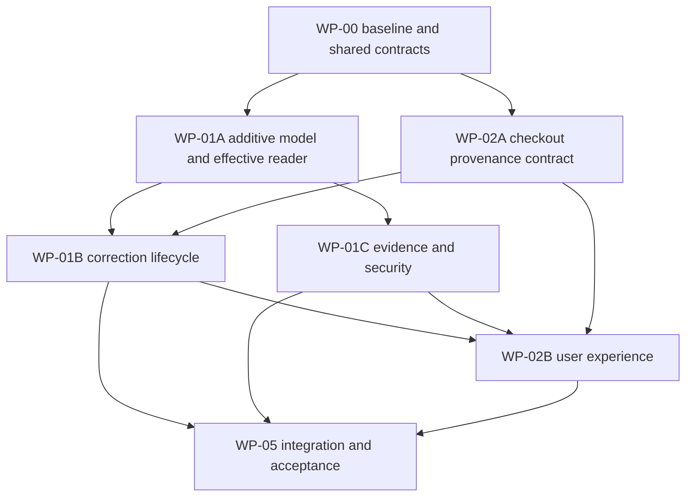

# V1 Flexible Attendance — Implementation Work Package Design

Date: 2026-11-05 (Asia/Jakarta). **Planning only. Implementation remains unauthorized.** This document creates no application capability, migration, test result, or deployment approval.

## 1. Authority, scope and evidence

Authority, in precedence order:

1. [Product Rules: Owner-authoritative freeze](product-rules-v1-flexible-attendance-shift-preference.md#owner-authoritative-freeze--2026-11-05), including unchanged baseline rules and the explicit G17 reservation.
2. [Implementation Blueprint: current contract](implementation-blueprint-v1-flexible-attendance-shift-preference.md#0-wp-01wp-02-documentation-freeze--2026-11-05). Historical proposals conflicting with its section 0 are superseded.
3. [Reconciled Gap Analysis](product-rules-v1-flexible-attendance-shift-preference-gap-analysis-2026-11-04.md). Historical counts are not present acceptance results.
4. [Trusted kiosk checkout freeze](trusted-kiosk-security.md#g02-checkout-freeze--2026-11-05). Its unrelated check-in and credential contracts remain intact.

The latest Implementation Readiness Audit is the preceding Codex response in this conversation, not a repository report file. Its conclusion was NOT READY, with reusable foundations, unresolved technical interfaces, unexecuted tests and a bounded G17 reservation. This design carries that assessment forward and cross-checks the relevant current source; it does not assume historical audit references prove current behavior.

Inspected repository: `/Users/aryaajisadda/Development/hadirinaja`, HEAD `3115ff9adb55fe80212b0f4a47fa8b094216ef57`. The dirty working tree, including untracked application files, is part of the inspected baseline; HEAD alone is insufficient to reproduce it. Pre-write inventory: 27,739 unique tracked/nonignored untracked paths; content/path digest `038bdbfcd1394d07ee4e1cef0537dfe8481a9acc816ba6e0bddfc8b578a860b9`; staged diff empty. Generated/rehearsal copies under `output/` are not application authority. No credentials, private configuration values or business records were inspected for this plan.

Evidence labels: **Verified** means static source observation; **Proposed** means future engineering design; **UNVERIFIED** means execution, deployed schema or runtime behavior was not established. All new names, fields and routes below are proposed unless explicitly called existing. No tests, builds, migrations, seeders or service operations were executed. Graphify guidance was considered; no existing graph was present, and generating graph artifacts would violate the one-document scope. Direct source inspection was used.

These seven packages implement the correction/cross-Outlet dependency slice of the wider Flexible Attendance and Shift Preference blueprint. They do not silently implement the separate Shift Preference module, full personal navigation redesign or every other V1 feature. WP-05 acceptance below is acceptance of this slice, not whole-V1 release approval.

## 2. Invariants and approved-rule traceability

| Rule | Frozen contract retained | Owning packages and acceptance |
| --- | --- | --- |
| G02 | Destination must be same-tenant with active Primary/Temporary assignment at server checkout time, allowed attendance mode and valid geofence for personal and kiosk. Kiosk destination derives from paired device. Fixed session Outlet, one active session, immutable destination provenance. | WP-02A A2.1–A2.5; WP-02B U2.1–U2.4; WP-05 I5.2 |
| G03 | Physical operations require assignment. Only Owner may approve an audited historical-assignment reconstruction exception. Never synthesize assignments, events or geofence evidence. | WP-01A A1.1; WP-01B B1.1–B1.3; WP-02A A2.1 |
| G08 | Owner may directly approve, including own Employee attendance. Revision/reversal preserve immutable history; only Owner approves reversal. Finalized periods require versioned re-finalization retaining old snapshots. | WP-01A A1.2–A1.4; WP-01B B1.4–B1.7; WP-05 I5.1/I5.3 |
| G10 | Reconstruction is one request for a completed claimed start/end interval. Still working: check in now, correct start, check out normally. | WP-01B B1.1/B1.2; WP-02B U2.2 |
| G12 | Work Date and actual Outlet timezone; inclusive end H+N; later historical/current policy deadline. Owner exempt. Supervisor out-of-window proposal needs Owner approval. | WP-01B B1.3; WP-02B U2.2; WP-05 I5.1 |
| G14 | Routine attachments optional, reasons/applicable approval mandatory; special review may need evidence. Private immutable JPEG/PNG/WebP/PDF, 5 MB/file, three/request. Owner retention 90 days–five years, default 365 days, holds protected. | WP-01C C1.1–C1.5; WP-05 I5.4 |
| G15 | Attendance Only; current effective attendance plus authorized immutable historical-finalization comparison. No payroll, historical rates, impact ledger or integration. | WP-01A A1.2–A1.4; WP-05 I5.3 |
| G17 | Current Supervisor authorization at historical Primary OR Actual Outlet for ordinary correction, one final decision, request-scoped disclosure. Exceptions and reversal approval Owner-only. | WP-01B B1.4/B1.6; WP-01C C1.2; WP-05 I5.5 |

**OPEN G17 reservation:** whether Checkout Destination independently qualifies as Actual Outlet for historical review. Do not infer that permission from G02. Store checkout provenance without adding destination-only review grants. Keep that authorization branch disabled/unimplemented until explicit Owner resolution. Ordinary historical Primary/Actual OR review can proceed independently. Unknown historical Primary stays unknown; never backfill it from today's assignment to manufacture access.

Legacy conflicts are engineering changes, not reopened product decisions: origin-only checkout; kiosk checkout without GPS; blanket Owner self-review ban; Primary AND Actual scope; start-only reconstruction; mandatory routine evidence; missing correction deadlines; historical wage dependencies. The frozen replacements above prevail.

## 3. Architecture to preserve and source ledger

Preserve `AttendanceService` as physical transaction owner, `EffectiveScheduleResolver` as effective schedule authority, `WeeklyPlannerService` as planner owner, `ApprovalWorkflowService` as approval foundation, and current idempotency/active-owner/append-only foundations. Add claim/effective-reader/evidence contracts around these owners; do not create a second physical attendance engine or third schedule engine.

Repository links below identify current symbols and entry lines. They are source evidence, not passing runtime tests.

| Ref | Existing component and verified observation |
| --- | --- |
| S01 | [AttendanceService::mutate](../backend/app/Services/AttendanceService.php#L279): durable operation processing and Employee locking; [performCheckIn](../backend/app/Services/AttendanceService.php#L386): assignment and actual Outlet snapshot; [performCheckOut](../backend/app/Services/AttendanceService.php#L469): origin kiosk restriction at 502, origin policy at 506, personal-only location at 521. |
| S02 | [AttendanceService::createEvent](../backend/app/Services/AttendanceService.php#L578): event Outlet follows session; [requestHash](../backend/app/Services/AttendanceService.php#L1099): existing canonical operation identity. [assignmentSnapshot](../backend/app/Services/AttendanceService.php#L940) records selected assignment, not a complete separate historical Primary contract. |
| S03 | [AttendanceController::personalCheckOut](../backend/app/Http/Controllers/Api/V1/AttendanceController.php#L101): no destination input; [kioskCheckOut](../backend/app/Http/Controllers/Api/V1/AttendanceController.php#L173): null location passed; [evidence](../backend/app/Http/Controllers/Api/V1/AttendanceController.php#L281): current session-based evidence authorization/audited serving. |
| S04 | [ApprovalWorkflowService::administrativeCorrection](../backend/app/Services/ApprovalWorkflowService.php#L76): Owner sensitive path and data-only operation hash; [decide](../backend/app/Services/ApprovalWorkflowService.php#L155): terminal replay before reviewer assertion, request then Employee locks; [prepareCorrection](../backend/app/Services/ApprovalWorkflowService.php#L647): session-based claim, fixed Jakarta future-time check. |
| S05 | [assertCorrectionCanBecomeEffective](../backend/app/Services/ApprovalWorkflowService.php#L740): basis checks, physical-checkout conflict and active-start restriction; [reconcileMissingCheckout](../backend/app/Services/ApprovalWorkflowService.php#L799): administrative closure without fake physical event; [assertNoOverlappingAttendance](../backend/app/Services/ApprovalWorkflowService.php#L831): session-based overlap reader. |
| S06 | [assertReviewer](../backend/app/Services/ApprovalWorkflowService.php#L974): self restrictions precede Owner bypass and changed Outlet requires both scopes; [canViewRequest](../backend/app/Services/ApprovalWorkflowService.php#L1006): current request visibility. [TenantAuthorization::canManageOutlet](../backend/app/Services/TenantAuthorization.php#L66): current role/Outlet authorization foundation. |
| S07 | [ApprovalWorkflowService::finalize](../backend/app/Services/ApprovalWorkflowService.php#L373): versioned snapshots and session-linked later-correction detection. Owner self-correction approval does not itself expand unrelated self-finalization permission. |
| S08 | [EffectiveAttendanceProjectionService::buildProjection](../backend/app/Services/EffectiveAttendanceProjectionService.php#L235): physical/session correction projection; [day review](../backend/app/Services/EffectiveAttendanceProjectionService.php#L315): absence precedence; [totals](../backend/app/Services/EffectiveAttendanceProjectionService.php#L413): session-based totals. |
| S09 | [AttendanceReportingService::shapeRows](../backend/app/Services/AttendanceReportingService.php#L196): session/request/finalization inclusion; [candidatePairs](../backend/app/Services/AttendanceReportingService.php#L348): source enumeration; [ReportingController::export](../backend/app/Http/Controllers/Api/V1/ReportingController.php#L62): CSV with session columns at 126; [AuditTrailQueryService](../backend/app/Services/AuditTrailQueryService.php#L65): typed audit sources. |
| S10 | [AttendancePolicyService::effective](../backend/app/Services/AttendancePolicyService.php#L87): dated policy merge; [SchedulingController policy validation](../backend/app/Http/Controllers/Api/V1/SchedulingController.php#L238): configured correction-window field. Configuration is not proof of correction deadline enforcement. |
| S11 | [AttendanceEvidenceStorage::prepare](../backend/app/Services/AttendanceEvidenceStorage.php#L25): physical photo image validation/normalization, not PDF attachments; [cleanup](../backend/app/Services/AttendanceEvidenceStorage.php#L148): physical evidence references; [AttendanceEvidenceExpirationService orphanCandidates](../backend/app/Services/AttendanceEvidenceExpirationService.php#L290): physical evidence namespace/reference scanning. |
| S12 | [Attendance tables](../backend/database/migrations/2026_10_23_000006_create_attendance_tables.php#L55): nonnull physical check-in, active ownership at 83, event composite session/Outlet FK at 122, event-bound evidence at 139. [Approval tables](../backend/database/migrations/2026_10_23_000007_create_approval_and_finalization_tables.php#L22): request/decision enums; session-required corrections at 83; versioned finalizations at 105. |
| S13 | [ApprovalRequest](../backend/app/Models/ApprovalRequest.php#L23), [AttendanceCorrection](../backend/app/Models/AttendanceCorrection.php#L31), [ApprovalDecision](../backend/app/Models/ApprovalDecision.php#L31): existing immutable payload/append-only model protections. These do not prove DB-level immutability for new tables. |
| S14 | [API routes](../backend/routes/api.php#L136): management corrections/approvals/finalizations/reports, personal writes at 157, requests at 169; kiosk checkout at 191. No existing complete reconstruction/reversal/comparison contract was established. [ApprovalController::submit](../backend/app/Http/Controllers/Api/V1/ApprovalController.php#L39) and [managementProjection](../backend/app/Http/Controllers/Api/V1/ApprovalController.php#L200): existing validation and broad-history scope checks. |
| S15 | [requests submit](../src/routes/requests.tsx#L244): correction requires session, browser time conversion, fresh UUID per submit; [session selector](../src/routes/requests.tsx#L572); [approvals correction UI](../src/routes/approvals.tsx#L848); [history component](../src/components/employee-attendance-history.tsx#L104): session-based display. |
| S16 | [attendance recovery](../src/routes/attendance.tsx#L587), [verification](../src/routes/attendance.tsx#L831), [pending checkout](../src/routes/attendance.tsx#L1617): existing recovery with nullable destination; [recovery types](../src/lib/attendance-photo-recovery.ts#L1): identity/payload persistence; [kiosk submit](../src/routes/kiosk.tsx#L402): existing photo/PIN flow without target checkout GPS. |
| S17 | [ApprovalWorkflowTest](../backend/tests/Feature/S5/ApprovalWorkflowTest.php#L134): physical preservation; missing checkout at 190; old self-review expectation at 317. [ApprovalConcurrencyTest](../backend/tests/Feature/S5/ApprovalConcurrencyTest.php#L44): decision/cancel races; competing corrections at 92; checkout/admin race at 113. Definitions only. |
| S18 | [AttendanceConcurrencyTest](../backend/tests/Feature/S4/AttendanceConcurrencyTest.php#L45), [GeofenceEnforcementTest](../backend/tests/Feature/S4/GeofenceEnforcementTest.php#L48), [WeeklyPlannerConcurrencyTest](../backend/tests/Feature/S3/WeeklyPlannerConcurrencyTest.php#L29), [frontend attendance tests](../src/routes/-attendance.test.tsx#L321), [kiosk tests](../src/routes/-kiosk.test.tsx#L1), [test DB guard](../backend/tests/TestCase.php#L10). Definitions inspected; no execution. |
| S19 | [EmployeeOutletAssignmentService](../backend/app/Services/EmployeeOutletAssignmentService.php#L22): Primary/Temporary history and Employee locking at 113; [WeeklyPlannerService lock order](../backend/app/Services/WeeklyPlannerService.php#L276): tenant/Outlet/Employee/week locks. Preserve published schedule authority; preferences must not become effective schedules. |

## 4. Shared contracts and dependency gates

### 4.1 Target data and effective-reader boundary

Proposed shared effective interval identity: tenant, Employee, source kind (`physical_session` or `reconstruction`), source/root ID, current effective revision/decision IDs, Work Date, original session Outlet if physical, historical Primary provenance, claimed/effective Actual Outlet, timestamps and completeness. Checkout Destination is a separate physical fact. Use source-kind discriminators rather than fabricated session IDs.

Physical facts remain immutable. Correction proposals and reconstruction revisions are immutable claims. Decisions and reversal events determine the surviving effective chain. A reversal targets an approved effect with expected basis; it is not a new `reversed` status written over the original request. Dependent amendments require explicit reconciliation; do not silently revive a superseded conflicting claim. Proposed technical rule: reject a reversal with unresolved dependent effects until their basis is reconciled, rather than invent cascade reversal behavior. WP-00 must make this deterministic in examples before writes are implemented.

Use half-open intervals `[start,end)` for overlap checks as recommended by the blueprint, with active physical sessions treated as open intervals rather than ending at query time. Serialize all attendance-affecting writers for the same tenant/Employee; lock relevant rows and re-evaluate effective intervals before commit. Adjacent intervals may touch. No reconstruction creates active ownership.

Current effective totals include each surviving physical/reconstruction source once. Physical actual totals remain physical-only. Separate physical, corrected-session and reconstruction presentation; combined effective duration must not add physical and corrected duration twice. Incomplete physical coverage produces an explicit incomplete indicator and unknown complete total; a separately named known-seconds subtotal may exist. Reconstruction-only days must enter history, report candidates, review and finalization. Preserve historical snapshot schema/version so comparison is reproducible.

### 4.2 Authorization and disclosure matrix

| Operation | Employee | Supervisor | Owner |
| --- | --- | --- | --- |
| Physical attendance | Own linked identity plus active assignment/mode/geofence | No management-role bypass | No management-role bypass |
| Submit correction/reconstruction | Own, within G12; complete reconstruction only | Currently scoped proposal; outside window requires Owner | Deadline exempt; reason/audit required |
| Ordinary final decision | No | Current historical Primary OR Actual scope; no Supervisor self-approval expansion | Direct/self approval allowed |
| Historical assignment exception | No | Cannot approve | Explicit exception approval only |
| Reversal approval | No | Cannot approve | Only Owner; expected basis and immutable audit |
| Cross-Outlet review detail/attachment | Own authorized request | Necessary request context only | Tenant-authorized context |
| General history/export/comparison | Existing authorized self scope | Existing authorized history scope; request access is not a blanket grant | Tenant-authorized scope |

Authorize every read, decision and operation-result replay using current membership/role/link/scope. Tenant-bind all roots, requests, Employee, Outlet, evidence and finalization version identifiers. Separate initiator, subject, proposer, decider and exception/reversal approver attribution. Use one shared request-scope policy for inbox, detail, evidence and comparison excerpts; do not loosen `managementProjection` globally. G17 destination-only remains excluded.

### 4.3 Dependency diagram and activation order

WP-02A's interface is agreed in WP-00, so WP-01A schema design does not wait for checkout implementation. WP-01A and WP-02A may then develop independently against that interface; checkout activation requires compatible effective/history/report readers. WP-01C may build against the WP-00 request/claim identity while lifecycle work proceeds, but upload activation waits for committed lifecycle ownership and authorization. WP-05 test design starts at WP-00; final execution/acceptance is last and separately authorized. No circular write dependency is required.

## 5. WP-00 — Implementation Baseline & Characterization

**Objective:** establish reproducible dirty-tree scope and concrete shared interfaces before any feature writes. Status: design proposed; implementation not authorized.

**Existing components:** S01–S19, the four authoritative documents, frontend recovery types, existing S4/S5 concurrency fixtures and database test guard. Preserve all user changes; do not substitute HEAD or generated `output/` copies for working application files.

**Proposed work:** inventory relevant tracked/untracked files and owners; record baseline behavior and contract examples; distinguish target-conflicting tests from regressions. Specify typed source IDs, provenance fields, finalization basis fingerprint, versioned operation payload, request-scoped capability and errors. Fix target identity in administrative idempotency hashing: session/root ID and operation kind must participate, not only body data (S04). Recheck authorization before replay, preserving identical-result semantics without leaking a revoked user's result.

Create a shared lock-order map across attendance, approval, assignment, planner, device and finalization writers. Existing physical Employee-first and approval request-first paths require reconciliation; do not introduce opposite ordering for new roots. Account for planner tenant/Outlet/Employee locking (S19). Choose a consistent ordered lock acquisition strategy and bounded deadlock retry policy; retries must re-evaluate current state and retain the same operation identity.

**Dependencies/migrations/API:** none applied. Produce reviewed interface examples for WP-01A/WP-02A, old/new checkout request compatibility, correction target discriminator, reversal dependencies, error semantics and timestamps. Use trusted server evaluation; distinguish originating Work Date from destination local checkout date. No client flag may select an authorization bypass.

**Acceptance and gate:**

- Z0.1: baseline manifest can reproduce the relevant dirty source; existing changes are attributed and preserved; staged state unchanged until separately authorized implementation.
- Z0.2: approved-rule examples cover own-Owner approval, Supervisor refusal, missing historical assignment, deadline boundaries, completed reconstruction, destination-only denied review and changed idempotency target.
- Z0.3: every reader/writer in S01–S19 is mapped to the new source/provenance contracts; lock order, migration compatibility, operation versions and reversal-chain examples are reviewable without inventing rules during coding.
- Z0.4: existing test definitions are mapped to retain/update/add; no claim of passed execution. G17 destination-only is isolated as blocked, not folded into default Actual scope.

**Risks/recovery/rollback:** dirty baseline drift and obsolete assertions are high risks. Re-inspect changed dependencies before implementation; pause only affected package if baseline drifts. WP-00 has no runtime rollback; keep characterization records and do not reset the tree. Completion requires engineering review of these contracts, not Owner reopening of already approved rules.

## 6. WP-01A — Data Model & Effective Reader

**Objective:** establish additive storage and make all effective readers reconstruction/reversal-aware before enabling new claims.

**Existing components:** S07–S09/S12–S14; `EffectiveAttendanceProjectionService`, `AttendanceReportingService`, finalization snapshots and `AuditTrailQueryService`. Keep physical tables and immutable correction foundation intact.

**Proposed changes:** introduce tenant/Employee-bound reconstruction roots and immutable claim revisions linked to one approval request each; retain session corrections as existing physical targets. Add append-only effect/reversal linkage sufficient to identify approved basis and dependency edges. A common effective-source reader merges surviving claims with physical sessions, and is used for overlap validation, projection, report candidates, totals, review and finalization. No nullable synthetic physical check-in and no fake physical session.

Add historical Primary provenance with explicit known/unknown status; Actual and destination remain separate. Legacy rows retain unavailable provenance rather than receiving guessed values. Add finalization source fingerprint/schema version and authorized version-list/comparison reads. Keep old snapshots intact; mark current attendance basis changed without mutating prior snapshots or auto-finalizing a new outcome. Resolve absence precedence so a prior absence snapshot cannot suppress newly approved effective attendance (S08).

**Migration/API implications:** new additive root/claim/effect tables, tenant-scoped composite FKs and uniqueness per request/revision; indexes for tenant/Employee/date and decision basis. Existing correction/session FKs stay valid. Prefer new effect records over extending the existing decision enum destructively. Verify exact DDL/index compatibility against the actual target engine in a separately authorized disposable environment; no deployed schema is assumed. Add typed effective intervals, completeness/totals, provenance and basis fields to responses. Comparison endpoint/path and snapshot-version format are proposed, not existing.

**Dependencies/order:** WP-00 contract gate; WP-02A provenance interface agreed before DDL finalization. Reader support and response compatibility must land before WP-01B reconstruction writes. Update all S09 candidate/export paths, not only the personal projection.

**Acceptance and gate:**

- A1.1: physical-only fixtures are unchanged; reconstruction-only day appears without physical events/session/active owner; tenant-mismatched joins are rejected; unknown provenance remains unknown.
- A1.2: pending/rejected/cancelled claims do not affect totals; approved surviving revision counted once; reversal and dependency conflicts resolve deterministically; overlapping sources cannot become effective together.
- A1.3: all history, review, dashboard, report/CSV and finalization consumers include claim-only attendance; incomplete physical duration remains explicit; original/effective timestamps distinguishable.
- A1.4: old finalization snapshots remain byte/logically unchanged; current basis differs after effective changes; authorized comparison identifies source/version changes and excludes unrelated Employee history; no payroll fields/dependency introduced.
- A1.5: additive migration forward/compatibility/recovery plan and response fixtures reviewed; writes stay unavailable until capable readers and WP-01B/WP-01C gates pass.

**Regression risks:** dropped claim-only days, duplicate totals, absence precedence, CSV consumers expecting session IDs, old app readers hiding accepted claims. **Recovery/rollback:** disable new writers while keeping capable readers and stored decisions; do not drop accepted claims or deploy a reader that omits them. Additive schema can remain dormant. No destructive down migration after data creation; repair by reviewed additive migration or audited lifecycle action.

## 7. WP-02A — Outlet Provenance & Checkout Contract

**Objective:** implement G02 within the current physical engine without session transfer or expanded review permissions.

**Existing components:** S01–S03/S10/S12/S16/S18/S19, current active ownership and event uniqueness, kiosk credential middleware/device revalidation, existing assignment service. Preserve original check-in, session Outlet, Work Date, schedule snapshot, PIN/photo and credential lease controls.

**Proposed backend changes:** personal checkout accepts explicit destination; kiosk derives it from authenticated paired device and rejects spoofed selection. At trusted checkout time recheck tenant, active Primary/Temporary assignment, destination-local policy/mode, actual GPS/geofence and current device authorization under the shared locks. Rejections persist/recover according to existing operation semantics without attendance/evidence side effects. Do not change unrelated kiosk check-in behavior.

Snapshot historical Primary at check-in separately from selected Actual assignment. Store immutable checkout destination/context: assignment identity/type/validity, policy version/mode/timezone, location verdict/evidence references, device/channel/actor and trusted timestamp. Keep event `outlet_id` equal to session Outlet to preserve composite FK; add separate checkout fields rather than repointing it. Classification must expose cross-Outlet context for review without changing session attribution, splitting duration, or inferring historical-review permission.

**Migration/API implications:** additive nullable event destination FK/context with same-tenant constraint; legacy context explicitly unavailable. Prefer required destination for new personal operation version, derived destination for kiosk; both carry location. Canonical hash/recovery payload includes destination and contract version. Define upgrade behavior for old in-flight null-destination operations: identify/recover their original result without falsely marking destination verified; never silently convert an old uncertain operation into a new checkout. Current routes remain usable through deliberate version compatibility, not arbitrary interpretation of missing fields.

**Dependencies/order:** WP-00; WP-01A shared readers before activation. Lock and idempotency contracts precede service/controller changes; API/recovery types precede frontend activation. No dependency on unresolved destination-only G17 permission.

**Acceptance and gate:**

- A2.1: same-Outlet and assigned cross-Outlet checkout work for personal/kiosk; no assignment, expired/not-yet-active assignment, foreign tenant, invalid mode/geofence, missing/denied GPS and revoked/expired device fail closed. No Owner physical bypass.
- A2.2: kiosk cannot select another destination; paired destination is validated as location rather than assumed geofence evidence. Unrelated kiosk check-in remains characterized.
- A2.3: one session/owner closes once; original Outlet/Work Date/schedule/check-in preserved; destination and historical Primary stay separate through midnight/timezone differences, projections, export and audit.
- A2.4: duplicate identical key replays original authorized result; changed destination/target/payload conflicts; uncertain recovery is identity/tenant/Employee/version bound; no new operation until resolved.
- A2.5: assignment revocation/policy change/device renewal races are serialized/revalidated; checkout versus approved missing-checkout resolution yields one closure. Destination alone grants no review/history access.

**Risks:** accidentally weakening kiosk trust, misattributing session duration, destination-policy/origin-schedule confusion, stale recovery replay. **Rollback:** stop new-version writes, preserve terminal operation/event records and capable readers; reconcile uncertain operations before fallback. Do not erase destination evidence, transfer session or relax geofence to recover availability. Completion requires schema/API/readers plus target acceptance evidence under separate implementation authorization.

## 8. WP-01B — Correction Lifecycle

**Objective:** support complete reconstruction, active-start correction, immutable revision/reversal, correct deadlines and one authorized final decision.

**Existing components:** S04–S08/S10/S13–S15/S17, administrative missing-checkout resolution and request cancellation. Extend `ApprovalWorkflowService`; preserve recorded physical events and existing approval request identity.

**Proposed workflows and states:**

| Flow | Transition/effect |
| --- | --- |
| Employee reconstruction | Completed start/end + reason + claimed Actual Outlet/Work Date → submitted/pending → approved/rejected/cancelled. Approval alone introduces effective interval; no physical session/event. |
| Still working after missed check-in | Actual current-time physical check-in → start correction request → normal checkout. Effective start may change while ownership stays active; never fabricate end. |
| Missed checkout | Existing correction path → approved administrative resolution; retain original physical events and reconcile owner once. |
| Owner direct/self correction | Submission and applicable decision atomically recorded; bypass only old Owner self-review prohibition, not conflict/tenant/audit validation. |
| Revision | New immutable request against expected effective basis; rejected/cancelled amendment leaves previous effective effect unchanged. |
| Reversal | New immutable targeted reversal decision approved only by Owner; expected basis/dependencies checked; original request/approval retained. |
| Finalized day changes | Mark effective basis changed → authorized reviewed re-finalization creates next version; earlier snapshots remain accessible under scope. |

**Backend changes:** introduce shared eligibility evaluator using Work Date/actual Outlet timezone and historical/current policy cutoffs. Compare inclusive deadlines at trusted submission time and persist policy basis/cutoff; exact authorized replay preserves already recorded result. Do not use browser time or fixed Jakarta checks for all Outlets. Owner exemption and Supervisor outside-window escalation are server-selected authorization branches. Validate historical assignment or explicit Owner exception for reconstruction; never manufacture evidence of presence.

Implement current historical Primary OR Actual authorization across inbox/detail/decision/result retrieval, with Owner self-approval preceding only the legacy self restriction. Supervisor self approval stays forbidden. Revalidate expected basis, complete interval and overlaps under common Employee serialization. Active-start approval must preserve a physical checkout arriving while pending; conflict/rebase requires explicit new basis, not overwriting original facts. Protect one final decision using transaction state/uniqueness and bind idempotency to target IDs and operation kind.

**Migration/API implications:** WP-01A root/claim/effect storage; typed target discriminator, expected basis, Work Date, actual Outlet, claimed start/end, reason and exception context. Proposed separate personal/management reconstruction routes, revision command and Owner reversal command; extend existing physical correction endpoint compatibly. Use explicit errors for stale basis, overlap, deadline, denied scope and unresolved dependent reversal. No status-reset reversal API. Expose server eligibility/cutoff and effective source IDs. API paths/error codes require WP-00 contract review, not product reapproval.

**Dependencies:** WP-01A reader gate + WP-02A provenance contract; WP-01C security before any attachment-enabled correction activation. Optional attachments do not mean mandatory evidence for ordinary claims. Special-review evidence requirements must be represented as explicit review context, not a new blanket requirement.

**Acceptance and gate:**

- B1.1: complete reconstruction needs both endpoints, valid order, reason and applicable approval; no partial active reconstruction; historical assignment exception only Owner and fully attributed.
- B1.2: active physical start-only correction remains active; normal checkout fact survives either race outcome; missing-checkout approval closes ownership once without fake event.
- B1.3: deadline tests include before/exact/after cutoff, H+0, overnight/local midnight, policy expansion/contraction and later cutoff, changed Work Date/Outlet basis, authorized retry after cutoff, Owner exemption and Supervisor escalation.
- B1.4: Owner direct/self approval succeeds; Supervisor self/foreign tenant/revoked scope fail; Primary-only or Actual-only current Supervisor can decide ordinary request; two concurrent reviewers produce one final decision.
- B1.5: rejected/cancelled revision leaves prior effect intact; stale revision/reversal conflicts; Owner reversal preserves immutable history, dependencies and source attribution; Supervisor cannot approve reversal.
- B1.6: request-scoped reviewer can read necessary claim context but cannot use it to enumerate history/export/other evidence/comparison; replay after revocation discloses no result. Destination-only permission remains reserved.
- B1.7: reconstructed/corrected/reversed finalized day requires new reviewed finalization version; prior snapshot retained; no auto-finalization or new self-finalization permission inferred.

**Risks:** lock inversion, broadening Owner bypass, stale claims overriding checkout, duplicate effect roots, legacy tests enforcing superseded rules. **Recovery/rollback:** reject stale effects and require explicit re-proposal; retain terminal decisions and expose trustworthy current basis. Disable new writes before reverting UI; keep effective readers. Correct accepted mistakes through new revision/Owner reversal, never mutation/deletion. Gate requires deterministic reversal examples, scoped policy and race verification.

## 9. WP-01C — Correction Evidence & Security

**Objective:** provide optional, private immutable request evidence with approved limits, retention and holds without changing physical-photo semantics.

**Existing components:** S03/S06/S11/S13 plus existing evidence legal-hold reader/service and expiration audit patterns. Physical photo processing normalizes images and has event bindings; it does not provide the correction PDF/request contract.

**Proposed changes:** separate correction attachment storage namespace and metadata/binding from physical photo evidence. Store immutable digest/content identity, detected MIME, byte count, tenant/request/claim ownership, uploader/time and retention policy basis; no public path or client-selected filesystem key. Reject executable/spoofed content, invalid formats and over-limit files at the boundary; PDFs should be served safely as authorized downloads without inline active-content execution. Choose and document safe content validation using installed capabilities before enabling uploads; do not claim antivirus capability exists.

Bind at most three files transactionally to a request; retries cannot multiply bindings. Recommend staging validated bytes then atomically committing metadata/request bindings; cleanup only unreferenced expired staging records. Failed DB/storage commit leaves no usable partial request evidence; reconciliation handles crashes without deleting referenced objects. Do not feed correction attachments into physical-only orphan deletion scans (S11).

Use one shared request-scoped authorization for list/view/download and audit denied access without exposing filenames/content across tenants. Audit upload/read/download/expiry/hold events; immutable metadata/tombstone survives authorized byte expiry. Owner-configurable retention validates 90-day minimum, 365-day default, five-year maximum. Explicit retention-basis timestamps and policy-change handling must be pinned in the engineering contract; do not silently shorten protected existing retention or release a hold. Hold acquisition/release and expiration recheck share locking so a committed hold prevents deletion; failures retry safely with audited outcome.

**Migration/API implications:** additive request-evidence metadata, binding, audit and hold linkage with composite tenant FKs; separate retention settings if existing policy cannot represent G14. Proposed authenticated upload/bind/read/download and Owner retention/hold operations; reject fourth file even under parallel upload. No change to existing physical camera photo requirement or its accepted formats. No broad evidence endpoint grant by Outlet destination.

**Dependencies:** WP-00 request identity/retention engineering details, WP-01A storage identities and WP-01B policy/lifecycle interface. Attachment activation requires lifecycle ownership and review authorization. Evidence is optional for routine reconstruction; special-review requirement handling must not invent mandatory routine attachments.

**Acceptance and gate:**

- C1.1: zero attachments accepted for routine requests; valid JPEG/PNG/WebP/PDF accepted up to inclusive 5 MB/file and three/request; malformed/spoofed/oversize/fourth rejected, including concurrent attempts.
- C1.2: foreign tenant/Employee/request, revoked reviewer, guessed object ID and destination-only reviewer cannot read bytes/metadata; authorized scoped reads audited; no public URL.
- C1.3: repeated upload/submit key cannot duplicate bindings; immutable digest/ownership cannot be rewritten; crash/retry/orphan recovery preserves referenced files and avoids physical-cleaner collision.
- C1.4: min/default/max retention validated; expired bytes removed only without active hold; metadata/audit retained; hold versus expiry race cannot delete protected bytes. Changes cannot silently shorten existing protected retention.
- C1.5: unavailable storage/validation/audit fails safely with actionable retry/recovery and no fabricated evidence; special review evidence state is explicit. Retention implementation details and safe PDF serving reviewed before activation.

**Risks:** unauthorized downloads, orphan cleaner loss, policy shortening, file-count races, PDF abuse and upload/decision partial commit. **Rollback:** disable uploads/expiry workers affecting new namespace while preserving authorized reads/holds; do not delete accepted bindings or release holds to simplify rollback. Keep failed expiry retryable and tombstones durable. Completion gate includes storage failure and hold-concurrency evidence, not only upload happy path.

## 10. WP-02B — Cross-Outlet User Experience

**Objective:** expose the new physical/correction contracts with clear identity, provenance and recoverable state, using current frontend architecture.

**Existing components:** S15/S16, `src/lib/api.ts`, attendance verification/confirmation, request and approval screens, history block, reports and existing shadcn/Base UI wrappers. Future component work must follow repository shadcn instructions, semantic typography, accessibility and UI-kit catalog/demo requirements; this plan creates no components.

**Proposed changes:** personal checkout chooses only server-returned eligible destinations and shows fixed session origin separately; server remains authoritative if eligibility changes. Kiosk has no arbitrary Outlet selector and collects checkout GPS while preserving device/PIN/photo flow. Show destination policy/geofence errors clearly. Capture destination/version in persisted recovery identity so changing Employee/tenant/destination cannot reuse old photos or operations.

State model: loading server state → ready/verification loading → GPS/camera ready or actionable denial → manual photo/retake → confirmation → submitting → confirmed/rejected/uncertain. Uncertain state reconciles the original operation before another submission; no fresh UUID on blind retry. Confirmations display destination, origin, server eligibility and original/effective distinction; final timestamps come from server. No false success from client time.

Requests distinguish existing-session correction, completed reconstruction and still-working guidance. Provide server cutoff/timezone, reason, optional attachments, pending/rejected/stale-basis and upload recovery states. Review screen shows frozen Primary/Actual provenance, relevant current authorization, exception/reversal restrictions and only necessary request context. History/report rows identify reconstruction source without session links; finalization comparison is authorized and labels immutable snapshot versions versus current effective attendance.

**Migration/API implications:** no independent DB changes; typed client adapters for WP-01A/WP-02A/WP-01B/WP-01C APIs and versioned local recovery metadata. Define legacy pending-operation migration/read path without deleting an uncertain transaction or resubmitting automatically. New reusable components require `src/components/ui-kit/catalog.ts` and matching section demos during future implementation; route-only pages are not UI-kit entries.

**Dependencies:** all backend contract gates; UI prototypes can use agreed response fixtures before writes activate. Do not enable destination-only review UI/permissions or unrelated full navigation redesign under this package.

**Acceptance and gate:**

- U2.1: personal destination selection constrained by server; kiosk destination fixed; GPS/camera loading/denial/retake/confirmation states accessible on supported devices; server rejections preserve recoverable context.
- U2.2: complete reconstruction and actual-time check-in guidance distinct; effective correction never appears as a fabricated physical check-in; deadline/optional evidence/Owner escalation correctly represented.
- U2.3: lost response, refresh, identity/tenant switch, expired device and changed destination reconcile original operation safely; no duplicate request/photo/checkout on retry.
- U2.4: session origin/Primary/Actual/destination labels remain distinct; reconstruction-only history visible; review disclosure and comparison stay scoped; G17 destination-only access absent.

**Risks:** stale eligible lists, local timezone conversion, legacy IndexedDB payloads, private evidence cache leakage, UI success before server confirmation. **Rollback:** hide new submission entry points while retaining recovery/read access; do not clear pending stores blindly. Preserve server/client version compatibility. Gate requires frontend fixtures plus separately authorized real-device acceptance, not component screenshots alone.

## 11. WP-05 — Integration & Acceptance

**Objective:** verify the integrated slice under regression, authorization, concurrency and device failures before any activation/release recommendation.

**Existing components:** S17/S18, S3 planner publication races, S4 engine/geofence/photo recovery, S5 approval/finalization tests and frontend attendance/kiosk tests. Reuse safe DB guards and independent-process race harnesses; do not run them against shared development/business data. Test execution and any disposable database preparation require separate implementation/verification authorization.

**Proposed work:** extend focused suites with source-kind fixtures and deterministic race barriers; update only assertions superseded by G02/G08/G17, preserving Supervisor restrictions and physical invariants. Audit tests that previously required origin-only kiosk checkout or universally denied self-review. Include API response/CSV compatibility and source fingerprints, not only service-level tests. Record tested engine/browser/device, contract version, schema version and skipped checks.

**Acceptance and completion gate:**

- I5.1: Z0/A1/B1 criteria pass with tenant/link/role adversarial cases, deadline boundaries, duplicate/stale basis and current authorization on replay. All mutation outcomes have immutable attributed audit.
- I5.2: A2/U2 pass; independent-process checkout/check-in, assignment change, device renewal/revoke and administrative closure races preserve one active session/one closure and destination validation.
- I5.3: physical plus reconstruction plus revisions/reversal/finalization produces matching current history, dashboard, reports/CSV and version comparison without duplicate/omitted totals; old snapshots remain immutable. No payroll dependency.
- I5.4: C1 passes for validation, optional attachments, storage/DB failure, cleanup, hold/expiry and count races; no cross-tenant/request leakage.
- I5.5: historical Primary-only and Actual-only review succeed under current authority; out-of-scope/self-Supervisor/revoked/foreign tenant/general-history escalation fail. Destination-only branch remains excluded and explicitly reported blocked pending Owner decision.
- I5.6: real-device personal/kiosk GPS accuracy/permission denial, camera permission/retake, network loss, refresh, overnight checkout and server-confirmed timestamps accepted. Synthetic tests do not substitute for device evidence.
- I5.7: reviewed additive migration rehearsal, old/new operation compatibility and write-disable recovery demonstrated in an authorized isolated environment; no destructive rollback or discarded claims. All package criteria have evidence or explicit blocking status; no unverified critical criterion marked PASS.

**Dependencies:** WP-00 test design first; final acceptance after all upstream completion gates. **Migration/API:** no new product schema/API; verify the complete compatibility inventory below. **Risks/rollback:** false confidence from sequential tests or shared fixtures, unsafe test DB identity, omitted legacy clients. Stop activation on integrity/security failure; preserve evidence and data. A failure blocks the affected release path; never bypass a guard or change approved rules to make acceptance pass.

## 12. Consolidated implementation inventory

| Surface | Proposed change | Owner / dependent consumers | Activation gate |
| --- | --- | --- | --- |
| Reconstruction roots/claims | New append-only tenant/Employee sources, request binding, basis/dependency identity | WP-01A; WP-01B, reports, finalization | Effective readers complete |
| Effect/reversal records | Targeted immutable Owner reversal, unique revision/application constraints | WP-01A/WP-01B; overlap/comparison | Deterministic dependency handling and race tests |
| Primary/destination provenance | Separate frozen Primary and checkout destination/context, nullable legacy unknown | WP-02A; WP-01A/readers/UI | Composite-FK and old-operation compatibility |
| Finalization basis/version | Preserve snapshot; add source fingerprint/schema version and current staleness | WP-01A/WP-01B; reporting/UI | Authorized comparison and re-finalization |
| Correction evidence | New private namespace, metadata/bindings/audit/holds/retention | WP-01C; requests/review | Lifecycle authorization and cleanup isolation |
| Physical checkout API | Explicit personal destination; derived kiosk destination; location and operation version | WP-02A; attendance/kiosk/recovery | Backend/device/current-assignment checks |
| Claim commands | Reconstruction, revision, Owner reversal; target/expected-basis/idempotency | WP-01B; requests/approvals | Readers, scoped policy and conflicts |
| Eligibility/read APIs | Server deadlines/capabilities, typed sources/provenance, scoped request detail | WP-01A/WP-01B; UI/reporting | No general-history privilege expansion |
| Evidence API | Authenticated upload/bind/read, Owner retention/hold management | WP-01C; requests/approvals | Limits, safe serving and holds |
| Comparison API | Authorized immutable version list/comparison with current basis | WP-01A; reporting/history | Request excerpts distinct from general history |
| Frontend recovery | Destination/version/identity-bound durable payload; legacy reconciliation | WP-02B; physical/claim operations | Uncertain-result and upgrade tests |

Exact new table/route names and DDL are engineering deliverables at WP-00/WP-01A, not claims about present implementation. Prefer additive columns/tables and versioned DTOs over editing historical migrations or removing existing response fields. New write paths cannot activate until every identified reader accepts their source kind. No runtime feature flag is assumed to exist; choose an explicit activation mechanism under later authorization.

## 13. Blockers, decisions and status

| Item | Classification | Resolution / dependency |
| --- | --- | --- |
| G17 destination-only historical review meaning | **BLOCKED product boundary** | Owner decision needed only for that isolated permission branch; G02 checkout proceeds without granting it. |
| Reversal dependency/effective-chain examples, lock order, API/version contracts | **PARTIAL technical design** | WP-00 engineering contracts, then WP-01A/WP-01B verification; no new product rule inferred. |
| Concrete additive DDL, target-engine support and legacy-operation compatibility | **UNVERIFIED** | WP-01A/WP-02A migration review/rehearsal after separate authorization. |
| Evidence retention-basis/policy-change details and safe PDF validation/serving | **PARTIAL technical design** | WP-00/WP-01C pin conservative implementation consistent with G14; if a choice changes product-visible rights/retention, obtain Owner clarification rather than silently decide. |
| Special-review evidence trigger semantics | **UNVERIFIED beyond frozen rule** | Represent explicit requirement context; do not invent automatic triggers. Escalate a concrete product ambiguity if required for activation. |
| Source gaps versus target contracts | **FAIL implementation completeness** | Packages above implement missing capabilities; absence is not authorization to implement now. |
| Test/runtime/device/deployed-schema evidence | **UNVERIFIED** | WP-05 under separately authorized isolated verification. |

No approved G02/G03/G08/G10/G12/G14/G15/G17 decision is reopened. Other wider-V1 decisions, including Shift Preference lifecycle, Extreme Late policy details and special closures, remain governed by the original blueprint; they are not invented or resolved here. Shift Preference submission/ranking/unavailability and Weekly Planner integration need their own work-package authorization/design continuation. Published schedules remain authoritative; drafts/preferences never directly drive attendance.

Out of scope: source implementation, executing tests/builds/migrations, modifying existing docs/configuration/runtime, Git history changes, deployment, payroll/rates/impact ledgers, multi-location sessions, automatic transfers, new attendance grants, replacing proven services, and activating the reserved G17 branch.

**Planning completion gate:** all seven package definitions, source references, dependency edges, acceptance IDs, failure/recovery and rollback constraints are present. **Implementation readiness remains NOT READY; runtime verification remains UNVERIFIED.** This planning document is not permission to code, migrate, execute tests or deploy. Stop after document verification and wait for explicit Owner implementation authorization.
