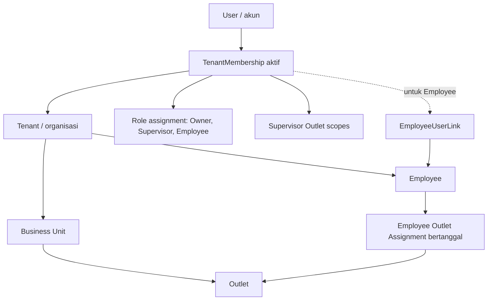

# HadirinAja — Product Discovery & Design Handoff

**Tujuan:** referensi implementasi aktual untuk perbaikan navigasi, information architecture, komponen bersama, dan struktur responsif di Pen.  
**Mode:** discovery read-only; dokumen ini bukan spesifikasi perubahan yang sudah disetujui.  
**Tanggal:** 26 Oktober 2026  
**Sumber utama:** working tree `/Users/aryaajisadda/Development/hadirinaja`.

## Ringkasan eksekutif

HadirinAja saat ini memiliki dua ruang pengalaman utama: ruang manajemen untuk Owner/Supervisor dan ruang karyawan untuk Employee. Pengguna masuk melalui akun, lalu bekerja di tenant aktif. Struktur organisasi terlihat sebagai Tenant → Business Unit → Outlet, sementara Employee adalah entitas tenant yang memperoleh penempatan Outlet melalui assignment bertanggal. Akun dan profil Employee terhubung melalui relasi tersendiri.

Menu manajemen mencakup workspace organisasi, akses pengguna, jadwal dan kebijakan, persetujuan, laporan, serta audit. Employee menggunakan attendance, jadwal pribadi, dan requests. Kiosk berdiri sebagai layar mandiri yang memerlukan pairing perangkat serta PIN Employee. `/reports` adalah dashboard operasional aktual. `/dashboard-1`, `/dashboard-2`, dan `/dashboard-3` adalah demo yang tertaut dari UI Kit, bukan dashboard operasional.

Implementasi mempunyai banyak aturan produk yang harus tetap terlihat di desain: lingkup Supervisor ditentukan per Outlet; izin akses backend tetap menjadi otoritas; koreksi tidak menghapus catatan asli; jadwal/kebijakan memiliki tanggal berlaku dan riwayat; tanggal laporan memakai semantik zona waktu berbeda antara work date Outlet dan audit UTC; attendance memiliki alur idempotensi dan pemulihan ketika hasil server belum pasti.

Temuan UX prioritas adalah perbedaan nama untuk tujuan navigasi yang sama, jalur mobile Owner yang menyebut halaman laporan detail sebagai “Team”, halaman Scheduling yang menyatukan empat area operasional yang berbeda, dan perbedaan konteks tanggal pada laporan. Semua ini adalah rekomendasi berbasis sumber, bukan klaim bahwa alur bisnis salah. Detail yang membutuhkan keputusan Owner dicatat di bagian akhir.

## Cakupan, metode, dan batas bukti

- Pemeriksaan dilakukan pada working tree saat ini, bukan hanya Git HEAD. Saat discovery dimulai, branch `main` berada di `3115ff9` dan `git status --short` menunjukkan 109 entri perubahan/untracked yang sudah ada. Perubahan itu dipertahankan.
- Source inspection meliputi route tree, halaman React, shell navigasi, komponen bersama, API client, Laravel routes/controllers/services/models, serta validasi dan permission yang relevan.
- `php artisan route:list --path=api/v1 --json` dipakai untuk inventaris API. Endpoint health lokal terbaca `200`; frontend `http://localhost:3000/` juga merespons `200`.
- Satu inspeksi browser menggunakan context Playwright baru dan fixture sintetis. Pemblokiran/mocking semua API dipasang **sebelum** membuka `/workspace`; metode mutasi diblokir dan seluruh `/api/v1/**` ditangani oleh fixture. Tidak ada permintaan browser yang mencapai backend. Workspace dirender pada 1440×900 dan 390×844; lebar dokumen mobile tetap 390 px. Temuan ini membuktikan rendering halaman Workspace dengan fixture, bukan isi atau perilaku akun nyata.
- Halaman Approvals yang terautentikasi tidak dibuka. `src/routes/approvals.tsx` memanggil `POST /management/attendance/reviews/discover` pada mount; endpoint ini dapat menghasilkan perubahan review. Halaman lain juga tidak diuji dengan akun nyata.
- GET export CSV dan GET bukti attendance sama-sama mencatat event audit. Keduanya tidak dipanggil selama discovery.
- Tidak ada perubahan source, Pen, backend, atau database. Tidak ada test suite, build, migration, seed, deployment, atau cleanup yang dijalankan.

### Label bukti dan keyakinan

| Label | Makna |
|---|---|
| **SOURCE VERIFIED** | Terlihat langsung pada working tree: route, handler, controller/service, validator, model, atau menu. Keyakinan tinggi untuk perilaku yang dinyatakan kode; hasil runtime tetap dapat bergantung pada konfigurasi. |
| **SYNTHETIC RUNTIME VERIFIED** | UI dirender di browser dengan respons API sintetis; bukan data atau backend runtime yang nyata. |
| **INFERENCE / RECOMMENDATION** | Kesimpulan UX dari fakta implementasi; perlu ditimbang Owner. |
| **NOT VERIFIED** | Tidak diperiksa secara runtime atau memerlukan keputusan bisnis/configuration untuk memastikan. |

Status `implemented` di dokumen ini berarti UI/API tersedia dalam source saat diperiksa. Status itu tidak berarti semua alur mutasi berhasil diuji.

## 1. Arsitektur produk dan model akses

### 1.1 Hubungan tenant dan identitas

**Fakta implementasi:** Tenant memiliki Business Units, Outlets, Employees, dan Memberships. Business Unit memiliki Outlets. Employee adalah entitas tenant dan menyimpan riwayat assignment ke Outlet dengan `effective_from`/`effective_until`; assignment primary aktif dipakai untuk menurunkan Business Unit/Outlet yang ditampilkan. Membership akun Employee terhubung ke profil melalui `EmployeeUserLink`. Jadi hierarki pada layar dapat disajikan Tenant → BU → Outlet → Employee, tetapi model akses tidak menjadikan akun, profil, dan penempatan sebagai satu objek atau satu relasi sederhana. [Tenant](../backend/app/Models/Tenant.php#L9-L30), [BusinessUnit](../backend/app/Models/BusinessUnit.php#L10-L18), [Outlet](../backend/app/Models/Outlet.php#L11-L29), [Employee](../backend/app/Models/Employee.php#L11-L24), [assignment](../backend/app/Models/EmployeeOutletAssignment.php#L11-L33), [employee link](../backend/app/Models/EmployeeUserLink.php#L10-L23), [payload penempatan aktif](../backend/app/Http/Controllers/Api/V1/ManagementController.php#L190-L203).

**SOURCE VERIFIED · Keyakinan tinggi.** Supervisor scopes menunjuk ke Outlet. Employee yang dapat dikelola Supervisor harus memiliki assignment efektif pada Outlet yang tercakup. Untuk Employee, API hanya mengembalikan profil yang terhubung dengan membership aktif. [TenantAuthorization](../backend/app/Services/TenantAuthorization.php#L20-L32) · [cakupan Outlet/Employee](../backend/app/Services/TenantAuthorization.php#L66-L112) · [daftar Employee menurut role](../backend/app/Services/TenantAuthorization.php#L169-L207).

### 1.2 Matriks capability role

| Role | Data yang dapat dilihat | Aksi dan batas akses | Status bukti |
|---|---|---|---|
| **Owner** | Semua BU/Outlet/Employee dalam tenant aktif; summary, roster, akses, kiosk, jadwal, approvals, laporan, dan audit. | Membuat/mengubah BU, Outlet, Employee dan placement; mengelola undangan, membership, employee link, serta Supervisor scope; menerbitkan kode pairing kiosk dan PIN; mengelola jadwal, template, kebijakan dan kalender; memutus request jika lolos aturan reviewer; laporan seluruh tenant. Legal hold tersedia melalui API Owner. Pembuatan Owner lain tidak tersedia di form undangan yang ada: undangan hanya `employee` atau `supervisor`. | **SOURCE VERIFIED.** [Access controller](../backend/app/Http/Controllers/Api/V1/AccessManagementController.php#L59-L82), [Management controller](../backend/app/Http/Controllers/Api/V1/ManagementController.php#L86-L109), [Scheduling capabilities](../backend/app/Http/Controllers/Api/V1/SchedulingController.php#L50-L97), [legal hold owner actions](../backend/app/Services/AttendanceEvidenceLegalHoldService.php#L98-L120). |
| **Supervisor** | BU/Outlet dan Employee yang berada dalam lingkup Outlet yang diotorisasi; jadwal, laporan dan queue sesuai cakupan. | Dapat mengelola jadwal dalam lingkupnya, melihat kebijakan, laporan dan request. Tidak mendapat halaman `/access` dan tidak dapat mengubah BU/Outlet/Employee atau policy/template/calendar. Dapat mengajukan legal hold di lingkup Outlet lewat API; Owner memutus permintaan. Reviewer harus bukan pemohon dan tidak boleh memutus kasus identitas Employee-nya sendiri. | **SOURCE VERIFIED.** [Scheduling capabilities](../backend/app/Http/Controllers/Api/V1/SchedulingController.php#L56-L87), [reviewer guard](../backend/app/Services/ApprovalWorkflowService.php#L974-L1004), [legal hold scope](../backend/app/Services/AttendanceEvidenceLegalHoldService.php#L477-L488) · [Owner decision](../backend/app/Services/AttendanceEvidenceLegalHoldService.php#L98-L120). |
| **Employee** | Attendance sendiri, jadwal pribadi bila profil terhubung, requests sendiri, dan proyeksi attendance sendiri. | Check-in/out personal, mengajukan/cancel request pending, melihat jadwal dan riwayat sendiri. Tidak memiliki akses ke laporan management atau pengelolaan tenant. Jika `EmployeeUserLink` tidak ada, halaman personal attendance/requests menampilkan status tidak tersedia dan request ditolak. | **SOURCE VERIFIED.** [personal attendance](../backend/app/Http/Controllers/Api/V1/AttendanceController.php#L50-L75), [request eligibility](../backend/app/Http/Controllers/Api/V1/ApprovalController.php#L39-L74), [employee navigation](../src/components/employee-shell.tsx#L15-L30). |

Otorisasi harus dimodelkan sebagai capability yang dibatasi tenant dan lingkup Outlet, bukan hanya menyembunyikan tombol. Role dapat dikirim sebagai daftar pada membership; desain tidak boleh berasumsi satu akun selalu punya tepat satu role. Untuk approvals, status `can_decide` bersifat per kasus: Owner/Supervisor tidak boleh menyetujui/menolak permintaannya sendiri atau perkara kehadiran identitas Employee yang terhubung kepadanya; Supervisor juga harus berada dalam scope Outlet. [reviewer guard dan `can_decide`](../backend/app/Services/ApprovalWorkflowService.php#L974-L1061).

### 1.3 Alur per role

**Owner — setup dan operasi**

1. Login, pilih tenant bila memiliki beberapa membership, lalu diarahkan ke `/workspace`. [auth entry](../src/lib/auth-navigation.ts#L10-L25)
2. Buat Business Unit, Outlet di BU yang benar, dan Employee dengan tanggal efektif penempatan.
3. Buat akses login Employee secara terpisah melalui `/access`; tautan aktivasi satu kali harus disalin dan dikirim sendiri. Aplikasi menyatakan tautan tidak dikirim lewat email. Undangan Employee harus dihubungkan ke Employee ID; undangan Supervisor harus memilih satu atau lebih Outlet.
4. Opsional: terbitkan kode PIN kiosk untuk Employee dan pairing code untuk perangkat; buka `/kiosk` di perangkat tersebut.
5. Buat jadwal mingguan, template shift, policy/calendar sesuai wewenang. Tinjau queue, proyeksi, bukti, lalu putus request/finalisasi jika eligible.
6. Gunakan `/reports` untuk ringkasan, `/reports/attendance` untuk daftar detail, dan `/reports/audit` untuk jejak aktivitas.

**Supervisor — operasi dalam scope**

1. Login/pilih tenant → `/workspace` sebagai entry manager.
2. Navigasi ke `/scheduling` untuk jadwal pada Outlet yang ditugaskan; dapat membaca policy/calendar tetapi kontrol manajemen policy, template, dan calendar hanya Owner.
3. Periksa `/approvals`, laporan dan audit yang dibatasi Outlet scope. Tombol keputusan mengikuti `can_decide` per kasus.
4. Tidak dapat mengundang/mencabut membership melalui `/access`; untuk legal hold, source saat ini hanya memberi API workflow, belum ada route UI.

**Employee — presensi dan permintaan**

1. Aktivasi undangan baru atau terima undangan pada akun existing, lalu login dan pilih tenant jika diperlukan.
2. `/attendance`: pilih Outlet bila lebih dari satu, lihat shift/eligibility, lakukan check-in/out. Policy dapat meminta geolocation; UI mengambil foto baru dan mengelola status operasi yang belum pasti.
3. `/scheduling`: lihat jadwal pribadi mingguan.
4. `/requests`: ajukan izin/sakit/cuti, lembur, atau koreksi; pantau status/decision history dan batalkan request pending.

**Employee melalui kiosk** mengikuti alur terpisah: pilih nama → masukkan PIN 6–8 angka → server menentukan next operation untuk Outlet kiosk → kamera/foto baru → konfirmasi → kirim dan cek pemulihan status jika hasil belum pasti. [kiosk states](../src/routes/kiosk.tsx#L43-L70) · [check-in flow](../src/routes/kiosk.tsx#L304-L337) · [UI](../src/routes/kiosk.tsx#L476-L642) · [recovery](../src/routes/kiosk.tsx#L739-L809).

## 2. Peta navigasi dan inventaris layar

### 2.1 Navigasi aktif

**Sidebar management (desktop):**

- **Organisasi:** “Ringkasan” → `/workspace`; “Akses pengguna” → `/access`.
- **Operasional:** “Jadwal & kebijakan” → `/scheduling`; “Approval Center” → `/approvals`; “Laporan kehadiran” → `/reports`; “Audit aktivitas” → `/reports/audit`.
- `/reports/attendance` dicapai dari CTA “Laporan detail”, bukan item sidebar.

**Owner mobile dock:** “Overview” → `/reports`; “Team” → `/reports/attendance`; “Schedule” → `/scheduling`; “Requests” → `/approvals`. Workspace, akses, dan audit dibuka melalui sidebar trigger. [menu desktop dan dock](../src/components/management-sidebar.tsx#L27-L42) · [render nav](../src/components/management-sidebar.tsx#L117-L173).

**Employee mobile dock:** “Home” → `/attendance`; “Schedule” → `/scheduling`; “Requests” → `/requests`; “Profile” membuka panel dengan riwayat attendance, ganti organisasi, dan logout. [employee nav](../src/components/employee-shell.tsx#L15-L30) · [profile panel](../src/components/employee-shell.tsx#L172-L200).

`/scheduling` adalah satu URL untuk dua konteks: manager melihat pengelolaan jika capability tersedia; Employee melihat jadwal personal. [capability API](../backend/app/Http/Controllers/Api/V1/SchedulingController.php#L56-L97). Tidak ditemukan route `/settings`; pengaturan saat ini tersebar pada `/workspace`, `/access`, serta tab Policy/Calendar di `/scheduling`.

### 2.2 Inventaris route dan capability

| Route/surface | Tujuan, data, filter/form, aksi | Status produk dan bukti |
|---|---|---|
| `/` | Memeriksa session lalu mengarahkan ke tenant picker/login atau entry berdasarkan role. | **Implemented · SOURCE VERIFIED.** [route](../src/routes/index.tsx#L16-L30), [redirect](../src/lib/auth-navigation.ts#L10-L25). |
| `/login` | Email/nomor telepon + password; error login, status session expired, redirect sesuai membership. | **Implemented · SOURCE VERIFIED.** [form dan submit](../src/routes/login.tsx#L19-L65), [field states](../src/routes/login.tsx#L68-L127). |
| `/activate` | Membaca token dari URL hash; inspect undangan; alur akun baru atau autentikasi akun existing lalu accept. | **Implemented · SOURCE VERIFIED; runtime NOT VERIFIED.** [inspect](../src/routes/activate.tsx#L60-L102), [aktivasi dan login](../src/routes/activate.tsx#L104-L157). |
| `/select-tenant` | Menampilkan daftar membership aktif dan role; pilih organisasi, atau tampilkan empty state bila tidak ada. | **Implemented · SOURCE VERIFIED.** [load dan pemilihan](../src/routes/select-tenant.tsx#L19-L65), [screen](../src/routes/select-tenant.tsx#L67-L129). |
| `/workspace` | Ringkasan tenant/BU/Outlet/Employee, roster dan status akses; Owner mengelola nama BU/Outlet, Employee/placement, tautan login, kode PIN, pairing/revocation kiosk. | **Implemented · SOURCE + SYNTHETIC RUNTIME VERIFIED** pada fixture 1440×900 dan 390×844. Mutasi tidak diuji. [load](../src/routes/workspace.tsx#L116-L177), [writes](../src/routes/workspace.tsx#L203-L357), [roster/actions](../src/routes/workspace.tsx#L879-L959). |
| `/access` | Undangan Employee/Supervisor; tabel membership dan undangan; scope Outlet; link/unlink Employee; aktif/nonaktif/revoke; cancel/reissue invitation; dialog konfirmasi. Hanya Owner. | **Implemented · SOURCE VERIFIED; route UI bukan runtime diuji.** [Owner guard](../src/routes/access.tsx#L135-L178), [invite token](../src/routes/access.tsx#L435-L477), [confirm dialog](../src/routes/access.tsx#L924-L951), [backend validation](../backend/app/Http/Controllers/Api/V1/AccessManagementController.php#L59-L82). |
| `/scheduling` (management) | Filter BU/Outlet dan minggu; matrix jadwal 7 hari; weekly rules dan one-date exceptions; tab Template shift, Kebijakan, Kalender Outlet; riwayat versi. Owner mengelola policy/template/calendar, Owner/Supervisor mengelola jadwal. | **Implemented · SOURCE VERIFIED; runtime NOT VERIFIED.** [context/capabilities](../src/routes/scheduling.tsx#L56-L84), [tabs](../src/routes/scheduling.tsx#L955-L969), [week grid responsive](../src/routes/scheduling.tsx#L1014-L1069), [policy fields](../src/routes/scheduling.tsx#L1694-L1897). |
| `/scheduling` (Employee) | Pilih minggu dan baca jadwal personal, tanpa form manajemen. | **Implemented · SOURCE VERIFIED.** [capability data](../src/routes/scheduling.tsx#L68-L84), [personal week picker](../src/routes/scheduling.tsx#L939-L953). |
| `/approvals` | Queue pending/reviewed, filter status/Outlet/date/category/Employee; detail request, riwayat keputusan, bukti, proyeksi efektif dan finalisasi. Aksi keputusan mengikuti `can_decide`, dengan alasan untuk review/koreksi dan penolakan. | **Implemented · SOURCE VERIFIED; live/runtime sengaja NOT VERIFIED.** Mount mengirim discovery POST, sehingga route autentikasi live tidak dibuka. [unsafe-on-mount call](../src/routes/approvals.tsx#L261-L310), [filter state](../src/routes/approvals.tsx#L140-L238), [decision controls](../src/routes/approvals.tsx#L882-L956), [projection/finalization](../src/routes/approvals.tsx#L1027-L1148). |
| `/attendance` | Hari ini, Outlet, jadwal/eligibility, check-in/out, kamera/foto, lokasi sesuai policy, sesi aktif, request preview, riwayat efektif dan recovery state. | **Implemented · SOURCE VERIFIED; camera/attendance mutasi NOT VERIFIED.** [API/state](../src/routes/attendance.tsx#L67-L165), [check-in/out](../src/routes/attendance.tsx#L651-L750), [location](../src/routes/attendance.tsx#L816-L879), [screen](../src/routes/attendance.tsx#L1081-L1199), [recovery UI](../src/routes/attendance.tsx#L1284-L1314). |
| `/requests` | Dialog tiga jenis: izin/sakit/cuti, lembur, koreksi attendance; daftar request, detail dan decision history, effective attendance projection, cancel request pending. | **Implemented · SOURCE VERIFIED; request submission/cancel NOT VERIFIED.** [types/load](../src/routes/requests.tsx#L35-L90), [submit/cancel](../src/routes/requests.tsx#L233-L314), [conditional form](../src/routes/requests.tsx#L442-L670). |
| `/kiosk` | Pairing device; status paired/revoked/unpaired; employee picker; enrollment PIN; check-in/out flow; camera, retry/recovery and success. URL mandiri, tanpa menu lintas halaman. | **Implemented · SOURCE VERIFIED; device/camera runtime NOT VERIFIED.** [states](../src/routes/kiosk.tsx#L43-L70), [pair/enroll](../src/routes/kiosk.tsx#L256-L302), [form](../src/routes/kiosk.tsx#L520-L642). |
| `/reports` | Dashboard operasional: attendance rate, scheduled/recorded workdays, review tertunda, potensi absence, perhatian, filter tanggal/BU/Outlet; link laporan detail dan audit. | **Implemented · SOURCE VERIFIED; runtime NOT VERIFIED.** [load/role](../src/routes/reports.index.tsx#L157-L230), [metrics](../src/routes/reports.index.tsx#L237-L260), [heading/links](../src/routes/reports.index.tsx#L286-L350), [filter dan date semantics](../src/routes/reports.index.tsx#L454-L554). |
| `/reports/attendance` | Laporan paginated dengan tanggal, BU, Outlet, Employee, outcome/status; team tabs mobile; detail selected row berisi jadwal, waktu, review/finalisasi, sesi/koreksi/sumber; CSV export. | **Implemented · SOURCE VERIFIED; export tidak dipanggil.** [filter state/load](../src/routes/reports.attendance.tsx#L243-L356), [CSV action](../src/routes/reports.attendance.tsx#L358-L384), [report cap](../src/routes/reports.attendance.tsx#L456-L467), [details](../src/routes/reports.attendance.tsx#L943-L980). |
| `/reports/audit` | Filter tanggal UTC, tipe sumber aktivitas, BU, Outlet, Employee ID; pagination dan detail entry. | **Implemented · SOURCE VERIFIED; runtime NOT VERIFIED.** [load/detail](../src/routes/reports.audit.tsx#L140-L244), [filter fields](../src/routes/reports.audit.tsx#L315-L429). |
| `/api-health` | Tombol pemeriksaan browser ke API dan status database; utility/diagnostic, bukan menu operasional. | **Implemented · SOURCE VERIFIED.** [read-only health UI](../src/routes/api-health.tsx#L15-L99). |
| `/ui-kit` | Katalog tokens, primitive UI, app components, pola demo, link ke tiga dashboard prototype. | **Implemented · SOURCE VERIFIED; internal design reference.** [catalog](../src/components/ui-kit/catalog.ts#L13-L143), [prototype links](../src/components/ui-kit/ui-kit-page.tsx#L50-L87). |
| `/dashboard-1`, `/dashboard-2`, `/dashboard-3` | Layar contoh/prototype dengan link placeholder; tidak menggunakan API management. | **DEMO, bukan dashboard produk.** [route list](../src/routeTree.gen.ts#L63-L76), [placeholder links contoh](../src/routes/dashboard-1.tsx#L150-L223), [tautan dari UI Kit](../src/components/ui-kit/ui-kit-page.tsx#L60-L81). |
| Backend-only `/management/attendance` dan legal hold | API untuk management attendance, evidence, permintaan/keputusan legal hold, extension dan release; tidak ada page route frontend pada route tree. | **BACKEND-ONLY.** [API routes](../backend/routes/api.php#L87-L109), [legal hold controller](../backend/app/Http/Controllers/Api/V1/AttendanceEvidenceLegalHoldController.php#L16-L97), [role scope and read access](../backend/app/Services/AttendanceEvidenceLegalHoldService.php#L225-L248). |

## 3. API dan service map

Semua management endpoints berada di `auth:sanctum`, `active-tenant`, `no-store`. Kiosk memiliki autentikasi perangkat sendiri; personal attendance/requests memerlukan session dan active tenant. [route groups](../backend/routes/api.php#L28-L43) · [kiosk group](../backend/routes/api.php#L145-L164).

| Domain | Endpoint/API utama | Penggunaan layar |
|---|---|---|
| Auth dan tenant | `POST /auth/login`, `GET /auth/me`, `GET /auth/tenants`, `POST /auth/tenant`, `/invitations/*` | Login, aktivasi, membership selection, session recovery. |
| Organization/access | `/management/organization`, `/employees`, `/business-units`, `/outlets`, `/access`, `/kiosks`, `/pin-enrollment` | Workspace, roster, akses dan perangkat. |
| Scheduling | `/management/scheduling/context`, `/week`, `/me/week`, `/resolve`, `/policies`, `/shifts`, `/weekly-rules`, `/exceptions`, `/calendar`, `/holidays` | Satu route responsif dengan capability untuk data/aksi role. |
| Personal attendance/requests | `/attendance/me`, `/check-in`, `/check-out`, `/operations/*`, `/requests`, `/effective` | Hari ini, recovery, history, requests. |
| Management approvals | `/management/approvals`, `/decision`, `/attendance/reviews/discover`, `/attendance/effective`, `/attendance/finalizations`, `/sessions/*/corrections` | Queue, keputusan, review, proyeksi dan finalisasi. |
| Reports/audit | `/management/reports/filters`, `/dashboard`, `/attendance`, `/attendance.csv`, `/audit`, `/audit/{source}/{entry}` | Dashboard, daftar detail, export, jejak aktivitas. |
| Kiosk | `/kiosk/pair`, `/status`, `/attendance/employees`, `/next-operation`, `/check-in`, `/check-out`, `/operations/*`, `/pin/*` | Pairing dan attendance tanpa akun web Employee. |
| Evidence/legal hold | `/management/attendance/events/{event}/evidence`, `/legal-holds`, `/legal-hold-requests/*`, `/extension-requests`, `/release` | Evidence link pada Approvals; lifecycle legal hold belum memiliki halaman khusus. |

### API side effect yang relevan untuk desain dan QA

- `GET /management/reports/attendance.csv` membuat `ReportExportEvent` dan relasi outlet untuk audit. Jangan anggap endpoint export sebagai GET yang murni baca. [export transaction](../backend/app/Http/Controllers/Api/V1/ReportingController.php#L62-L94).
- GET evidence merekam hasil `view`/`download`/denied/failure pada audit evidence. Tautan membuka bukti dalam tab baru. [evidence audit](../backend/app/Http/Controllers/Api/V1/AttendanceController.php#L281-L340) · [evidence link UI](../src/routes/approvals.tsx#L1081-L1096).
- `/approvals` mengirim `POST /attendance/reviews/discover` saat mount. Ini alasan utama route itu tidak boleh dibuka dalam konteks live discovery. [mount flow](../src/routes/approvals.tsx#L261-L310).

## 4. Form, data, validasi, dan state yang wajib dipertahankan

| Area | Data/aksi dan state penting | Batas fungsional |
|---|---|---|
| Login/onboarding | Identifier email/nomor telepon, password; invite token dari URL hash; aktivasi akun baru atau login dan accept untuk akun existing. | Owner menyalin tautan aktivasi satu kali dan mengirimkan melalui kanal tepercaya; UI menyebut aplikasi tidak mengirim email. Jangan menampilkan ulang token setelah disembunyikan/halaman ditutup. [Access UI](../src/routes/access.tsx#L435-L477). |
| Workspace | BU/outlet create/rename; Employee create/edit mencakup nama, BU, Outlet, tanggal efektif; pairing kiosk dan enrollment PIN. | `Employee` baru **tidak** otomatis mempunyai akun login; alur `/access` terpisah. Employee placement harus memakai Outlet dalam BU terpilih. Tidak ada tombol delete BU/Outlet/Employee di layar yang diperiksa. [workspace actions](../src/routes/workspace.tsx#L203-L287) · [controller placement validation](../backend/app/Http/Controllers/Api/V1/ManagementController.php#L86-L109). |
| Access | Undang role Employee/Supervisor; employee ID untuk Employee; minimal satu Outlet untuk Supervisor; cancel/reissue invitation; aktif/nonaktif/revoke membership; ganti scope dan employee link; konfirmasi tindakan. | Owner only; invite link satu kali dan bukan email otomatis. Backend mengikat role dan resource ke tenant aktif. [validator](../backend/app/Http/Controllers/Api/V1/AccessManagementController.php#L59-L82) · [confirmation dialog](../src/routes/access.tsx#L924-L951). |
| Attendance | Check-in memilih Outlet jika perlu; check-out sesi aktif; browser camera, preview/retake, optional/required location sesuai policy, photo dan idempotency key; refresh/recovery status. | Foto harus baru untuk tiap operasi kiosk. Personal photo dapat dipengaruhi config backend, namun UI personal saat ini menahan submit bila foto lokal atau identitas/storage tidak siap. Geolocation menyimpan provided/unavailable/permission denied; policy menentukan kebutuhan/penilaian. Status pending/unknown memblokir operasi baru sampai pulih. [front-end guard](../src/routes/attendance.tsx#L651-L739) · [policy/location](../src/routes/attendance.tsx#L816-L879) · [server rules](../backend/app/Http/Controllers/Api/V1/AttendanceController.php#L343-L367) · [service location indicators](../backend/app/Services/AttendanceService.php#L751-L797). |
| Requests | Leave: kategori + range tanggal; overtime: work date + start/end time; correction: sesi yang ada + waktu efektif; reason selalu wajib; list status/decision history; cancel pending. | Backend membatasi type ke `leave`, `overtime`, `attendance_correction`, reason 1–1000 karakter, dan memerlukan role Employee serta link profil. Koreksi mempertahankan waktu asli; overtime approval tidak menambah durasi aktual. [form](../src/routes/requests.tsx#L442-L670) · [validation/eligibility](../backend/app/Http/Controllers/Api/V1/ApprovalController.php#L39-L74). |
| Scheduling | Filter BU/Outlet/minggu; jadwal mingguan, rest day, one-date exception; shift version, policy tenant/outlet override, geofence, check-in window/tolerance, retroactive limit, minimum notice; kalender, timezone, weekdays, holiday, open/closed exception. | Schedule/policy/shift/calendar efektif berdasarkan tanggal; versi lama disimpan; perubahan meminta alasan. Override outlet hanya mengganti field tertentu dan field lainnya mewarisi policy tenant. [weekly forms](../src/routes/scheduling.tsx#L1071-L1186) · [policy form](../src/routes/scheduling.tsx#L1641-L1897) · [policy inheritance](../src/routes/scheduling.tsx#L1645-L1651) · [history copy](../src/routes/scheduling.tsx#L2119-L2152). |
| Approvals | Status/category/outlet/date/employee filters; detail; decision reason; evidence; projection; finalization reason dan outcome. | `can_decide` harus dihormati, keputusan bukan tombol umum untuk semua manager. Pengaju dan Employee yang menjadi subjek tak dapat memutus perkaranya. Projection menunjukkan original vs effective, unresolved conflicts, lembur, dan finalization. [backend eligibility](../backend/app/Services/ApprovalWorkflowService.php#L974-L1061) · [decision UI](../src/routes/approvals.tsx#L882-L956) · [projection](../src/routes/approvals.tsx#L1027-L1148). |
| Reports | Dashboard date range, preset, BU/Outlet; detail report menambah Employee/status, pagination, selected row panel, CSV; audit adds source/Employee ID and detail. | Dashboard/detail report menggunakan work date lokal Outlet, maksimum 31 hari; detailed report menyebut maksimum 5.000 employee-workdays; CSV maksimum 500 rows dan ditolak bila melampaui, tidak dipotong diam-diam. Audit UI memberi label tanggal UTC. Export mencatat audit. [dashboard date context](../src/routes/reports.index.tsx#L454-L463) · [detail cap](../src/routes/reports.attendance.tsx#L460-L467) · [export audit](../backend/app/Http/Controllers/Api/V1/ReportingController.php#L62-L94). |
| Kiosk | Pair code, PIN enrollment code, PIN baru/konfirmasi, pilih nama, PIN personal, camera/retake/confirm, sending/recovery/success. | Pair code berlaku lima menit; PIN 6–8 angka; setiap operasi membutuhkan foto kamera baru; pending tidak boleh memulai operasi baru. [pair copy](../src/routes/kiosk.tsx#L520-L555) · [PIN](../src/routes/kiosk.tsx#L607-L641) · [photo requirement copy](../src/routes/kiosk.tsx#L476-L484) · [recovery](../src/routes/kiosk.tsx#L739-L809). |

### Konsep data attendance yang penting

1. Jam server menentukan event dan operasi idempotent; ketika respons belum pasti, layar menampilkan status recovery, bukan langsung menyimpulkan gagal/sukses.
2. Work date dan jam laporan mengikuti zona waktu Outlet; rentang yang sama diterapkan per Outlet. Waktu audit ditampilkan dalam UTC. Nilai laporan memakai `current_effective_state`, bukan historical snapshot. [report provenance](../backend/app/Services/ReportingAccessService.php#L107-L135).
3. Catatan asli dan proyeksi efektif harus dapat dibedakan. Approved correction tidak menghapus event asli; laporan menampilkan durasi asli dan efektif. [history copy](../src/components/employee-attendance-history.tsx#L37-L45) · [report detail](../src/routes/reports.attendance.tsx#L943-L980).
4. Lembur yang disetujui tetap terpisah dari durasi kerja aktual. [request copy](../src/routes/requests.tsx#L565-L568) · [projection copy](../src/routes/approvals.tsx#L1109-L1114).

## 5. Component system dan responsive behavior

### 5.1 Component inventory

**Shell/layout aplikasi**

- `ManagementSidebar` mengatur dua grup navigasi dan `OwnerMobileNavigation`; `SidebarProvider`/`SidebarTrigger` menangani sidebar responsif. [sidebar](../src/components/management-sidebar.tsx#L82-L173).
- `EmployeeShell` menyediakan dock Employee, profile panel, logout dan skip link “Lewati navigasi”. [shell](../src/components/employee-shell.tsx#L34-L96) · [skip link/profile](../src/components/employee-shell.tsx#L150-L200).
- `EmployeeAttendanceHistory` digunakan di halaman Employee dan menampilkan outcome, review, sesi original/effective, correction dan konflik. [history component](../src/components/employee-attendance-history.tsx#L21-L180).

**Primitive/shared UI**

`src/components/ui/` memiliki wrapper Button, Card, Badge, Field/FieldLabel, Input/NativeSelect/Textarea, Dialog/AlertDialog, Tabs, Sidebar, Table, Pagination, Alert, Empty, Calendar, Popover dan lainnya. Primitive memakai Base UI (`@base-ui/react`) dan mengikuti komposisi shadcn yang lokal. [contoh wrappers](../src/components/ui/dialog.tsx#L1-L20) · [sidebar wrapper](../src/components/ui/sidebar.tsx#L35-L60) · [dependencies](../package.json#L18-L32).

`/ui-kit` mengatalogkan design tokens, primitives dan beberapa app components termasuk navigation, sidebar, attendance history dan app sections; demo mengimpor komponen riil. [catalog](../src/components/ui-kit/catalog.ts#L13-L143) · [section demos](../src/components/ui-kit/sections/app-components.tsx#L26-L40).

### 5.2 Responsive patterns yang sudah ada

- Employee memakai fixed bottom dock empat item; konten diberi bottom safe-area padding. Saat keyboard virtual terdeteksi, navigation disembunyikan. Ada skip link, label nav, dan `aria-current`. [CSS](../src/styles.css#L443-L483) · [shell keyboard state](../src/components/employee-shell.tsx#L105-L133).
- Owner mobile memakai dock empat item dan sidebar trigger; 768–1279 px sidebar menyempit menjadi icon rail 82 px dengan teks visual tersembunyi; ≥1280 px sidebar 248 px. [mobile](../src/styles.css#L909-L925) · [tablet](../src/styles.css#L1026-L1052) · [desktop](../src/styles.css#L1094-L1097).
- Workspace roster tabel mempertahankan minimum width `54rem` di dalam wrapper yang dapat overflow/scroll; layout summary dan form berubah pada breakpoint desktop. Pada synthetic viewport 390 px body tidak melebar, tetapi tabelnya tetap lebih lebar daripada viewport. [table CSS](../src/styles.css#L724-L730) · [table markup](../src/routes/workspace.tsx#L879-L960).
- Jadwal manager memakai tabel mingguan pada ≥1024 px dan kumpulan Employee/day cards pada layar lebih kecil. [responsive schedule](../src/routes/scheduling.tsx#L1014-L1069).
- Approval queue/detail memakai split layout pada layar lebar dan perpindahan queue/detail untuk mobile; advanced filter dikontrol terpisah. **Source verified; runtime tidak diuji.** [mobile queue states](../src/routes/approvals.tsx#L240-L259) · [layout](../src/routes/approvals.tsx#L719-L755) · [responsive CSS](../src/styles.css#L1000-L1024).
- Requests mengubah list menjadi cards dan menyembunyikan detail sampai dibuka; mobile date/time fields disusun ulang. [CSS](../src/styles.css#L829-L859).
- Reports dashboard menyederhanakan header/filter dan menyediakan filter disclosure mobile. [CSS](../src/styles.css#L927-L955) · [filter controls](../src/routes/reports.index.tsx#L314-L339).

**SYNTHETIC RUNTIME VERIFIED:** pada 390×844, halaman Workspace tidak membuat horizontal overflow di dokumen dan roster berisi fixture sintetis. Ini bukan QA interaksi tabel, screen-reader, atau seluruh breakpoint.

## 6. UX architecture audit

Temuan di bawah memisahkan fakta implementasi dari rekomendasi. Priority: **P1** perlu ditentukan sebelum struktur navigasi Pen disetujui; **P2** meningkatkan kejelasan/kemudahan; **P3** peluang konsolidasi komponen. Peringkat bukan penilaian severity insiden.

| Prioritas | Fakta terverifikasi | Rekomendasi UX untuk Pen | Keyakinan |
|---|---|---|---|
| **P1 · Naming/IA** | `/reports` bernama “Laporan kehadiran” pada sidebar dan breadcrumb, tetapi heading konten “Ringkasan operasional”; owner dock menyebutnya “Overview”. `/reports/attendance` disebut “Team” di mobile, sedangkan `/workspace` berisi organisasi/roster. [sidebar](../src/components/management-sidebar.tsx#L37-L42) · [dashboard heading](../src/routes/reports.index.tsx#L286-L323). | Tetapkan satu nama kanonis untuk ringkasan dashboard, laporan detail, dan pengelolaan tim. Jangan gunakan “Team” untuk laporan jika pengguna mengartikan tim sebagai roster. Tampilkan hubungan “Ringkasan → Laporan detail → Audit” secara konsisten. | **Tinggi** untuk fakta; **sedang** untuk dampak pengguna. |
| **P1 · Mobile navigation** | Owner dock hanya memiliki empat slot: overview, laporan detail (`Team`), schedule, approvals (`Requests`); Workspace/access/audit berada di sidebar trigger. [dock](../src/components/management-sidebar.tsx#L35-L42) · [sidebar](../src/components/management-sidebar.tsx#L129-L162). | Minta Owner memilih apakah roster/workspace harus mendapat shortcut mobile, dan apakah Requests merupakan istilah yang tepat untuk queue keputusan. Pertahankan cara yang jelas untuk mencapai access/audit tanpa menambah semua tujuan ke dock. | **Tinggi** untuk fakta; **sedang** untuk prioritas kebutuhan. |
| **P2 · Scheduling information architecture** | Satu halaman `/scheduling` menampung weekly roster/rules/exception dan tiga area tambahan: shift templates, policy, outlet calendar. Capability management berbeda menurut role. [tabs](../src/routes/scheduling.tsx#L955-L969) · [capabilities](../backend/app/Http/Controllers/Api/V1/SchedulingController.php#L81-L87). | Di Pen, pertahankan hierarchy yang memisahkan “Jadwal” dari “Konfigurasi”; tampilkan tab yang tersedia menurut capability; pecah layar hanya bila Owner menyetujui model navigasinya. Form efektif-tanggal, alasan dan riwayat harus berada dekat dengan perubahan yang dicatat. | **Tinggi** untuk fakta; **sedang** untuk rekomendasi. |
| **P2 · Konteks tanggal laporan** | Dashboard/detail memakai work date lokal Outlet dan rentang maksimal 31 hari; audit filter diberi label UTC. Reporting provenance menyebut generated time UTC dan nilai current effective state. [dashboard copy](../src/routes/reports.index.tsx#L454-L463) · [audit labels](../src/routes/reports.audit.tsx#L324-L345) · [provenance](../backend/app/Services/ReportingAccessService.php#L107-L135). | Bedakan “tanggal kerja Outlet” dan “waktu audit UTC” di label, preset, dan detail; tampilkan zona waktu dan basis data saat membuka hasil. Jangan menyatukan label tanggal pada tiga halaman tanpa konteksnya. | **Tinggi**. |
| **P2 · Bentuk mobile roster** | Roster Workspace menggunakan tabel minimum 54rem; hasil synthetic pada 390 px tidak memperlebar dokumen tetapi tabel memerlukan ruang scroll horizontal. [CSS](../src/styles.css#L724-L730) · [synthetic runtime evidence](#cakupan-metode-dan-batas-bukti). | Pertimbangkan kartu ringkas atau prioritas kolom untuk layar sempit; pastikan action Edit/Login/PIN mudah ditemukan dan aksesibilitas tabel/scroll tetap jelas. Validasi dengan roster panjang sebelum menyetujui layout. | **Tinggi** untuk source; **sedang** untuk biaya UX aktual. |
| **P2 · Multi-step workspace/access** | Workspace menampilkan status akses dan link `/access?employeeId=…`, tetapi membuat Employee tidak membuat login. Undangan login menghasilkan tautan satu kali yang dikirim manual. [workspace](../src/routes/workspace.tsx#L253-L287) · [row actions](../src/routes/workspace.tsx#L905-L927) · [access token](../src/routes/access.tsx#L435-L477). | Buat status/next-step yang eksplisit: “profil dibuat → akses belum dibuat → undang/tautkan”. Pertahankan dua entitas dan tindakan, tetapi jangan membuat Owner menebak jalur berikutnya. | **Tinggi**. |
| **P2 · Backend capability tanpa halaman** | Legal hold memiliki route API placement, approve/reject, extension, release dengan role berbeda; route tree tidak memiliki halaman legal hold. API `/management/attendance` juga tidak memiliki route screen tersendiri. [API](../backend/routes/api.php#L87-L109) · [role rules](../backend/app/Services/AttendanceEvidenceLegalHoldService.php#L225-L248) · [route tree](../src/routeTree.gen.ts#L33-L117). | Tanyakan apakah lifecycle evidence/legal hold perlu UI tenant; jika iya, putuskan pemilik tugas, review independen, status expiry/lease dan audit detail sebelum membuat layar. Jangan merepresentasikan endpoint ini seolah sudah tersedia di product nav. | **Tinggi** untuk fakta; **keputusan bisnis terbuka**. |
| **P2 · Prototype routes** | `/dashboard-1/2/3` tetap menjadi route langsung dan ditautkan dari `/ui-kit`; contohnya berisi banyak `href="#"`. [routes](../src/routeTree.gen.ts#L63-L76) · [placeholder links](../src/routes/dashboard-1.tsx#L150-L223) · [UI Kit links](../src/components/ui-kit/ui-kit-page.tsx#L60-L81). | Owner menentukan apakah demo tetap tersedia di build produk, hanya di UI Kit/dev, atau dipindah dari route tree. Desain Pen operasional jangan mengambil elemen demo sebagai capability nyata. | **Tinggi**. |
| **P2 · Bahasa/copy** | Root memakai `lang="id"`, tetapi beberapa label/actions di shell dan halaman Indonesia tetap Inggris: “Overview”, “Team”, “Schedule”, “Requests”, “After check-in…”, “Review team requests”. [root lang](../src/routes/__root.tsx#L57) · [navigation](../src/components/management-sidebar.tsx#L37-L42) · [copy](../src/routes/attendance.tsx#L1175-L1179) · [approval](../src/routes/approvals.tsx#L731-L734). | Putuskan apakah app bilingual atau Bahasa Indonesia default. Bila Indonesia, samakan istilah produk dan pastikan bahasa pada screen reader mengikuti salinan yang terlihat. | **Tinggi** untuk fakta. |
| **P3 · Component reuse** | Primitive UI telah terpusat, sementara pola filter/date range, table/detail, status dan page header muncul terpisah pada reports, audit dan approvals. UI Kit memasukkan shell/navigation/history tetapi bukan keseluruhan pola laporan/approval. [primitives catalog](../src/components/ui-kit/catalog.ts#L145-L220) · [report filters](../src/routes/reports.attendance.tsx#L456-L590) · [audit filters](../src/routes/reports.audit.tsx#L315-L429). | Buat referensi Pen untuk komposisi “page header + filter disclosure + result list/table + detail panel”, date context, empty/loading/error, dan action eligibility; gunakan sebagai pattern, bukan copy-paste komponen tiruan. Pertahankan primitive riil yang sudah ada. | **Tinggi** untuk fakta; **sedang** untuk efisiensi konsolidasi. |

### Cakupan review interface

- **Layout/responsiveness:** source dan satu render Workspace desktop/mobile diperiksa; halaman lain source-only.
- **Navigation/content hierarchy:** diperiksa pada sidebar, dock, route tree, heading dan link antar halaman.
- **Accessibility:** ada skip link Employee, semantic nav, aria labels/current state, Field labels, status/error regions, dialog title; keterbacaan semua state dan keyboard flow belum diverifikasi runtime.
- **Typography/color/visual polish:** token dan semantic typography tersedia di `src/styles.css` dan UI Kit; ini discovery, bukan visual acceptance atau audit contrast menyeluruh.
- **Interaction/motion:** handler dan state dibaca source-only di sebagian besar layar; tidak ada mutasi diklik; tidak ada rekomendasi animation dibuat.

## 7. Aturan desain fungsional untuk Pen

1. **Pertahankan context tenant aktif.** Selector mengganti membership tenant; semua data dan menu sesudahnya harus menampilkan konteks tenant dan capability yang benar.
2. **Bedakan akun, profil Employee, dan penempatan kerja.** Employee baru tidak otomatis punya akun; undangan, link employee, dan outlet assignment adalah aksi yang berlainan.
3. **Tampilkan scope yang membatasi data.** Pilihan BU/Outlet bagi Supervisor harus mengikuti scope server; UI tidak boleh menyiratkan akses tenant-wide.
4. **Tampilkan capability per aksi.** Supervisor dapat mengatur jadwal dalam scope tetapi tidak policy/template/calendar; Owner-only Access harus jelas. Untuk approval, tunggu `can_decide`, bukan hanya role label.
5. **Pertahankan timeline efektif.** Jadwal, assignment, shift, policy, calendar dan finalisasi memiliki tanggal berlaku, revision/history atau reason. Jangan desain seolah menimpa fakta historis.
6. **Pisahkan original, effective, dan finalized.** Koreksi mengubah projection efektif; session/event asli tetap bisa dilihat. Lembur tidak menambah actual duration.
7. **Jelaskan work date dan timezone.** Attendance/report memakai konteks Outlet; audit memakai UTC. Judul tanggal dan download harus mempertahankan konteks ini.
8. **Jangan memulai attendance kedua saat status pertama belum pasti.** Sediakan recovery/status check dan pesan yang tidak menyuruh retry dengan kunci/foto berbeda.
9. **Perlakukan foto/geolocation sebagai bukti sensitif.** Kiosk meminta PIN dan foto baru; personal geolocation mengikuti policy. Membuka bukti dapat menulis audit event.
10. **Tampilkan batas data export secara eksplisit.** Maksimum rentang dan row cap merupakan batas server, bukan hanya detail teknis.
11. **Pisahkan kiosk dari session Employee.** Device memiliki pairing token dan scope Outlet tersendiri; tampilkan tenant/Outlet/device agar pengguna tahu lokasi data.
12. **Pertahankan reason dan audit trail.** Decision, scheduling changes, corrections dan finalization mencatat reason/history. Confirmation harus menyebut akibat tindakan.

## 8. Prioritas handoff untuk Pen

1. Ajukan variasi struktur: dashboard vs reports detail vs audit; Workspace roster vs mobile shortcut; Scheduling summary/configuration. Bawa nama route dan capability aktual ke artboard.
2. Rancang role journeys dan state matrix untuk Owner, Supervisor scoped, Employee linked/unlinked, serta kiosk unpaired/ready/revoked. Masukkan empty/loading/error/unauthorized/pending/recovery states.
3. Bentuk layar dalam pola reusable: management shell, page header/context, filter disclosure, data list/table, detail panel, action eligibility, empty state, confirmation, server error.
4. Tandai data provenance pada layout: tenant, BU/Outlet, local work date, UTC audit, source vs effective value, revision, actor, and scope.
5. Perlihatkan dua tahap Employee provisioning dengan next action dan status akses; jangan gabungkan Employee profile creation dengan account invite.
6. Siapkan versi responsive untuk 390 px, tablet 768–1024 px, desktop 1280+ px. Uji tabel roster, approval queue/detail, tabs Scheduling, mobile dock dan kamera form tanpa menutupi aksi utama.
7. Setelah keputusan Owner, validasi ulang terhadap source dan synthetic fixtures sebelum perubahan UI. Hindari menganggap demo dashboard sebagai target produk.

## 9. Keputusan dan pertanyaan untuk Owner

1. **Naming:** apakah ringkasan `/reports` disebut “Ringkasan”, “Dashboard”, atau “Laporan kehadiran”? Apa arti “Team” di dock: laporan tim atau roster?
2. **Mobile shortcuts:** apakah Workspace/roster perlu shortcut dock Owner? Apakah Access dan Audit cukup berada di sidebar trigger pada mobile?
3. **Scheduling IA:** pertahankan satu halaman bertab atau pisahkan jadwal mingguan dari konfigurasi kebijakan/template/kalender?
4. **Pengaturan:** apakah BU/Outlet, akses, dan kebijakan memang sengaja berada di tiga area berbeda, atau pengguna memerlukan landing “Pengaturan” yang mengelompokkan tautan?
5. **Evidence/legal hold:** apakah Owner membutuhkan UI untuk daftar hold, permintaan, approval, extension, release dan expiry? Siapa yang harus melihat status lease/retention dan alasannya?
6. **Prototype routes:** apakah `/dashboard-1/2/3` harus tetap dapat dibuka di product build, atau hanya UI Kit/dev?
7. **Onboarding:** apakah Owner memang akan mengirim activation link manual, atau ada kebutuhan notifikasi/email? Desain saat ini harus menjelaskan transfer link satu kali dengan aman.
8. **Bahasa:** apakah semua interface operasional harus berbahasa Indonesia, termasuk label menu dan pesan status?
9. **Bukti foto:** apakah copy/confirmation perlu menjelaskan bahwa membuka atau mengunduh bukti tercatat di audit?

## 10. Hal yang belum diverifikasi

- Interaksi mutasi Organization, Access, Scheduling, approval decision/finalization, requests, report CSV, kiosk pairing/PIN dan attendance tidak dijalankan.
- Tidak ada authenticated live UI yang diperiksa. Khusus `/approvals`, hanya source inspection karena mount menjalankan discovery POST.
- Browser runtime hanya membuktikan Workspace dengan fixture sintetis; device camera/geolocation, backend database state, real scopes, current policy config dan isi data produksi tidak diverifikasi.
- Endpoint `GET /management/reports/attendance.csv` dan evidence sengaja tidak dipanggil karena keduanya mencatat audit. Tidak ada bukti evidence nyata yang dibuka.
- Beberapa eligibility dan form validation bergantung pada konfigurasi backend; nilai konfigurasi aktif tidak diperiksa.
- Contrast, keyboard-only interaction, screen reader, zoom, reduced motion dan semua viewport pada seluruh route belum diaudit.

## Referensi sumber utama

- Route inventory: [`src/routeTree.gen.ts`](../src/routeTree.gen.ts#L33-L126)
- API inventory: [`backend/routes/api.php`](../backend/routes/api.php#L15-L164)
- Tenant authorization: [`backend/app/Services/TenantAuthorization.php`](../backend/app/Services/TenantAuthorization.php#L20-L225)
- Component catalog: [`src/components/ui-kit/catalog.ts`](../src/components/ui-kit/catalog.ts#L13-L220)
- Responsive styles: [`src/styles.css`](../src/styles.css#L443-L483) · [`src/styles.css`](../src/styles.css#L724-L830) · [`src/styles.css`](../src/styles.css#L909-L1097)

---

**Status discovery: selesai untuk handoff sumber; runtime verification terbatas dan seluruh pertanyaan Owner di atas masih terbuka.** Dokumen ini adalah ringkasan implementasi working tree pada tanggal inspeksi, bukan approval desain atau izin implementasi.
